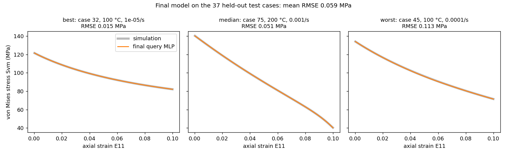

# AlSi10Mg stress–strain predictor

A small neural network that predicts how an AlSi10Mg aluminium alloy responds when it is stretched. You give it a temperature, a stretching speed (strain rate), a density and a shear modulus. It draws the full stress–strain curve almost instantly, instead of running a new simulation.

It was built for the course **Multiscale Modelling of Materials using Machine Learning**, from 73 simulations supplied by the professor. A local chat page lets you ask for curves in plain English.



*The grey line is the simulation; the orange line is the model's prediction for a case it was never trained on. These are the best, median and worst of the 37 test cases.*

## Try it in three commands

```bash
python3 -m venv .venv && .venv/bin/pip install -r requirements.txt
.venv/bin/python app/server.py          # then open http://127.0.0.1:8766
```

Type things like:

- `stress curve at 150 C, rate 1e-4`
- `compare 30, 100 and 200 C at 1e-3 /s`
- `stress at 5% strain for 100C, density 2619, G 24541`
- `how accurate is it?` or `what ranges are valid?`

The page answers with a chart, a small table and any warnings. It runs entirely on your computer. Its "chat" is a set of fixed text rules (`app/nlu.py`), not an AI model, so it needs no internet or API key.

Prefer the command line?

```bash
.venv/bin/python src/predict.py --temperature 100 --rate 1e-4 --density 2619 --G 24541 --plot curve.png
```

## How good is it?

The professor asked for a random half of the simulations to be used for training and the other half for testing. That split is saved in `data/split.json`: 36 cases for training and 37 for testing.

| What we measured | Result |
|---|---|
| Average error on the 37 test curves | **0.059 MPa** (worst curve 0.113 MPa) |
| Stress levels in these curves | up to about 160 MPa, so the average error is under 0.1 % of peak stress |
| A "copy the closest training curve" shortcut, for comparison | 1.38 MPa, about 23× worse |
| A temperature/rate combination **never seen** in training | about 1.5–8 MPa below 200 °C; 8–25 MPa at 200 °C |

The last row is the honest limit. The random split mostly asks the model to fill in between conditions it has already seen, which is easy here. Predicting a genuinely new condition is harder, and the model gets worse there.

## How it works, in plain words

```
 73 simulation files  ──►  each curve resampled to 120 strain points (equal weight per case)
                                         │
             conditions (T, rate, density, G) + one strain value
                                         ▼
               small neural network: 2 layers × 16 neurons, 5 copies averaged
                                         ▼
                       one stress value ── ask 120 times ──► a full curve
```

- **Input:** the four material conditions, plus the strain at which you want the stress.
- **Output:** the von Mises stress at that strain.
- **Why ask one point at a time?** It lets one small network learn the shape of every curve. A curve is just the same question asked at 120 strains.
- **Why so small?** There are only 36 training curves. A big network would memorise them instead of learning the pattern. In our tests, the larger 32×32 networks did consistently worse.
- **Why five copies?** Each network starts from random weights. Averaging five makes the answer steadier. Each network has 385 numbers inside; together, 1,925.

## How we chose this model

We compared five approaches using **only the training half**, so the test set was not used to pick the winner:

| Approach | Error on seen conditions | Error on an unseen condition | Neural network? |
|---|---|---|---|
| **Query MLP**: this model | 1.16 MPa | **6.8 MPa** (best) | yes |
| PCA + Gaussian process | **0.66 MPa** (best) | 11.0 MPa | no |
| Average of the two | 0.87 MPa | 8.0 MPa | partly |
| Query MLP with a 1/temperature input | 1.54 MPa | 8.6 MPa | yes |
| Curve-shape (PCA) neural network | 2.00 MPa | 11.2 MPa | yes |

*Errors are from 3-fold cross-validation inside the 36 training cases, and from hiding one temperature/rate combination at a time.*

The Gaussian process is slightly better at filling in between known conditions. The course asks for a neural network, though, and the query MLP is the best network here and the best model on unseen conditions, so it is the final model. The Gaussian process stays in the chat page as a dashed comparison line. Where the two lines disagree, trust both less.

The selection rule was written down before the last candidates were scored. The full history is in [`runs/score/`](runs/score) and [`reports/claude-model-recommendation.md`](reports/claude-model-recommendation.md).

## What the data taught us

- **Temperature and strain rate drive the curve.** Changing either one level moves the stress by 20–30 MPa.
- **Shear modulus matters a little,** about 4 MPa per level.
- **Density barely matters,** about 0.25 MPa across its whole range. In these simulations, lower density, often used as a stand-in for porosity, hardly changes the stress at all.
- **The curves start at full flow stress and soften.** They have no elastic part, so stiffness can't be learned from them. G enters only as a supplied input.
- **Case 60 is odd:** the only 200 °C / 1e-5 simulation, and its stress collapses unevenly. Every model struggles with it.

## What it can't do

- **No 300 °C:** there is no data there. Outside the trained ranges the app warns you. At 300 °C the network even predicts negative stress, which is impossible, and the app says so.
- **No coefficient of lift:** the project discussed porosity and coefficient of lift, but these simulations contain no lift values, and their curves have no elastic part (G is only a supplied input). No model can learn porosity → lift from them. That needs aerodynamic data or an agreed physics calculation; see [`docs/project-questionnaire.md`](docs/project-questionnaire.md).
- **Units are provisional:** MPa, °C and 1/s are inferred from the numbers, not from documentation.
- **The test set is not fully blind:** model settings were explored early on using all 73 cases before the formal training-only selection. Both reports say so openly.

## Repository map

| Folder | What's inside |
|---|---|
| `app/` | chat page (`index.html`), local server, plain-English parser |
| `src/` | data loading, split, models, training, scoring, prediction |
| `runs/score/final_Svm/` | **the final model**, its test predictions and metrics |
| `runs/` | every other experiment: selection history, comparisons, calibration checks |
| `figures/` | plots used above and in the reports |
| `reports/` | Claude's modelling report and Codex's independent checks |
| `docs/` | project context, decisions, research notes, open questions, questionnaire |
| `tests/` | automated checks: `.venv/bin/python -m unittest discover -s tests`. With the app running and the raw data processed, `-p live_model_app_check.py` also checks the live app end to end |

## Re-running everything from the raw data

The professor's raw simulation files are **not** in this repo. To rebuild from scratch:

1. Put the folder `TEAM_8_extracted_results_set_1/` (73 `simulation_XXXX/STR_STR.OUT` files plus `simulation_matrix.csv`) in the repo root.
2. Run:

   ```bash
   .venv/bin/python src/data.py                                # parse and resample; checks every file
   .venv/bin/python -W ignore src/select_settings.py --target Svm
   .venv/bin/python src/score.py --candidate mlp --target Svm   # training-half scores
   .venv/bin/python -W ignore src/evaluate.py --target Svm      # comparisons and figures
   ```

`data/manifest.json` lists a SHA-256 checksum for every raw file, so you can confirm you have exactly the same data. The final test score is deliberately locked: `src/score.py --final` refuses to run twice.

## Who did what

This project was carried out by Team 8. Its ML work was developed with two AI coding agents, working in a shared local chat room:

- **Claude (Anthropic):** analysed the data, built and trained the models, the scoring tool, the chat app and this README.
- **Codex (OpenAI):** researched the approach, kept the project notes, built the curve-shape network, and independently re-checked the saved models and metrics.

All numbers above come from files saved in this repo.
