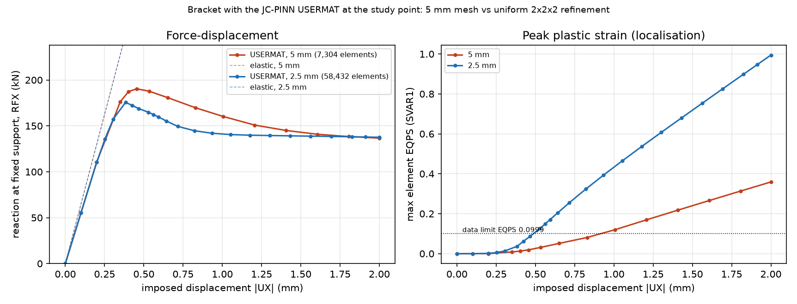

# Bracket mesh study with the JC-PINN USERMAT (Q9), 17 November 2026

**Conclusion: the response after first yield is mesh dependent. The bracket's softening branch, and also its peak, change with the mesh.**

Halving the element size (5 mm → 2.5 mm, 8 × the elements) gives these changes:
- **Elastic response:** unchanged (initial stiffness −0.07 %).
- **Peak reaction:** **7.7 % lower** (190.4 → 175.6 kN), reached earlier (UX −0.455 → −0.384 mm).
- **Reaction between the peak and −2 mm:** **up to 14.9 % lower**.
- **Peak plastic strain:** almost **3 × higher** (max element EQPS 0.36 → 0.99), and 3–4 × higher at every displacement after yield. It is still rising with refinement.

The reactions happen to meet again at −2 mm (+0.7 %). That is not convergence. By then most of the yielded zone is beyond EQPS 0.0999, where the routine holds the flow stress flat, so both meshes settle on the same plateau.

This matches what a softening law does without regularisation: strain concentrates into a band about one element wide. A regularised softening law (for example a length scale or a nonlocal/gradient formulation) would be needed for a mesh-independent result after yield. That is beyond this task. The USERMAT was not changed.



## What was run

The same material, supports, load, substepping and solver were used on two meshes:
- MAPDL 2024 R1 batch, SMP on 4 cores, with `ANS_USER_PATH` set to the tested USERMAT build;
- the study point: 100 °C, 1e-4 /s, ρ 2592, G 24541 MPa, ν 0.33 (assumed);
- fixed support, imposed UX = −2 mm, `nsub,20,1000,10`, PCG, small strain.

| Mesh | Source deck | Elements | Nodes | Fixed-support nodes | Load nodes |
|---|---|---|---|---|---|
| 5 mm | Workbench SYS-2 `ds.dat` (committed project, sha256 `8c01c0ac…5705d`) | 7,304 | 34,763 | 554 | 208 |
| 2.5 mm | `refine_mesh.py` output (sha256 `a314c217…070e5`) | 58,432 | 255,111 | 2,066 | 800 |

**How the fine mesh was made: a deviation from the Workbench remesh in the brief.** The project was saved in Workbench 2026 R1. This computer has only Workbench 2024 R1, which cannot open it, and Ansys 2026 R1 Optics and Student MAPDL, which have no Workbench or Mechanical. So instead of remeshing, `refine_mesh.py` refines the Workbench mesh uniformly:
- **Hexes:** every SOLID186 hex splits 2 × 2 × 2 in its own parametric space, with the new nodes placed by the parent's 20-node shape functions.
- **Prisms:** every SOLID186 prism (64 of them) splits as a 15-node wedge. Its triangle splits into 4 through the edge midpoints, times 2 layers, so the split is the same from both sides of a shared triangle.
- **Node sets:** the fixed support and the load nodes are carried over. A new node joins a set when every node of the parent corner, edge or face it lies on is in that set.

This is a pure h-refinement: the same discretised geometry, element type and shapes, and half the element size. Checks:
- **Conformity:** 3,618 boundary faces become exactly 4 × 3,618 = 14,472.
- **Parent nodes:** every parent node is reproduced.
- **Supports and load:** the elastic run on the fine mesh gives 650.0 kN/mm against 650.4 kN/mm (−0.07 %). Its reaction at −2 mm is 1,299.9 kN against 1,300.9 kN.

A Workbench remesh would also change element shapes and the CAD fit, so it is a different test. It can be run later with `make_decks.py --source`.

## Results (`mesh_summary.json`)

| | 5 mm | 2.5 mm | Change vs 5 mm |
|---|---|---|---|
| Elements | 7,304 | 58,432 | ×8 |
| Initial stiffness, kN/mm | 554.30 | 553.90 | −0.07 % |
| Peak RFX, kN (UX at peak) | 190.37 (−0.455 mm) | 175.65 (−0.384 mm) | **−7.7 %** |
| RFX at −2 mm, kN | 136.68 | 137.59 | +0.7 % (plateau, see above) |
| Max element EQPS at −2 mm | 0.359 | 0.995 | **+177 %** |
| Elements flagged (EQPS > 0.0999) | 190 | 1,072 | ×5.6 in count; about 30 % less volume (1,072 / 8 = 134 parent-sized elements) |
| Substeps, bisections | 14, 1 | 23, 3 | |
| Wall time | 75 s | 1,630 s | |

Reaction at matching displacements (the fine curve interpolated at the 5 mm substeps):

| UX (mm) | 0.10 | 0.20 | 0.35 | 0.455 | 0.65 | 0.83 | 1.01 | 1.41 | 1.81 | 2.00 |
|---|---|---|---|---|---|---|---|---|---|---|
| 5 mm (kN) | 55.43 | 110.76 | 176.28 | 190.37 | 180.77 | 169.76 | 160.22 | 145.01 | 138.37 | 136.68 |
| 2.5 mm (kN) | 55.39 | 110.37 | 167.82 | 169.87 | 154.66 | 144.54 | 141.11 | 139.23 | 138.18 | 137.59 |
| Difference | −0.07 % | −0.35 % | −4.8 % | −10.8 % | −14.4 % | −14.9 % | −11.9 % | −4.0 % | −0.1 % | +0.7 % |
| Max EQPS 5 mm / 2.5 mm | 0 / 0 | 0.0002 / 0.0014 | 0.009 / 0.027 | 0.019 / 0.080 | 0.052 / 0.211 | 0.081 / 0.328 | 0.120 / 0.437 | 0.218 / 0.666 | 0.313 / 0.888 | 0.359 / 0.995 |

**Judged against the brief's criteria:**
- **Initial stiffness:** unchanged, as expected.
- **Peak RFX:** not "only slightly" changed. It is 7.7 % lower. At this point the JC-PINN softens almost from first yield (its single-element peak is at EQPS ≈ 4×10⁻⁴), so the peak is already partly governed by softening.
- **RFX at −2 mm:** within 5 %. But max EQPS keeps rising with refinement (×2.8), and the reaction differs by up to 14.9 % in between. **The post-peak response is mesh dependent.**

**Where the strain localises.** In both meshes the ten most-strained elements are next to the imposed-displacement patch: their centroids are 1–2.5 mm from the load nodes and about 207 mm from the fixed support. So the strain does not concentrate at the support singularity. The edge of an imposed-displacement patch is itself a stress concentration, so part of the EQPS growth may come from how the load is applied, not from softening alone. A run with a hardening material on the fine mesh would separate the two effects. That was not done here.

## Limits

- **One material condition** (the study point). ν = 0.33 is assumed. Small strain. Imposed displacement only, as in the Workbench project.
- **Two mesh levels**, made by uniform refinement of one Workbench mesh, not by remeshing the CAD.
- **Outside the data.** Elements with flag 1 (EQPS > 0.0999) are outside the data range, and the flow stress there is held flat. On the fine mesh that applies to 1,072 elements, and the peak EQPS (0.99) is about 10 × the data limit.
- **No validation.** The data are simulations, with units confirmed by the user. Nothing is experimentally validated, and no critical flaw length is predicted.

## Files

| File | What it is |
|---|---|
| `usermat_5mm_history.csv`, `usermat_2p5mm_history.csv` | USERMAT runs, per substep (same columns as `../results_2026-11-17/`). The 5 mm file is the same run as `../results_2026-11-17/usermat_history.csv`. |
| `elastic_5mm_history.csv`, `elastic_2p5mm_history.csv` | Elastic reference runs |
| `*_out_key_lines.txt` | Deck headers (nblock, eblock, CMBLOCK, TBDATA), key lines, and the last 60 lines of each `bracket.out` |
| `mesh_summary.json`, `mesh_force_displacement.png` | Written by `../plot_mesh.py` |

The refined `ds.dat`, the decks and the solver files (`.rst`, `.db`, `.full`, `.esav`) are not committed. They are in `%USERPROFILE%\jcpinn_fine_mesh` and `%USERPROFILE%\jcpinn_mesh_run`.

## Commands

```bat
python bracket\ansys_usermat\refine_mesh.py %USERPROFILE%\jcpinn_fine_mesh\ds.dat
python bracket\ansys_usermat\make_decks.py --source %USERPROFILE%\jcpinn_fine_mesh\ds.dat --label fine %USERPROFILE%\jcpinn_mesh_run
cd /d %USERPROFILE%\jcpinn_mesh_run\elastic_fine
set "ANS_USER_PATH=%USERPROFILE%\jcpinn_usermat_build" && "C:\Program Files\ANSYS Inc\v241\ansys\bin\winx64\ANSYS241.exe" -b -smp -np 4 -dir . -j bracket -i bracket.dat -o bracket.out
```

Run the same MAPDL command in `usermat_fine`. Then copy the histories and log extracts into this folder, using the names above, and run:

```bat
python bracket\ansys_usermat\plot_mesh.py bracket\ansys_usermat\mesh_2026-11-17
```

The 5 mm runs are the ones in `../results_2026-11-17/`, made with `make_decks.py` without arguments.
