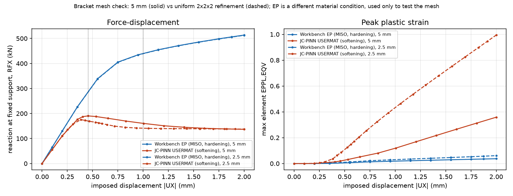

# Bracket mesh check with the hardening EP material (Q9), 17 November 2026

**Conclusion: the mesh dependence of the bracket force comes from the JC-PINN's softening. The load-patch concentration adds only to the local peak strain.**

On the same 5 mm → 2.5 mm refinement:
- **Workbench EP material (hardening):** the force changes by at most **0.3 %**.
- **JC-PINN USERMAT (softening):** the force changes by **7.7–12.1 %** at the same probes, and by up to 14.9 % after the peak (`../mesh_2026-11-17/`).

Using the EP change as the baseline for what the mesh alone does, the mesh alone accounts for 1.3–2.6 % of the USERMAT's force change at the peak, −0.455 mm and −1.0 mm probes. The other 97–99 % comes from softening.

The peak plastic strain is different. It grows with refinement for **both** materials, and in both it sits next to the imposed-displacement patch (1–2.5 mm from the load nodes, about 205–209 mm from the fixed support):
- **EP:** grows ×1.64 (0.037 → 0.061). That is the effect of the patch-edge concentration alone.
- **USERMAT:** grows ×2.77 (0.36 → 0.99), so softening adds roughly a further ×1.7 on top.

The local peak strain is therefore not mesh converged even for a hardening material, and should not be quoted as a material result.



## What was run

The Workbench "AlSi10Mg - EP" material (`TB,PLAS,1,,8,MISO`: 251.45 MPa at 0 up to 524.3 MPa at plastic strain 0.07; EX 76,600 MPa at 25 °C; ν 0.33) was used on two meshes. Both runs used MAPDL 2024 R1 batch, SMP on 4 cores, with no USERMAT and no `ANS_USER_PATH`. Supports, load, substepping and solver are those of the Workbench project.

| Mesh | Deck | Elements | Nodes |
|---|---|---|---|
| 5 mm | `make_decks.py` `ep_miso` (Workbench SYS `ds.dat`, sha256 `b5934e34…43875`). The same run as `../results_2026-11-17/ep_miso_*`; its history file is byte-identical. | 7,304 | 34,763 |
| 2.5 mm | `refine_mesh.py` on the SYS `ds.dat` (output sha256 `a0dca3f9…22bb8f`), then `make_decks.py --source … --label fine --kinds ep_miso` | 58,432 | 255,111 |

**How the EP fine deck was made, and the checks on it:**
- `refine_mesh.py` refined the SYS (EP) deck the same way it refined the SYS-2 (elastic) deck in `../mesh_2026-11-17/`. It produced 3,618 → 14,472 boundary faces (exactly ×4), and the support and load sets went 554 → 2,066 and 208 → 800 nodes.
- **The refined EP mesh is identical to the refined elastic mesh** used in the USERMAT mesh study:
  - the same 255,111 node IDs, with a largest coordinate difference of 0.0 mm;
  - identical connectivity for all 58,432 elements;
  - identical support (2,066 nodes) and displacement (800 nodes) sets.
- **The material block is the unchanged one from the committed SYS deck:** the whole `/wb,mat,start … /wb,mat,end` block is identical, including the eight `TBPT` points.
- **Only the mesh blocks differ.** Outside the `nblock`, `eblock` and `CMBLOCK` blocks, `ep_miso_fine/bracket.dat` is line for line identical to the 5 mm `ep_miso/bracket.dat`.
- **`make_decks.py` defaults are unchanged.** Without options, and with `--porosity` or the default `--source` kinds, it still writes byte-identical decks to before (SHA-256 compared). The new `--kinds` option (comma-separated; `ep_miso` keeps the source's own material) is the only addition.

## Results (`mesh_ep_summary.json`)

| | EP 5 mm | EP 2.5 mm | EP change | USERMAT 5 mm | USERMAT 2.5 mm | USERMAT change |
|---|---|---|---|---|---|---|
| Initial stiffness (kN/mm) | 650.43 | 649.96 | −0.07 % | 554.30 | 553.90 | −0.07 % |
| Peak RFX (kN) | 513.47 (at −2 mm, still hardening) | 512.62 | −0.17 % | 190.37 (at −0.455) | 175.65 (at −0.384) | **−7.7 %** |
| RFX at UX −0.455 mm (kN) | 285.86 | 285.04 | −0.28 % | 190.37 | 169.87 | **−10.8 %** |
| RFX at UX −1.0 mm (kN) | 439.71 | 439.02 | −0.16 % | 160.56 | 141.19 | **−12.1 %** |
| RFX at −2 mm (kN) | 513.47 | 512.62 | −0.17 % | 136.68 | 137.59 | +0.7 % (plateau) |
| Max element EPPL,EQV at −2 mm | 0.0371 | 0.0609 | ×1.64 (+64 %) | 0.359 | 0.994 | ×2.77 (+177 %) |
| Substeps, bisections | 12, 0 | 12, 0 | | 14, 1 | 23, 3 | |
| Wall time | 26 s | 229 s (228 s measured outside MAPDL) | | 75 s | 1,630 s | |

The RFX values at −0.455 mm and −1.0 mm are interpolated linearly between saved substeps. The USERMAT values are recomputed from `../mesh_2026-11-17/` histories, and `plot_mesh_ep.py` checks that they agree with its `mesh_summary.json`.

**Judged against the brief's criteria:**
- **EP force:** changes by less than 2 % (at most 0.28 %), while the USERMAT force changes by 7.7–14.9 %. **The force mesh dependence is due to the softening.**
- **Plastic-strain growth:** EP ×1.64 against USERMAT ×2.77. The imposed-displacement patch creates a strain concentration that keeps sharpening with refinement whatever the material. Softening amplifies it: 2.77 / 1.64 ≈ ×1.7 more.

**EP table range.** On the 2.5 mm mesh MAPDL warns from substep 9 (UX ≈ −1.55 mm) on. Some integration points (28 at first) pass the last point of the MISO table (plastic strain 0.07), and there the flow stress is held at 524.3 MPa. This affects a few points next to the load patch in the last four substeps. The 5 mm mesh never reaches the table end (max 0.037). It does not change the conclusion, because the EP force at −0.455 mm and −1.0 mm (both before substep 9) already agrees to within 0.3 %.

## Limits

- **This is a check on the mesh, not a comparison of materials.** The EP card is a different material condition from the JC-PINN study point: yield 251 MPa, hardening, source not recorded.
- **The fine mesh is a uniform 2 × 2 × 2 split** of the Workbench mesh, not a Workbench remesh. There are two mesh levels.
- **Small strain.** Imposed displacement only, as in the Workbench project. ν = 0.33.
- **No validation.** The data behind the JC-PINN are simulations, with units confirmed by the user. Nothing is experimentally validated, and no critical flaw length is predicted.

## Files

| File | What it is |
|---|---|
| `ep_miso_5mm_history.csv`, `ep_miso_2p5mm_history.csv` | Per substep: time, applied UX, reactions, max nodal and element von Mises, max element EPPL,EQV (the SVAR columns are 0, because there is no USERMAT) |
| `*_out_key_lines.txt` | Deck headers and the MISO table, key lines, and the last 60 lines of each `bracket.out` |
| `mesh_ep_summary.json`, `mesh_ep_force_displacement.png` | Written by `../plot_mesh_ep.py`, which also reads the USERMAT pair from `../mesh_2026-11-17/` |

The refined `ds_ep.dat`, the decks and the solver files are not committed. They are in `%USERPROFILE%\jcpinn_fine_mesh` and `%USERPROFILE%\jcpinn_mesh_run\ep_miso_fine`.

## Commands

```bat
python bracket\ansys_usermat\refine_mesh.py %USERPROFILE%\jcpinn_fine_mesh\ds_ep.dat bracket\ansys\Elastic_files\dp0\SYS\MECH\ds.dat
python bracket\ansys_usermat\make_decks.py --source %USERPROFILE%\jcpinn_fine_mesh\ds_ep.dat --label fine --kinds ep_miso %USERPROFILE%\jcpinn_mesh_run
cd /d %USERPROFILE%\jcpinn_mesh_run\ep_miso_fine
"C:\Program Files\ANSYS Inc\v241\ansys\bin\winx64\ANSYS241.exe" -b -smp -np 4 -dir . -j bracket -i bracket.dat -o bracket.out
```

Copy `bracket_history.csv` here as `ep_miso_2p5mm_history.csv`. The 5 mm EP run is `../results_2026-11-17/ep_miso_history.csv`. Then run:

```bat
python bracket\ansys_usermat\plot_mesh_ep.py bracket\ansys_usermat\mesh_ep_2026-11-17
```
