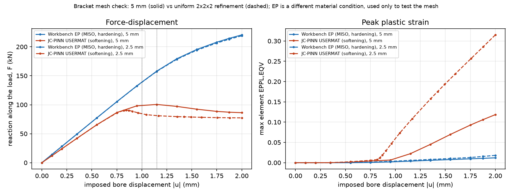

# Bracket mesh check with the hardening EP material, corrected load, 18 November 2026

**Load (corrected on 18 Nov 2026):** the pin load +P_y, imposed as UY = +2 mm on the bore nodes with y >= 0, which is the upper half of the 10 mm bore. UX and UZ are free. The decks are built by `make_decks.py --load plus_y`. The 17 Nov 2026 folders without `_uy` used the Workbench file's load, UX = -2 mm on the whole bore. They are kept as evidence only.

The same 5 mm and 2.5 mm meshes are used with the Workbench EP (MISO) card, against the USERMAT pair in `../mesh_uy_2026-11-18/`. Forces are compared at the 5 mm USERMAT peak (UY = 1.150 mm), at 1 mm and at 2 mm (linear interpolation between saved substeps).



| | EP 5 mm | EP 2.5 mm | EP change | USERMAT 5 mm | USERMAT 2.5 mm | USERMAT change |
|---|---|---|---|---|---|---|
| Initial stiffness (kN/mm) | 140.76 | 140.60 | -0.11 % | 119.95 | 119.82 | **-0.1 %** |
| Peak F (kN) | 220.5 | 219.0 | -0.69 % | 100.5 | 90.6 | **-9.8 %** |
| F at UY = 1.150 mm (kN) | 158.1 | 157.6 | -0.31 % | 100.5 | 81.2 | **-19.2 %** |
| F at UY = 1 mm (kN) | 139.0 | 138.7 | -0.22 % | 98.7 | 84.5 | **-14.3 %** |
| F at 2 mm (kN) | 220.5 | 219.0 | -0.69 % | 86.3 | 77.4 | **-10.3 %** |
| Max element EPPL,EQV | 0.0119 | 0.0181 | x1.51 | 0.1185 | 0.3150 | x2.66 |

- **EP barely moves.** With the hardening EP card the force changes by under 1 %, so the force's mesh dependence comes from the JC-PINN's softening.
- **Local strain is not converged for either material.** The EP peak plastic strain sits at the R10 crotch fillet and the JC-PINN's at the loaded half of the bore. Both still grow under refinement.

## Reproduce (Windows, MAPDL 2024 R1)

```bat
python bracket\ansys_usermat\make_decks.py --load plus_y --source %USERPROFILE%\jcpinn_fine_mesh\ds_ep.dat --label fine --kinds ep_miso %USERPROFILE%\jcpinn_uy_run\mesh
set "ANS_USER_PATH=%USERPROFILE%\jcpinn_usermat_build"
rem in each run folder:
"C:\Program Files\ANSYS Inc\v241\ansys\bin\winx64\ANSYS241.exe" -b -smp -np 4 -dir . -j bracket -i bracket.dat -o bracket.out
python bracket\ansys_usermat\extract_key_lines.py <run folder> <label> <label>_out_key_lines.txt
python bracket\ansys_usermat\plot_mesh_ep.py bracket\ansys_usermat\mesh_ep_uy_2026-11-18
```

The `.rst`, `.db` and other solver files are not committed. `*_history.csv` is the `bracket_history.csv` that `post_bracket.mac` writes. Its `u_load_mm` column is the imposed UY, and `F_load_N` is the reaction along y (= -RFY at the fixed support). `*_out_key_lines.txt` holds the key lines of `bracket.out`.

## Limits

- **One material condition** per run (100 degC, 1e-4 /s); small strain; nu = 0.33 assumed.
- **Mesh dependence.** The JC-PINN softens, so forces after yield depend on the mesh (see `../mesh_uy_2026-11-18/`). Each peak is resolved only to the substep spacing.
- **Imposed displacement.** The bore displacement is imposed; it is not a service load. No service load magnitude exists.
- **Not experimental.** Nothing here is experimentally validated.
