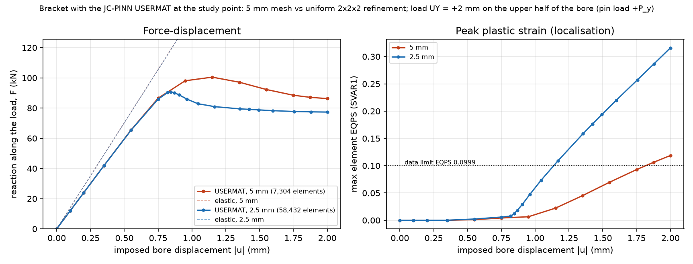

# Bracket mesh study (JC-PINN USERMAT), corrected load, 18 November 2026

**Load (corrected on 18 Nov 2026):** the pin load +P_y, imposed as UY = +2 mm on the bore nodes with y >= 0, which is the upper half of the 10 mm bore. UX and UZ are free. The decks are built by `make_decks.py --load plus_y`. The 17 Nov 2026 folders without `_uy` used the Workbench file's load, UX = -2 mm on the whole bore. They are kept as evidence only.

The 5 mm runs are the ones in `../results_uy_2026-11-18/`. The 2.5 mm mesh is the uniform 2x2x2 split by `refine_mesh.py`, the same refined source as on 17 Nov (sha256 `a314c217...070e5`).



| | 5 mm | 2.5 mm | Change |
|---|---|---|---|
| Elements / nodes | 7,304 / 34,763 | 58,432 / 255,111 | |
| Initial stiffness (kN/mm) | 119.95 | 119.82 | -0.11 % |
| Peak (kN), UY at peak | 100.5 (1.150 mm) | 90.6 (0.845 mm) | **-9.8 %** |
| F at 2 mm (kN) | 86.3 | 77.4 | -10.3 % |
| Max element EQPS (SVAR1) | 0.119 | 0.316 | x2.66 |
| Flagged elements (EQPS > 0.0999) | 102 | 648 | (count, not volume) |
| Substeps, bisections, wall time | 12, 0, 46 s | 19, 3, 3635 s | |

- **Elastic check.** The stiffness changes by -0.11 %, so the supports and load carried over to the refined mesh.
- **Not converged.** The peak, and the forces after it, change by about 10 to 20 %. The finer mesh is still -10.3 % lower at 2 mm. The plastic strain localises at the loaded half of the bore and keeps rising.
- **Conclusion.** Results after yield, including the peak, are not mesh converged.

## Reproduce (Windows, MAPDL 2024 R1)

```bat
python bracket\ansys_usermat\make_decks.py --load plus_y --source %USERPROFILE%\jcpinn_fine_mesh\ds.dat --label fine %USERPROFILE%\jcpinn_uy_run\mesh
set "ANS_USER_PATH=%USERPROFILE%\jcpinn_usermat_build"
rem in each run folder:
"C:\Program Files\ANSYS Inc\v241\ansys\bin\winx64\ANSYS241.exe" -b -smp -np 4 -dir . -j bracket -i bracket.dat -o bracket.out
python bracket\ansys_usermat\extract_key_lines.py <run folder> <label> <label>_out_key_lines.txt
python bracket\ansys_usermat\plot_mesh.py bracket\ansys_usermat\mesh_uy_2026-11-18
```

The `.rst`, `.db` and other solver files are not committed. `*_history.csv` is the `bracket_history.csv` that `post_bracket.mac` writes. Its `u_load_mm` column is the imposed UY, and `F_load_N` is the reaction along y (= -RFY at the fixed support). `*_out_key_lines.txt` holds the key lines of `bracket.out`.

## Limits

- **One material condition** per run (100 degC, 1e-4 /s); small strain; nu = 0.33 assumed.
- **Mesh dependence.** The JC-PINN softens, so forces after yield depend on the mesh (see `../mesh_uy_2026-11-18/`). Each peak is resolved only to the substep spacing.
- **Imposed displacement.** The bore displacement is imposed; it is not a service load. No service load magnitude exists.
- **Not experimental.** Nothing here is experimentally validated.
