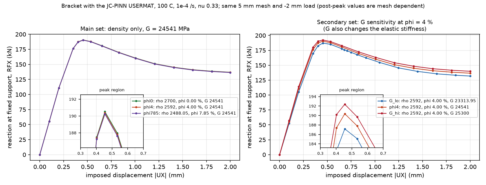

# Bracket porosity comparison with the JC-PINN USERMAT, 17 November 2026

**Result:** at fixed G, lowering the density from φ = 0 to 7.85 % lowers the bracket's peak reaction by **0.16 %** (190.53 → 190.23 kN). That matches the single-element prediction of the locked model at small plastic strain, −0.15 %.

The bracket's force at −2 mm drops by 0.34 %, against −0.24 % to −0.37 % for the single element over EQPS 0.05–0.0999.

The G sensitivity runs (−5.0 % and +3.1 % in G) move the peak by −1.8 % and +1.0 %. Per 1 % change in its input, G acts about 18 times more strongly than density.

All five runs converge to UX = −2 mm with 0 errors. The phi4 run repeats the earlier study-point run exactly.



## What was run

All runs used:
- the same 5 mm Workbench mesh (7,304 SOLID186 elements), fixed support and imposed UX = −2 mm;
- the same substepping (`nsub,20,1000,10`) and PCG solver as the earlier `usermat` run (`../results_2026-11-17/`);
- MAPDL 2024 R1 batch, SMP on 4 cores, with `ANS_USER_PATH` set to the USERMAT build tested in `umat/ansys_test/results_2026-11-17/`.

Only the `TBDATA,1,...` line and a comment naming the case differ between the decks. The constants are T, rate, ρ, G, ν, ITEMP; GEL = 0, so the elastic shear modulus is the G given.

| Case | TBDATA | φ = 1 − ρ/2700 | Set |
|---|---|---|---|
| phi0 | `TBDATA,1,100,1.0E-4,2700,24541,0.33,0` | 0 % | main: density only |
| phi4 | `TBDATA,1,100,1.0E-4,2592,24541,0.33,0` | 4 % | main: the study point |
| phi785 | `TBDATA,1,100,1.0E-4,2488.05,24541,0.33,0` | 7.85 % (lowest density in the data) | main: density only |
| G_lo | `TBDATA,1,100,1.0E-4,2592,23313.95,0.33,0` | 4 % | secondary: G sensitivity |
| G_hi | `TBDATA,1,100,1.0E-4,2592,25300,0.33,0` | 4 % | secondary: G sensitivity |

`make_decks.py` without `--porosity` still writes byte-identical `elastic`, `ep_miso` and `usermat` decks: SHA-256 compared against a run of the unmodified script.

## Results (`porosity_summary.json`)

| Case | Peak RFX (kN) | UX at peak (mm) | Δ peak vs phi0 | RFX at −2 mm (kN) | Δ at −2 mm vs phi0 | Max element EQPS | Flagged elements | Substeps | Wall time |
|---|---|---|---|---|---|---|---|---|---|
| phi0 | 190.525 | −0.455 | 0 | 136.913 | 0 | 0.358 | 190 | 14 | 72 s |
| phi4 | 190.374 | −0.455 | −0.080 % | 136.679 | −0.171 % | 0.359 | 190 | 14 | 72 s |
| phi785 | 190.228 | −0.455 | −0.156 % | 136.453 | −0.336 % | 0.360 | 190 | 14 | 68 s |
| G_lo | 187.177 | −0.455 | −1.758 % | 131.885 | −3.673 % | 0.359 | 190 | 18 (3 bisections) | 108 s |
| G_hi | 192.385 | −0.455 | +0.976 % | 139.892 | +2.176 % | 0.352 | 190 | 14 | 71 s |

Notes on the table:
- **Peak values.** The peak is the largest RFX over the saved substeps, so it is resolved only to the substep spacing. All five cases have the same substep times up to and including the peak (time 0.2275, UX −0.455 mm), so the peak changes compare like with like.
- **G_lo after the peak.** G_lo took smaller substeps after the peak. Its −2 mm value is still at the same final time.
- **Flagged elements.** In every case, 190 elements end with flag bit 1 (EQPS > 0.0999).
- **Elastic stiffness.** The first-substep RFX relative to phi4 is 1.000000 for phi0 and phi785. For G_lo and G_hi it is 0.950000 and 1.030928, equal to G/24541. Density does not touch the elastic response; G does.

## Bracket against single element (`expected_flow_stress.csv`)

The single-element values come from `jc_pinn.equation_predict(load_final_equation(), X)` with rows [100, −4, ρ, G, eqps], computed by `../expected_flow_stress.py`, without ANSYS.

| Case | Single element at eqps 0.0002 | at 0.05 | at 0.0999 | Bracket Δ peak | Bracket Δ at −2 mm |
|---|---|---|---|---|---|
| phi4 | −0.077 % | −0.121 % | −0.190 % | −0.080 % | −0.171 % |
| phi785 | −0.150 % | −0.237 % | −0.373 % | −0.156 % | −0.336 % |
| G_lo | −1.366 % | −2.848 % | −4.177 % | −1.758 % | −3.673 % |
| G_hi | +0.767 % | +1.775 % | +2.399 % | +0.976 % | +2.176 % |

**Do they agree? Yes, for the density cases. The G cases are consistent, but they are not a like-for-like check.**

- **Density, peak.** The peak is reached at EQPS ≈ 0.019 in the most strained element (phi4, set 5) and before localisation, so it is the more trustworthy comparison. There the bracket change (−0.080 % and −0.156 %) equals the single-element change near first yield (−0.077 % and −0.150 %) to within 0.006 percentage points.
- **Density, at −2 mm.** Here the bracket change (−0.171 % and −0.336 %) lies inside the single-element range for EQPS 0.05–0.0999 (−0.12 to −0.19 % and −0.24 to −0.37 %). That is what a part with a spread of plastic strains should show.

  This value is after the peak and depends on the mesh (Q9 is open). Its agreement means only that the density effect passes through the localised zone unchanged. It is not a mesh-converged number.
- **G cases.** The bracket changes lie within the single-element range for EQPS 0.0002–0.0999. They are not a clean comparison, for two reasons:
  - G also scales the elastic stiffness by 5.0 % and 3.1 %. That shifts how far the part has yielded at a given displacement, so the peak change is larger than the near-yield flow-stress change (−1.76 % against −1.37 %).
  - G acts strongly on the flow stress, so the cases differ more at larger plastic strain.

  Per 1 % relative change at the peak, G moves the force by 1.758/5.0 ≈ 0.35 %, and density by 0.156/7.85 ≈ 0.020 %. That is a ratio of about 18, of the same order as the "about 16 times" in `bracket/README.md`. Part of the G effect here is elastic stiffness.

## Checks

- **phi4 reproduces the earlier run** (`../results_2026-11-17/usermat_history.csv`): the same 14 substeps at the same times, and RFX identical in every printed digit. All other columns are identical as well, except RFY and RFZ, which are about zero and differ by at most 4×10⁻⁸ N (multi-threaded round-off).
- **Every run is clean:** 0 errors, converged to UX = −2 mm, and loaded the user library ("linked by Licensee"). Each has the same three warnings as before: shape checking off, the default USERCK, and EX read at 22 °C, which is unused by the USERMAT. See `*_out_key_lines.txt`.

## Limits (do not overclaim)

- **Density only, at fixed G.** The real effect of porosity also depends on G(φ), which is unknown (Q4). G acts about 16 times more strongly than density. So these numbers are **not** the porosity effect on the bracket; they are its density-only part. The G set shows only the sensitivity to the G range of the data at φ = 4 %.
- **One mesh.** Post-peak values (RFX at −2 mm, EQPS) depend on the mesh (Q9).
- **Fixed conditions.** 100 °C and 1e-4 /s for the whole run. ν = 0.33 is assumed.
- **Outside the data.** 190 elements per case have flag 1 (EQPS > 0.0999). There the flow stress is held flat, which is outside the data range.
- **No validation.** The data are simulations, with units confirmed by the user. Nothing is experimentally validated, and no critical flaw length is predicted.

## Files

| File | What it is |
|---|---|
| `<case>_history.csv` | Per substep: time, applied UX, reaction at the fixed support, max nodal and element von Mises, max element EPPL,EQV and SVAR1, number of flagged elements |
| `<case>_out_key_lines.txt` | The TBDATA used, key lines, and the last 60 lines of `bracket.out` |
| `porosity_summary.json`, `porosity_force_displacement.png` | Written by `../plot_porosity.py` |
| `expected_flow_stress.csv` | Single-element flow stress and % change vs phi0, written by `../expected_flow_stress.py` |

Solver scratch files (`.rst`, `.db` and so on) are not committed. They are in `%USERPROFILE%\jcpinn_porosity_run`.

## Commands

```bat
python bracket\ansys_usermat\make_decks.py --porosity %USERPROFILE%\jcpinn_porosity_run
python bracket\ansys_usermat\expected_flow_stress.py bracket\ansys_usermat\porosity_2026-11-17
```

For each case in phi0, phi4, phi785, G_lo and G_hi:

```bat
cd /d %USERPROFILE%\jcpinn_porosity_run\<case>
set "ANS_USER_PATH=%USERPROFILE%\jcpinn_usermat_build" && "C:\Program Files\ANSYS Inc\v241\ansys\bin\winx64\ANSYS241.exe" -b -smp -np 4 -dir . -j bracket -i bracket.dat -o bracket.out
```

Then copy each `bracket_history.csv` to `porosity_2026-11-17\<case>_history.csv` and run:

```bat
python bracket\ansys_usermat\plot_porosity.py bracket\ansys_usermat\porosity_2026-11-17
```
