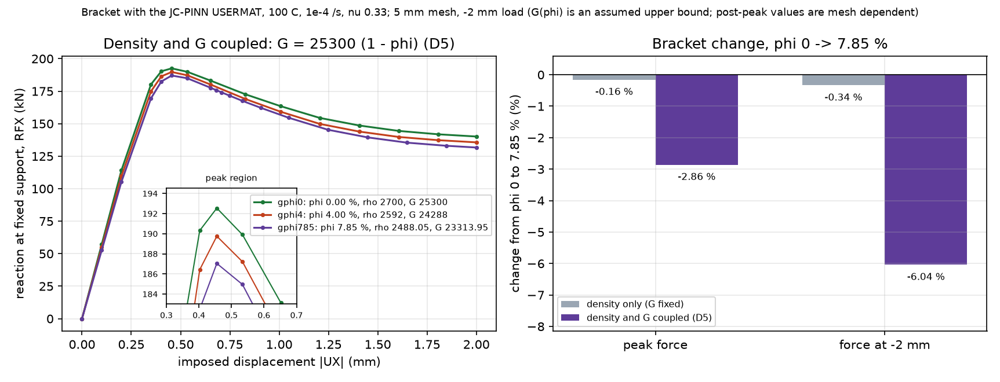

# Bracket porosity with density and G coupled (decision D5), 17 November 2026

**Result:** with G tied to porosity by decision D5, G(φ) = 25300 · (1 − φ), raising porosity from φ = 0 to 7.85 % changes the bracket as follows:
- **elastic stiffness: −7.85 %**, exactly the G ratio;
- **peak reaction: −2.86 %** (192.55 → 187.05 kN, both at UX = −0.455 mm);
- **reaction at −2 mm: −6.04 %.**

Density alone, with G fixed (`../porosity_2026-11-17/`), gives only −0.16 % and −0.34 %. The porosity effect on the bracket therefore comes almost entirely through G. Because D5 is the **upper bound** on G (the stiffest possible G(φ)), these coupled changes are a **lower estimate** of the porosity effect.



## What was run

Three MAPDL 2024 R1 batch runs (SMP, 4 cores), with `ANS_USER_PATH` set to the tested USERMAT build. The setup is identical to the earlier runs: the 5 mm Workbench mesh (7,304 SOLID186), fixed support, imposed UX = −2 mm, `nsub,20,1000,10`, PCG, small strain, and the study conditions 100 °C, 1e-4 /s, ν = 0.33 (assumed). Only `TBDATA,1,...` differs between the decks.

| Case | TBDATA | φ = 1 − ρ/2700 | G = 25300 (1 − φ) |
|---|---|---|---|
| gphi0 | `TBDATA,1,100,1.0E-4,2700,25300,0.33,0` | 0 % | 25300 |
| gphi4 | `TBDATA,1,100,1.0E-4,2592,24288,0.33,0` | 4 % (study point) | 24288 |
| gphi785 | `TBDATA,1,100,1.0E-4,2488.05,23313.95,0.33,0` | 7.85 % | 23313.95 |

Every (ρ, G) pair is inside the data's ranges (ρ 2488.05–2700, G 23313.95–25300), so there is no extrapolation in G. The φ = 0 and 7.85 % pairs are cells of the instructor's design. Decks: `make_decks.py --porosity-gphi`. Without that option, `make_decks.py` writes byte-identical decks to before (checked).

## Results (`porosity_gphi_summary.json`)

| Case | Initial stiffness (kN/mm) | Peak RFX (kN), UX at peak | Δ peak | RFX at −2 mm (kN) | Δ at −2 mm | Max element EQPS | Flagged | Substeps (bisections) | Wall time |
|---|---|---|---|---|---|---|---|---|---|
| gphi0 | 571.4 | 192.55 at −0.455 | 0 | 140.13 | 0 | 0.351 | 190 | 14 (1) | 63 s |
| gphi4 | 548.6 (−4.00 %) | 189.76 at −0.455 | −1.45 % | 135.64 | −3.20 % | 0.362 | 190 | 14 (1) | 68 s |
| gphi785 | 526.6 (−7.85 %) | 187.05 at −0.455 | −2.86 % | 131.67 | −6.04 % | 0.360 | 190 | 18 (3) | 88 s |

All three converged to UX = −2 mm with 0 errors and loaded the user library. They show the same three benign warnings as the earlier runs: shape checking off, the default USERCK, and EX at 22 °C, which the USERMAT does not use.

**Comparison with the single element** (`expected_flow_stress.csv`, the locked model with no ANSYS): over φ 0 → 7.85 % with G coupled, the flow stress changes by −2.27 % at EQPS 0.0002, −4.77 % at 0.05 and −6.77 % at 0.0999.
- **At −2 mm:** the bracket's −6.04 % lies inside that range.
- **At the peak:** the bracket's −2.86 % is larger than the near-yield −2.27 %. The elastic stiffness also falls 7.85 % with G, so the peak region yields under slightly different strains. Elastic stiffness is not a flow-stress effect.

## Limits

- **G(φ) is an assumption (D5), not a measurement.** It is the upper bound, which the data's G levels follow exactly. Real pores, and the dilute spherical-pore estimate (slope −1.88), would lower G more, so the true porosity effect is likely larger than shown here.
- **One mesh.** The force after the peak, including the force at −2 mm, is mesh dependent (Q9).
- **Fixed conditions.** 100 °C and 1e-4 /s throughout; ν = 0.33 assumed.
- **Outside the data.** In 190 elements per case EQPS exceeds 0.0999, which is outside the data range.
- **No validation.** The data are simulations, with units confirmed by the user. Nothing is experimentally validated, and no critical flaw length is predicted (Q5 stays open).

## Commands

```bat
python bracket\ansys_usermat\make_decks.py --porosity-gphi %USERPROFILE%\jcpinn_gphi_run
python bracket\ansys_usermat\expected_flow_stress.py --gphi bracket\ansys_usermat\porosity_gphi_2026-11-17
```

For each case in gphi0, gphi4 and gphi785:

```bat
cd /d %USERPROFILE%\jcpinn_gphi_run\<case>
set "ANS_USER_PATH=%USERPROFILE%\jcpinn_usermat_build" && "C:\Program Files\ANSYS Inc\v241\ansys\bin\winx64\ANSYS241.exe" -b -smp -np 4 -dir . -j bracket -i bracket.dat -o bracket.out
```

Then copy each `bracket_history.csv` here as `<case>_history.csv` and run:

```bat
python bracket\ansys_usermat\plot_porosity_gphi.py bracket\ansys_usermat\porosity_gphi_2026-11-17
```
