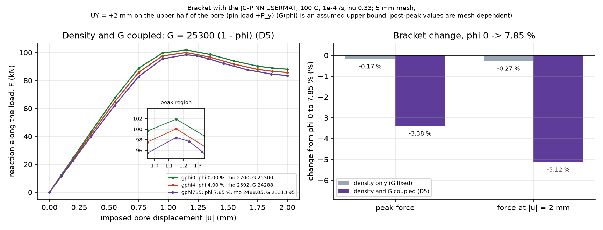

# Bracket porosity with G coupled (decision D5), corrected load, 18 November 2026

**Load (corrected on 18 Nov 2026):** the pin load +P_y, imposed as UY = +2 mm on the bore nodes with y >= 0, which is the upper half of the 10 mm bore. UX and UZ are free. The decks are built by `make_decks.py --load plus_y`. The 17 Nov 2026 folders without `_uy` used the Workbench file's load, UX = -2 mm on the whole bore. They are kept as evidence only.

Density and G are coupled by the assumed upper bound G = 25300 (1 - phi) (decision D5).



| Case | phi (%) | G (MPa) | Initial stiffness (kN/mm) | Peak | Change in peak vs gphi0 (%) | F at 2 mm (kN) | Change at 2 mm (%) | Max element EQPS |
|---|---|---|---|---|---|---|---|---|
| gphi0 | 0.00 | 25300 | 123.7 | 101.9 at 1.150 mm | +0.00 | 88.1 | +0.00 | 0.118 |
| gphi4 | 4.00 | 24288 | 118.7 | 100.1 at 1.150 mm | -1.79 | 85.7 | -2.68 | 0.119 |
| gphi785 | 7.85 | 23313.95 | 114.0 | 98.4 at 1.150 mm | -3.38 | 83.6 | -5.12 | 0.119 |

- **Coupled.** phi 0 -> 7.85 % changes the stiffness by -7.85 % (the G ratio), the peak by -3.38 % and the force at 2 mm by -5.12 %.
- **Density only.** For comparison, density alone (`../porosity_uy_2026-11-18/`) gives -0.17 % and -0.27 %.
- **Lower estimate.** G(phi) is an assumed upper bound, so these values are a lower estimate of the porosity effect.

## Reproduce (Windows, MAPDL 2024 R1)

```bat
python bracket\ansys_usermat\make_decks.py --load plus_y --porosity-gphi %USERPROFILE%\jcpinn_uy_run\gphi
set "ANS_USER_PATH=%USERPROFILE%\jcpinn_usermat_build"
rem in each run folder:
"C:\Program Files\ANSYS Inc\v241\ansys\bin\winx64\ANSYS241.exe" -b -smp -np 4 -dir . -j bracket -i bracket.dat -o bracket.out
python bracket\ansys_usermat\extract_key_lines.py <run folder> <label> <label>_out_key_lines.txt
python bracket\ansys_usermat\plot_porosity_gphi.py bracket\ansys_usermat\porosity_gphi_uy_2026-11-18
```

The `.rst`, `.db` and other solver files are not committed. `*_history.csv` is the `bracket_history.csv` that `post_bracket.mac` writes. Its `u_load_mm` column is the imposed UY, and `F_load_N` is the reaction along y (= -RFY at the fixed support). `*_out_key_lines.txt` holds the key lines of `bracket.out`.

## Limits

- **One material condition** per run (100 degC, 1e-4 /s); small strain; nu = 0.33 assumed.
- **Mesh dependence.** The JC-PINN softens, so forces after yield depend on the mesh (see `../mesh_uy_2026-11-18/`). Each peak is resolved only to the substep spacing.
- **Imposed displacement.** The bore displacement is imposed; it is not a service load. No service load magnitude exists.
- **Not experimental.** Nothing here is experimentally validated.
