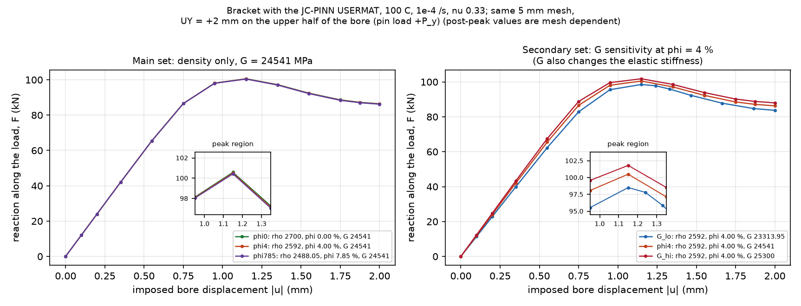

# Bracket porosity, density only (G fixed), corrected load, 18 November 2026

**Load (corrected on 18 Nov 2026):** the pin load +P_y, imposed as UY = +2 mm on the bore nodes with y >= 0, which is the upper half of the 10 mm bore. UX and UZ are free. The decks are built by `make_decks.py --load plus_y`. The 17 Nov 2026 folders without `_uy` used the Workbench file's load, UX = -2 mm on the whole bore. They are kept as evidence only.

Five USERMAT runs differ only in density and G (`make_decks.POROSITY_CASES`). phi = 1 - density/2700.



| Case | rho (kg/m3) | phi (%) | G (MPa) | Peak (kN) | UY at peak (mm) | Change in peak vs phi0 (%) | F at 2 mm (kN) | Change at 2 mm vs phi0 (%) | Max element EQPS | Flagged elements |
|---|---|---|---|---|---|---|---|---|---|---|
| phi0 | 2700 | 0.00 | 24541 | 100.6 | 1.150 | +0.000 | 86.4 | +0.000 | 0.119 | 102 |
| phi4 | 2592 | 4.00 | 24541 | 100.5 | 1.150 | -0.084 | 86.3 | -0.138 | 0.119 | 102 |
| phi785 | 2488.05 | 7.85 | 24541 | 100.4 | 1.150 | -0.167 | 86.2 | -0.270 | 0.119 | 102 |
| G_lo | 2592 | 4.00 | 23313.95 | 98.5 | 1.150 | -2.058 | 83.7 | -3.128 | 0.119 | 102 |
| G_hi | 2592 | 4.00 | 25300 | 101.8 | 1.150 | +1.209 | 88.0 | +1.826 | 0.119 | 102 |

- **Density only.** At fixed G, phi 0 -> 7.85 % changes the peak by -0.17 % and the force at 2 mm by -0.27 %.
- **Single element.** The single-element change in flow stress is in `expected_flow_stress.csv` (locked model, no ANSYS; identical to the 17 Nov file because it does not depend on the load).
- **G range.** At phi = 4 % the data's G range (G_lo, G_hi) moves the peak by -1.97 and +1.29 % relative to phi4. G also changes the elastic stiffness.

## Reproduce (Windows, MAPDL 2024 R1)

```bat
python bracket\ansys_usermat\make_decks.py --load plus_y --porosity %USERPROFILE%\jcpinn_uy_run\porosity
set "ANS_USER_PATH=%USERPROFILE%\jcpinn_usermat_build"
rem in each run folder:
"C:\Program Files\ANSYS Inc\v241\ansys\bin\winx64\ANSYS241.exe" -b -smp -np 4 -dir . -j bracket -i bracket.dat -o bracket.out
python bracket\ansys_usermat\extract_key_lines.py <run folder> <label> <label>_out_key_lines.txt
python bracket\ansys_usermat\plot_porosity.py bracket\ansys_usermat\porosity_uy_2026-11-18
```

The `.rst`, `.db` and other solver files are not committed. `*_history.csv` is the `bracket_history.csv` that `post_bracket.mac` writes. Its `u_load_mm` column is the imposed UY, and `F_load_N` is the reaction along y (= -RFY at the fixed support). `*_out_key_lines.txt` holds the key lines of `bracket.out`.

## Limits

- **One material condition** per run (100 degC, 1e-4 /s); small strain; nu = 0.33 assumed.
- **Mesh dependence.** The JC-PINN softens, so forces after yield depend on the mesh (see `../mesh_uy_2026-11-18/`). Each peak is resolved only to the substep spacing.
- **Imposed displacement.** The bore displacement is imposed; it is not a service load. No service load magnitude exists.
- **Not experimental.** Nothing here is experimentally validated.
