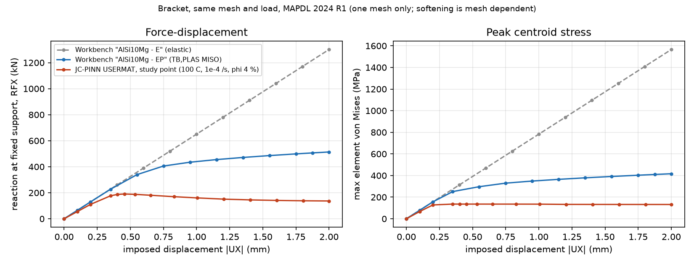

# Bracket run with the JC-PINN USERMAT, 17 November 2026

**Result:** the bracket solves to the full imposed UX = −2 mm with the JC-PINN USERMAT. It took 14 substeps, 40 equilibrium iterations and one automatic bisection, and there were 0 errors. The reaction force peaks at **190.4 kN at UX = −0.455 mm** and then falls to **136.7 kN at −2 mm**. That fall is the model's softening.

This is a single solve on one mesh. It shows that the USERMAT runs on the real part. It is **not** a validated bracket strength:
- The softening localises, so the post-peak branch depends on the mesh (see Limits).
- 190 elements end beyond the plastic-strain range of the data.



## What was run

The same mesh, supports, load, substepping and solver were used in three MAPDL 2024 R1 batch runs. Each was SMP on 4 cores, with `ANS_USER_PATH` set to the USERMAT build.

| Run | Deck source | Material |
|---|---|---|
| `elastic` | `bracket/ansys/.../SYS-2/MECH/ds.dat` | Workbench "AlSi10Mg - E", EX 76,600 MPa at 25 °C, ν 0.33 |
| `ep_miso` | `bracket/ansys/.../SYS/MECH/ds.dat` | Workbench "AlSi10Mg - EP": the same plus `TB,PLAS,MISO` (251.45 MPa at 0, up to 524.3 MPa at 0.07) |
| `usermat` | SYS-2 deck plus the `TB,USER` snippet from `umat/README.md` and `outres,svar,all` | JC-PINN at the study point: 100 °C, 1e-4 /s, ρ 2592 (φ = 4 %), G 24,541 MPa, ν 0.33 (assumed), ITEMP 0 |

The model is your Workbench project as it stands, and none of its values were changed:
- 7,304 SOLID186 elements (full integration) and 38,239 nodes, in mm and MPa;
- fixed support `_FIXEDSU`, 31 nodes;
- imposed UX = −2 mm on 12 nodes;
- `nsub,20,1000,10`, PCG solver, small strain (no NLGEOM), `tref` 22 °C.

`bracket/ansys/` was not modified. `make_decks.py` reads its `ds.dat` files and writes the decks outside the repository. The `.rst`, `.db` and other solver files are not committed.

**Deck conversion.** Workbench 2026 R1 writes the elements as `eblock,21,COMPACT`, which MAPDL 2024 R1 does not read: the first attempt stopped silently at the element block. `make_decks.py` rewrites that block in the standard `eblock,19,SOLID` layout, with the same element numbers, nodes and attributes.

This check shows the conversion is faithful. The local `elastic` and `ep_miso` runs repeat your original 2026 R1 Workbench solves (`solve.out`) exactly:
- the same substep sequence, 11 and 12 substeps;
- the same cumulative iterations, 11 and 20;
- for EP, the same final force-convergence value of 21.92.

## Results (from `summary.json` and `*_history.csv`)

| | Elastic | EP (MISO) | JC-PINN USERMAT |
|---|---|---|---|
| Initial stiffness, kN/mm | 650.4 | 650.4 | 554.3 |
| Peak RFX, kN | 1,300.9 (at −2 mm, linear) | 513.5 (at −2 mm, still hardening) | **190.4 at −0.455 mm** |
| RFX at −2 mm, kN | 1,300.9 | 513.5 | 136.7 |
| Max element von Mises at −2 mm, MPa | 1,565.6 | 416.6 | 132.1 |
| Max element equivalent plastic strain at −2 mm | 0 | 0.037 | 0.358 (SVAR1 0.359) |
| Elements with a USERMAT flag at −2 mm | — | — | 190 of 7,304 (bit 1, EQPS > 0.0999. Bits 2 and 4 cannot occur because T, rate, ρ and G are fixed inside the data range) |
| Substeps, bisections | 11, 0 | 12, 0 | 14, 1 |
| Wall time | 12 s | 26 s | 75 s |

Consistency checks on the USERMAT run:
- **Stiffness.** 554.3 / 650.4 = 0.852 = 65,279 / 76,600. That is the USERMAT's E = 2G(1+ν) divided by the Workbench EX, as expected, because the solver uses the USERMAT's stiffness.
- **Peak stress.** The peak element stress is 136.0 MPa. This matches the single-element peak of 135.8 MPa at the same point (`umat/ansys_test/results_2026-11-17/`).
- **EQPS.** SVAR1 (EQPS) agrees with ANSYS's own EPPL,EQV to within 0.2 %. This shows the plastic strain that the routine returns is consistent.

**Do not read the EP curve as a validation.** The "AlSi10Mg - EP" card is a different material condition. Its yield is 251 MPa and it hardens, and its source is not recorded here. The JC-PINN study point is at 100 °C with 4 % porosity, and its curves soften. The comparison shows only that the decks behave the same apart from the material.

## Limits

- **One mesh only.** At this point the JC-PINN softens almost from first yield: its single-element peak is at EQPS ≈ 4×10⁻⁴. Strain therefore localises after the peak. The 136.7 kN at −2 mm and the 0.36 peak plastic strain depend on the mesh. Q9 asks for two mesh sizes. The mesh is fixed in the Workbench deck, so a second mesh must be made in Workbench.
- **Outside the data.** In 190 elements EQPS exceeds 0.0999, the limit of the data. There the routine holds the flow stress flat at 75.41 MPa (flag bit 1). The post-peak result in that region is extrapolation.
- **Fixed condition.** The temperature (100 °C), strain rate (1e-4 /s) and porosity (4 %) are constants of the run. The model's 22 °C reference temperature is not used (ITEMP = 0), and 22 °C would be outside the 30–200 °C data range anyway. The rate is not computed from the analysis.
- **Assumptions.** ν = 0.33 is assumed. The load is only the −2 mm displacement already in your project. Small-strain kinematics are used, as in the project.
- **No validation.** Nothing here is experimental, and the test of the model is not blind. No critical flaw length is predicted.

## Files

| File | What it is |
|---|---|
| `elastic_history.csv`, `ep_miso_history.csv`, `usermat_history.csv` | Per substep: time, applied UX, reaction at the fixed support, max nodal and element von Mises, max element EPPL,EQV, and for the USERMAT the max SVAR1 and the number of flagged elements |
| `summary.json`, `force_displacement.png` | Written from the CSVs by `../plot_results.py` |
| `*_out_key_lines.txt` | Key lines and the last 60 lines of each `bracket.out` |

The nodal von Mises peaks sit at the fixed-support corner, which is a singularity. Use the element-centroid columns.

## Commands

```bat
python bracket\ansys_usermat\make_decks.py %USERPROFILE%\jcpinn_bracket_run
cd /d %USERPROFILE%\jcpinn_bracket_run\usermat
set "ANS_USER_PATH=%USERPROFILE%\jcpinn_usermat_build" && "C:\Program Files\ANSYS Inc\v241\ansys\bin\winx64\ANSYS241.exe" -b -smp -np 4 -dir . -j bracket -i bracket.dat -o bracket.out
```

Run the same commands in `elastic\` and `ep_miso\`. Then:

```bat
python bracket\ansys_usermat\plot_results.py bracket\ansys_usermat\results_2026-11-17
```

The USERMAT library is the one built and tested in `umat/ansys_test/results_2026-11-17/`, compiled with ifx 2026.2 and VS 2019.
