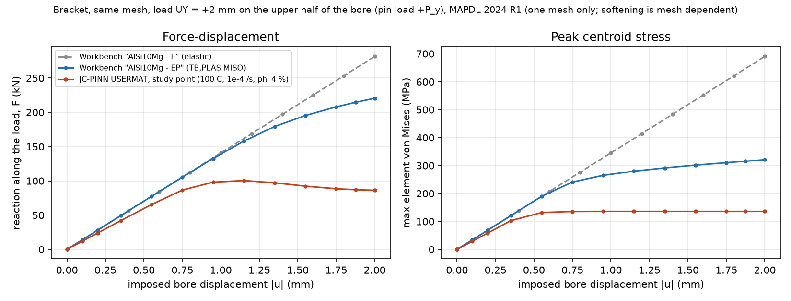

# Bracket with the corrected load: three materials, 18 November 2026

**Load (corrected on 18 Nov 2026):** the pin load +P_y, imposed as UY = +2 mm on the bore nodes with y >= 0, which is the upper half of the 10 mm bore. UX and UZ are free. The decks are built by `make_decks.py --load plus_y`. The 17 Nov 2026 folders without `_uy` used the Workbench file's load, UX = -2 mm on the whole bore. They are kept as evidence only.

**Result:** with the JC-PINN USERMAT, the reaction peaks at **100.5 kN at UY = 1.150 mm**, then softens to **86.3 kN at 2 mm**. All three runs converged to 2 mm with 0 errors.



| | Elastic | EP (MISO) | JC-PINN USERMAT |
|---|---|---|---|
| Initial stiffness, kN/mm | 140.8 | 140.8 | 120.0 |
| Peak reaction, kN | 281.5 (at 2 mm, linear) | 220.5 (at 2 mm, still hardening) | **100.5 at 1.150 mm** |
| Reaction at 2 mm, kN | 281.5 | 220.5 | 86.3 |
| Max element von Mises at 2 mm, MPa | 690.3 | 321.0 | 136.0 |
| Max element plastic strain at 2 mm | 0 | 0.012 | 0.118 (SVAR1 0.119) |
| Elements with a USERMAT flag at 2 mm | - | - | 102 of 7,304 (EQPS > 0.0999) |
| Saved substeps | 11 | 12 | 12 |
| Wall time | 13 s | 27 s | 46 s |

**Checks:**
- **Stiffness.** 120.0 / 140.8 = 0.852 = 65,279 / 76,600, the USERMAT's E = 2G(1+nu) over the Workbench EX.
- **Bending.** Under +P_y the bracket bends, so it is about 4.6 times more compliant than under the old UX load.
- **Where the strain goes.** The JC-PINN's largest plastic strain is at the loaded half of the bore. The EP card's largest plastic strain is at the R10 crotch fillet (axis at x = 36.15, y = 23 mm).

The EP card is a different material condition (yield 251 MPa, hardening, no recorded source). It is a reference, not a validation.

## Reproduce (Windows, MAPDL 2024 R1)

```bat
python bracket\ansys_usermat\make_decks.py --load plus_y %USERPROFILE%\jcpinn_uy_run\bracket
set "ANS_USER_PATH=%USERPROFILE%\jcpinn_usermat_build"
rem in each run folder:
"C:\Program Files\ANSYS Inc\v241\ansys\bin\winx64\ANSYS241.exe" -b -smp -np 4 -dir . -j bracket -i bracket.dat -o bracket.out
python bracket\ansys_usermat\extract_key_lines.py <run folder> <label> <label>_out_key_lines.txt
python bracket\ansys_usermat\plot_results.py bracket\ansys_usermat\results_uy_2026-11-18
```

The `.rst`, `.db` and other solver files are not committed. `*_history.csv` is the `bracket_history.csv` that `post_bracket.mac` writes. Its `u_load_mm` column is the imposed UY, and `F_load_N` is the reaction along y (= -RFY at the fixed support). `*_out_key_lines.txt` holds the key lines of `bracket.out`.

## Limits

- **One material condition** per run (100 degC, 1e-4 /s); small strain; nu = 0.33 assumed.
- **Mesh dependence.** The JC-PINN softens, so forces after yield depend on the mesh (see `../mesh_uy_2026-11-18/`). Each peak is resolved only to the substep spacing.
- **Imposed displacement.** The bore displacement is imposed; it is not a service load. No service load magnitude exists.
- **Not experimental.** Nothing here is experimentally validated.
