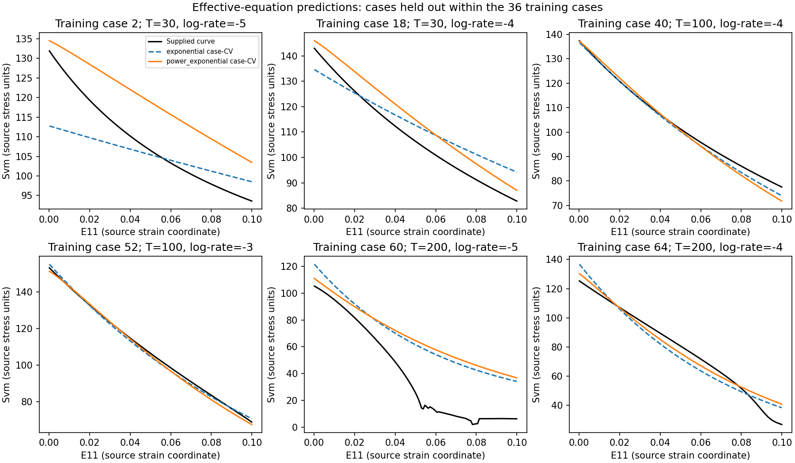

# Effective-equation qualification — 31 October 2026

**Decision: neither tested effective equation qualifies for the full requested
loading family. Continue equation research before creating the MLP/PINN comparison.**
This is a useful negative result; it does not prove that no suitable effective
law exists. It rejects the two tested families with the specified coefficient
maps, fitting bounds, regularization and validation protocol.

## What was checked

The fixed split is unchanged: 36 training and 37 test simulation cases, seed 42.
Only the 36 training histories were opened: 1,224,000 rows. Each was interpolated
to 120 E11 values from 0.0002 to 0.0999, giving every simulation equal weight.
The 37 test histories and delivered neural predictor were not used in this study.
Earlier project-wide test exploration remains disclosed; this is development
validation, not a newly blind final test or experimental validation.

User selected an **effective law**, rather than requiring identifiable microscopic
mechanisms. Fixed nominal porosity 0.04 remains an assumption in metadata; no
porosity response, density relation or G(phi) relation was inferred.

## Candidate equations and interpretation

Let x=E11/0.1 and c=(matrix temperature, log10(matrix rate), density, G).

`Svm(x,c) = R(c) + A(c) exp[-k(c) x^n(c)]`

The simple exponential fixes n=1; the power exponential lets n vary between
0.1 and 8. R>=0, A>0 and k>0. R and A have source stress units; x, k and n are
dimensionless. R is a fitted limiting parameter, not an experimentally established
saturation stress. The unmeasured x=0 value R+A is not called the yield stress.

The corresponding differential residual is

`dSvm/dE11 + (k*n/0.1) (E11/0.1)^(n-1) (Svm-R) = 0`.

The initial value at E11=0.0002 is evaluated from this same equation and its
condition-dependent parameters. No validation case's measured initial stress is
used as an input. For n<1 the derivative is singular at zero, so zero and all
strains outside the recorded interval are excluded.

The exponential-power family is inspired by the original
[Hockett–Sherby paper](https://doi.org/10.1016/0022-5096(75)90018-6), which describes
hardening of other polycrystalline metals. Our decreasing branch and use of E11
with Svm are **effective adaptations**. That paper does not validate this adaptation
for AlSi10Mg, establish 4% porosity, or identify the supplied generator. Likewise,
the earlier Kocks–Mecking analogy does not establish that E11 is plastic strain.

## Data-definition evidence

Svm agrees with the von Mises combination of the supplied stress components
within 9.85e-7 relative error. The recorded Evm is reproduced to a maximum
absolute cumulative error of 7.282e-9 using right-endpoint increments

`dEvm = (SCAU : dE) / Svm`,

where tensor shear terms are counted twice. This supports a work-conjugate
interpretation, consistent with [LANL VPSC source](https://raw.githubusercontent.com/lanl/VPSC_code/main/vpsc8sub.for)
and its [strain accumulation](https://raw.githubusercontent.com/lanl/VPSC_code/main/vpsc8main.for).
It does not establish provenance or a full constitutive closure. Evm must not be
relabeled as conventional nondecreasing accumulated plastic strain.

Case 60 retains its 237 recorded negative Evm increments. Its reconstructed
stress-work history has 241 increments below -1e-10 in source stress–strain
units, with the small count difference affected by output rounding. Its loading
and state interpretation require attention before imposing a dissipative plastic
law. Matrix temperature plus 273.15 matches the training histories' TEMP, but
stress units and detailed strain definitions remain undocumented.

## Calibration and validation

Per-curve three-/four-parameter fits diagnose shape only; they cannot predict a
new case. Mean shape-fit RMSE across 36 curves is 1.9499 for the simple family
and 0.8550 for the flexible family, in source stress units. Better individual
curve fits did not translate into better cross-case prediction.

For prediction, four condition variables are standardized using fitting cases.
The basis is [1,zT,zlograte,zrho,zG,zT*zlograte]. R and A are fitting-RMS-stress
times exp(basis*beta), k=exp(basis*beta), and flexible n=0.1+7.9*sigmoid(basis*beta).
There are 18 or 24 fitted coefficients. Beta bounds [-8,8] and n bounds are
numerical/modeling choices, not material constants.

The objective is mean squared stress error normalized by fitting RMS stress,
plus alpha times squared non-intercept coefficients. SciPy least_squares uses an
analytical Jacobian, three deterministic initializations, at most 1500 evaluations
per start, and fixed tolerances. Alpha is selected from 0.0001, 0.01, 1 using
three KFold case partitions, shuffle=True, seed=42. Each validation case is
predicted from its four conditions only. Scaling and coefficients are refitted
inside every fold. Saved fold manifests and models support exact reconstruction.

Normalized curve error means RMSE divided by that observed curve's RMS stress.
The prospective screening limits were mean <5%, worst <10%, improvement over
the fitting-mean-curve reference, selected-fit convergence, and passing numerical
checks. These limits are research screens, not engineering acceptance limits.

- **Simple exponential:** selected alpha 0.0001; mean case RMSE 4.8993;
  mean normalized error **5.79%**, worst **54.28%** (case 60). Fails both error limits.
- **Power exponential:** selected alpha 0.01; mean case RMSE 5.8200;
  mean normalized error **6.68%**, worst **58.28%** (case 60). Fails both error limits.
- The fitting-mean-curve reference gives mean RMSE 15.3468 and mean normalized
  error 17.13%. Both candidates improve on that weak reference but still fail.

Additional temperature/rate-group holdouts are diagnostics using the alpha
already selected by case CV; they are not independently tuned/nested estimates.
The sole training case at temperature 200 and rate 1e-5 is case 60. Holding it
out gives normalized errors 48.21% and 54.45%. Thus its combination lacks another
training example and its abrupt response is not reliably recovered from others.
Do not silently drop it or claim a validated equation on all 73 cases.

All selected fits converged. Final-model predictions from the three starts agree
closely (relative RMS spread about 3.0e-9 and 2.0e-8). However, data-Jacobian
condition numbers around 2.2e5 and 4.3e5 indicate parameter sensitivity. Stable
predictions do not identify microscopic mechanisms or unique physical constants.



## Reproduce and inspect

- Checker: `src/effective_equation.py`; frozen settings: `configs/effective_equation.json`.
- Open `notebooks/effective_equation_check.ipynb` in Colab. Set the Drive ZIP path.
  It extracts only whitelisted training histories, embeds the tested checker and
  split, and writes a new dated Drive result folder. No neural network is created.
- Results, all predictions, source hashes, folds, coefficient maps, numerical
  diagnostics and verification: `reports/effective_equation_20261031/`.
- Local commands:

```powershell
.venv/Scripts/python.exe -B -m unittest discover -s tests -p test_effective_equation.py -v
.venv/Scripts/python.exe -B src/effective_equation.py --output reports/NEW_RUN_DIRECTORY
.venv/Scripts/python.exe -B scripts/build_effective_equation_notebook.py
.venv/Scripts/python.exe -B scripts/verify_effective_equation.py
```

Five focused tests cover analytical Jacobians, physical-strain derivative scaling,
ODE integration, n=1 reduction, frozen-model reload and train/test file isolation.
Independent saved-result verification checks every case-CV prediction, metrics,
fold scalers, mean-curve reference, training source hashes and notebook source.
Derivative relative error is 1.95e-10; ODE/closed-form relative error is 2.05e-9.
The notebook's bootstrap, ZIP extraction and full computation are checked locally;
Google-hosted execution and Drive authorization are not verified here.

The next research step is to distinguish inadequate condition dependence from
missing state or numerical/loading issues, especially case 60. The available
evidence does not yet justify freezing either tested equation into the PINN loss.
