# JC-PINN and the AM wing-rib bracket: complete study guide

**Team 8:** Pranav Parasuram C · R Saravanan · Dinesh Y · Amit Narayan K\
**Course:** Multiscale Modelling of Materials using Machine Learning (instructor: Prof. Arul Kumar Mariyappan), IIITDM Kancheepuram\
**Prepared:** 25 November 2026, from the repository as it stands after the final check of 22 November 2026.

This guide covers the whole project, from the problem statement to the critical flaw length. It explains every concept we used, every step we took and every result we obtained, and it gives the reason behind each choice. Each project number was read from the saved result files: `report/numbers.json`, the locked run in `reports/jc_pinn_20261107/`, the bracket result folders in `bracket/ansys_usermat/` and `umat/`. The worked examples were recomputed from the saved model for this guide. General theory (textbook material) is marked **Background**, so that you can tell what is standard knowledge and what we did.

> **How to use this guide**
>
> 1. Read Part A first: it gives you the story in two minutes and the six numbers everyone must know.
> 2. Work through Parts B to H in order. Each part ends with a "Remember" box.
> 3. Before the exam, use Part J: the formula sheet, the key-number table, the glossary, the practice questions and the list of common mistakes.

---

## Contents

- **Part A. The big picture:** 1 The project in two minutes · 2 The problem · 3 How we worked · 4 Timeline
- **Part B. The data:** 5 The dataset · 6 Porosity and the study point · 7 What the data show · 8 Preparing the data
- **Part C. The governing equation:** 9 Classic Johnson–Cook · 10 Our Equation 1 · 11 Bounds · 12 Calibration · 13 Why Equation 1 alone is not enough
- **Part D. The JC-PINN model:** 14 What a PINN is · 15 Architecture · 16 Ensemble · 17 Loss and physics residuals · 18 Frozen or joint constants · 19 Training
- **Part E. Selection, lock and test:** 20 Protocol · 21 Selection result · 22 The lock · 23 Metrics · 24 Test results · 25 Comparisons and the control · 26 Constants and identifiability · 27 Physical checks and extrapolation · 28 Porosity in the data · 29 Improvement screen · 30 Verification
- **Part F. From model to finite-element material:** 31 Continuum mechanics · 32 The USERMAT · 33 Return mapping · 34 Consistent tangent · 35 Verification in ANSYS
- **Part G. The bracket:** 36 FEA background · 37 The bracket model · 38 The team's first ANSYS comparison · 39 Three materials on the bracket · 40 Porosity, density only · 41 G(φ) · 42 Porosity with G coupled · 43 Mesh dependence
- **Part H. Critical flaw length:** 44 Fracture mechanics · 45 Damage tolerance · 46 Why simple LEFM was rejected · 47 The load · 48 The toughness · 49 The 2D crack model · 50 The failure assessment diagram · 51 Worked example · 52 Results · 53 Checks and caveats
- **Part I. Limits, decisions and open questions:** 54 Limits · 55 Decision log · 56 Open questions and next steps
- **Part J. Revision tools:** 57 Formula sheet · 58 Key numbers · 59 Glossary · 60 Practice questions · 61 Numerical problems · 62 Common mistakes · 63 Where to find things

---

# Part A. The big picture

## 1. The project in two minutes

**The question.** An aircraft wing-rib bracket is 3D-printed (laser powder-bed fusion, LPBF) in the aluminium alloy AlSi10Mg. Printing always leaves pores. How does porosity affect the bracket, and how long a crack can the bracket carry (its critical flaw length, **CL**)?

**What we did, in four steps:**

1. **Material model.** From 73 simulated stress–strain histories supplied by the instructor, we built the **JC-PINN**. Its governing law is our customised Johnson–Cook equation (**Equation 1**). A small neural network multiplies Equation 1 by a learned correction $\exp(\delta)$, and starts at $\delta = 0$, so the untrained model *is* Equation 1.
2. **Honest testing.** We chose the model's settings using the 36 training simulations only, locked it, and then scored it once on the 37 test simulations.
3. **Finite elements.** We turned the locked model into an ANSYS user material (**USERMAT**), verified it, and solved the bracket in ANSYS MAPDL. We compared porosity levels and checked the mesh.
4. **Critical flaw length.** We modelled a crack at the bracket's R10 fillet in 2D, and assessed it with the BS 7910 failure assessment diagram.

**The six numbers everyone must know:**

| What | Number |
|---|---|
| Test error of the JC-PINN (mean per-curve RMSE, 37 test cases) | **0.439 MPa** (Equation 1 alone: 7.37 MPa, so 17 times better) |
| Error on unseen temperature/rate groups (training cases only) | **6.23 MPa** (plain MLP baseline: 11.90 MPa) |
| ANSYS single element against the offline model | agrees to **1.2 × 10⁻⁵ MPa** |
| Bracket peak reaction at φ = 4 % (5 mm mesh) | **100.5 kN** at UY = 1.150 mm |
| Porosity effect on the bracket peak, φ 0 → 7.85 % | **−0.17 %** density only; **−3.38 %** with G coupled (a lower estimate) |
| Critical flaw length at the 35.9 kN limit load | **CL > 30 mm** at every porosity, for K_mat = 36–50 MPa√m |

**The honest findings you must be able to state:**

- A control (the same network with Equation 1 switched off) scored *better* on every measure (test 0.338 MPa). Equation 1 gives the model structure and interpretability, not accuracy.
- The selected physics-loss weight is **λ = 0**. The physics residuals were tested but did not help on this data.
- The plain MLP is more precise on the random test split (0.143 MPa), but about twice as bad on unseen conditions.
- The model softens, so the bracket results after yield depend on the mesh (peak −9.8 % when the elements are halved).
- The test is not blind, the data are simulations, nothing is validated above 200 °C, and nothing is experimentally validated.

## 2. The problem

### 2.1 The part

The part is an **aircraft wing-rib bracket**: it carries load from a wing rib into the wing spar. It is printed by **laser powder-bed fusion (LPBF)**, a metal 3D-printing process, in **AlSi10Mg**, for low weight and a complex, optimised shape.

The CAD file `bracket/cad/Rib Bracket.STEP`, measured with Gmsh (`bracket/geometry_report/parts_20261026.json`), gives:

- a 40 mm thick plate with two arms meeting at a bore;
- an envelope of about 231.5 × 230 × 40 mm;
- a volume of 778 cm³, about 2.1 kg at 2700 kg/m³;
- a **Ø10 mm bore** that takes the pin load;
- an **R10 crotch fillet** near the bore, the stress hot spot (axis at x = 36.15, y = 23 mm);
- two 50 × 40 mm mounting faces at x = 210 mm, fixed to the spar.

### 2.2 Background: LPBF and porosity

**LPBF** spreads a thin layer of metal powder and melts selected regions with a laser, layer by layer. Fast solidification gives a fine microstructure, but the process also leaves defects:

- **gas pores:** small, roughly spherical, from gas trapped in the powder or melt;
- **lack-of-fusion voids:** irregular, between layers or tracks, when too little energy melts the powder;
- **keyhole pores:** from too much energy, when the melt pool becomes a deep vapour cavity.

**Porosity** φ is the pore volume divided by the total volume. Pores lower the density and the stiffness, and they act as ready-made flaws from which cracks can grow under repeated flight loads.

**AlSi10Mg** is an aluminium casting alloy with nominally about 10 wt % silicon and a few tenths of a percent of magnesium. Aluminium is the ductile matrix, silicon improves castability and printability, and magnesium allows precipitation strengthening after heat treatment. We have no microscopy, composition or heat-treatment data for the project material, so this is background only.

### 2.3 What "CL" means

**CL means critical flaw length** (decision S3, 27 Oct 2026), not coefficient of lift. It is the longest crack of a given type that the bracket can carry under a given load without fracturing. Our CL is a **static** critical crack size. It is not a fatigue life or an airworthiness criterion.

### 2.4 The problem statement in one sentence

> How much does porosity reduce the flaw size that a printed AlSi10Mg wing-rib bracket can safely carry, and how can a designer check that quickly?

## 3. How we worked

### 3.1 The data-science life cycle (the order of the slides)

| Stage | What we did |
|---|---|
| 1. Problem | Porosity in a printed wing bracket; target CL(φ) |
| 2. CAD and ANSYS | Bracket geometry, loads and supports; the team's three ANSYS runs |
| 3. EDA | Explored the 73 simulations: coverage, trends, key inputs |
| 4. Model | Selected and trained the JC-backbone hybrid (JC-PINN, λ = 0) |
| 5. Evaluate | Scored once, after locking, on the 37 test simulations |
| 6. Deploy | USERMAT bracket runs and the CL check done; a decision tool is planned |

### 3.2 Why the project is "multiscale"

- **Material scale:** the network learns how the simulated AlSi10Mg stress varies with temperature, strain rate, density, shear modulus and strain.
- **Part scale:** the locked network runs inside ANSYS as a user material at every integration point of the bracket mesh.
- **Decision:** a failure assessment of a fillet crack turns the bracket response into a critical flaw length.

So the chain is: *pores (porosity φ) → material response (JC-PINN) → material-point stress update (USERMAT) → finite-element equilibrium (bracket) → reaction forces and fillet stresses → fracture assessment (CL)*.

## 4. Timeline

| Date (2026) | Step |
|---|---|
| Oct | Data supplied (73 of 108 planned cases); 36/37 split fixed (seed 42); bracket geometry measured from the CAD (26 Oct); CL defined as critical flaw length (27 Oct) |
| 2 Nov | Plain MLP (5–16–16–1, scikit-learn), kept as the one baseline |
| 7 Nov | **JC-PINN built, selected on training data, locked and tested once**; post-hoc control and improvement screen; decision to submit it unchanged (A3) |
| 9 Nov | Porosity analysis of the data (post-hoc, descriptive) |
| 17 Nov | ANSYS USERMAT generated and verified; single-element test passes in MAPDL 2024 R1; user decisions D1–D5 (units, density = porosity, no data above 200 °C, ANSYS only, G(φ) = 25300(1 − φ)) |
| 18 Nov | **Bracket load corrected** to +P_y on the upper half of the bore; every bracket study re-run; Workbench 2024 R1 project |
| 20 Nov | **Critical flaw length** assessed (decisions F1, F2): CL > 30 mm at the 35.9 kN limit load |
| 22 Nov | Final check of the repository, report, paper and slides |

> **Remember (Part A).** JC-PINN = Equation 1 × exp(δ). Locked before testing. 0.439 MPa test error. The control without Equation 1 was better. USERMAT verified to 1.2e-5 MPa. Bracket peak 100.5 kN, mesh dependent. Porosity: −0.17 % (density) / −3.38 % (G coupled). CL > 30 mm at 35.9 kN.

---

# Part B. The data

## 5. The dataset

### 5.1 What was supplied

The instructor's design matrix planned **108** simulations: 4 temperatures × 3 strain rates × 9 density/shear-modulus pairs. **73** have results (folder `TEAM_8_extracted_results_set_1`, which stays out of Git). The data folder is complete as supplied (decision S1); the 35 missing conditions are not requested again.

| Cases available | 10⁻⁵ s⁻¹ | 10⁻⁴ s⁻¹ | 10⁻³ s⁻¹ | Total |
|---|---:|---:|---:|---:|
| 30 °C | 9 | 9 | 9 | 27 |
| 100 °C | 9 | 9 | 9 | 27 |
| 200 °C | **1** (case 60) | 9 | 9 | 19 |
| 300 °C | 0 | 0 | 0 | **0** |

Each filled cell holds all 9 combinations of three densities and three shear moduli.

### 5.2 Inputs and output

| Quantity | Levels | Unit |
|---|---|---|
| Temperature T | 30, 100, 200 | °C |
| Strain rate ε̇ | 10⁻⁵, 10⁻⁴, 10⁻³ | s⁻¹ |
| Density ρ | 2700, 2619, 2488.05 | kg/m³ |
| Shear modulus G | 25300, 24541, 23313.95 | MPa |
| **Output:** von Mises stress `Svm` along the axial strain `E11` | E11 from about 0 to 0.1 | MPa |

- **Units:** no unit is written in the files. The units (°C, s⁻¹, MPa, kg/m³) were **confirmed by the user** (decision D1, 17 Nov), but no documentation of the generator was ever seen.
- **History length:** slow runs have many more rows: 100,000 rows at 10⁻⁵ s⁻¹, 10,000 at 10⁻⁴ and 1,000 at 10⁻³. In total that is about 2.2 million rows (19 × 100,000 + 27 × 10,000 + 27 × 1,000 = 2,197,000).
- **The simulation solver and constitutive model that generated the data are unknown** (open question Q2).

### 5.3 The task

Given temperature, strain rate, density (porosity), shear modulus and axial strain, predict the simulated von Mises stress `Svm`. A model therefore maps **5 inputs → 1 output**, and is evaluated as a 120-point curve per case.

## 6. Porosity and the study point

### 6.1 Density stands for porosity

The data contain no porosity column. The user confirmed (decisions M5 and D2) that **density stands for porosity**:

$$
\phi = 1 - \frac{\rho}{\rho_0}, \qquad \rho_0 = 2700\ \text{kg/m}^3
$$

| ρ (kg/m³) | φ |
|---|---|
| 2700 | 0 |
| 2619 | 3 % |
| 2592 | **4 % (study point, not in the data)** |
| 2488.05 | 7.85 % |

### 6.2 The study point

The project's study condition is **φ = 4 %**, so ρ = 2700 × 0.96 = **2592 kg/m³**. The original study point uses the middle shear modulus level, **G = 24541 MPa**, because the data vary G and density independently. The ANSYS runs use **100 °C and 10⁻⁴ s⁻¹**.

> **Do not mix up the two 4 % conditions.** The original 4 % study point has G = 24541 MPa (E = 65,279 MPa at ν = 0.33). The later coupled-porosity study (decision D5) uses G = 25300 × 0.96 = **24288 MPa** at 4 % (E = 64,606 MPa).

### 6.3 A hidden pattern: the G levels follow porosity

The three G levels are exactly 25300 (1 − φ) at the three porosities: 25300 × 0.97 = 24541 and 25300 × 0.9215 = 23313.95. In the design, however, every G is paired with every density (all 9 combinations), so in the data **G and density vary independently**. This pattern later justified decision D5 (Section 41).

## 7. What the data show (exploratory data analysis)

1. **Every history softens.** In all 73 cases the stress at the end is below the stress at the start; on average about 138 → 68 MPa over 10 % strain. Only case 60 rises locally again after it collapses. There is **no elastic loading segment**, so the strain axis cannot be split into elastic and plastic parts. Why the generator produced softening is unknown (Q2).
2. **Hotter means weaker.** Higher temperature lowers the whole curve.
3. **Rate:** a faster rate starts higher but softens faster, so at 30 °C the curves of different rates cross near 6 % strain. At large strain the data even show stress falling with rate at 30 °C. This is why strain rate was not included in the sign checks (Section 27).
4. **The curve shape changes with condition.** The stress at 10 % strain divided by the starting stress is:

   | Condition | End / start stress |
   |---|---:|
   | 30 °C, 10⁻⁵ s⁻¹ | 0.71 |
   | 30 °C, 10⁻³ s⁻¹ | 0.49 |
   | 200 °C, 10⁻⁴ s⁻¹ | 0.20 |
   | 200 °C, 10⁻⁵ s⁻¹ (case 60) | 0.06 |

   This matters a great deal: a separable equation cannot change the shape (Section 13).
5. **Effect sizes.** Comparing pairs of cases that differ in one input by one level (mean of the largest gap between the paired curves): one temperature step moves the curve by about 22 MPa, one rate step by about 17 MPa, one G step by about 3 MPa, and one density step by only about **0.2 MPa**. The data therefore say very little about porosity directly.
6. **Case 60** (200 °C, 10⁻⁵ s⁻¹, ρ 2619, G 23313.95) is the only case at that condition and collapses irregularly (end/start 0.06). We kept it. It is in the training set, and every model misses it when it is hidden.

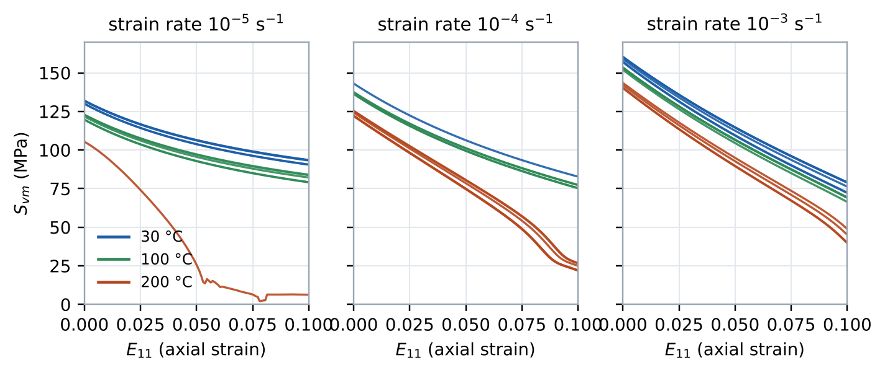

## 8. Preparing the data

| Step | What | Why |
|---|---|---|
| **Resample** | Every history is linearly interpolated onto the same **120 strains, E11 = 0.0002 to 0.0999** (spacing about 0.00084) | So that slow cases with 100,000 rows do not outweigh fast ones with 1,000: **each curve counts equally** (decision S4) |
| **Split by case** | Random 50/50 split of **whole simulations**, seed 42: **36 training, 37 test** (`data/split.json`, decision S2) | All 120 points of a curve stay together. Splitting by points would leak near-duplicate neighbours into the test set |
| **Scale** | Input standardisation $z = (x - \mu)/s$ with statistics from the training cases only | Large raw inputs (ρ ≈ 2600, G ≈ 24000) would dominate the optimisation |
| **Learn** | Each query is (T, log₁₀ ε̇, ρ, G, E11) → Svm; 36 × 120 = **4,320 training points** | These are 4,320 points from only **36 independent simulations**, not 4,320 independent experiments |

**Training scaler statistics** (from `docs/spec.md`): μ = [107.22, −3.9167, 2598.71, 24371.98, 0.05005] and s = [68.094, 0.82916, 89.262, 850.39, 0.029022] for (T, log₁₀ ε̇, ρ, G, E11). The stress scale used in the loss is s_y = 27.376 MPa, the standard deviation of the training stresses.

**Which conditions are in training?** The split is random by case, so it is uneven by condition. The most important consequence: **30 °C, 10⁻⁴ s⁻¹ has 8 test cases but only 1 training case.** That condition is the model's weakest (Section 24).

| Condition | Train | Test |
|---|---:|---:|
| 30 °C, 10⁻⁵ | 5 | 4 |
| 30 °C, 10⁻⁴ | **1** | **8** |
| 30 °C, 10⁻³ | 6 | 3 |
| 100 °C, 10⁻⁵ | 5 | 4 |
| 100 °C, 10⁻⁴ | 4 | 5 |
| 100 °C, 10⁻³ | 4 | 5 |
| 200 °C, 10⁻⁵ | 1 (case 60) | 0 |
| 200 °C, 10⁻⁴ | 6 | 3 |
| 200 °C, 10⁻³ | 4 | 5 |
| **Total** | **36** | **37** |

**The test set is not blind.** Earlier project stages (before 7 Nov) explored these 37 cases. They were excluded from all fitting and selection of the JC-PINN, but we must say they are not a blind holdout.

> **Remember (Part B).** 108 planned, 73 supplied, none at 300 °C, one at 200 °C/10⁻⁵ (case 60). φ = 1 − ρ/2700 → 0, 3, 7.85 %; study point 4 % = 2592 kg/m³, G 24541. Every curve softens; the shape changes with condition. 120 points per curve, 36/37 split by case (seed 42), 4,320 training points from 36 simulations.

---

# Part C. The governing equation

## 9. Background: the classic Johnson–Cook model

The Johnson–Cook (JC) model (Johnson and Cook, 1983) gives the flow stress of a metal as a **product of three separate factors**:

$$
\sigma_y=\underbrace{\left(A+B\,\varepsilon_p^{\,n}\right)}_{\text{strain hardening}}\;
\underbrace{\left(1+C\ln\dot\varepsilon^{*}\right)}_{\text{strain-rate hardening}}\;
\underbrace{\left(1-T^{*m}\right)}_{\text{thermal softening}},
\qquad
\dot\varepsilon^{*}=\frac{\dot\varepsilon}{\dot\varepsilon_0},\quad
T^{*}=\frac{T-T_r}{T_m-T_r}
$$

- **A:** yield stress at the reference rate and temperature (MPa).
- **B, n:** hardening modulus (MPa) and hardening exponent; ε_p is the equivalent plastic strain.
- **C:** strain-rate sensitivity; ε̇₀ is the reference strain rate.
- **m:** thermal-softening exponent; T_r is the reference (room) temperature and T_m the melting temperature, so T* is the homologous temperature (0 at T_r, 1 at melting).

It is popular because it is simple, has few constants and is built into most finite-element codes (ANSYS has it as a built-in strength model; the team's run "B" used it, Section 38). Its main weakness is the one that matters to us: because it is a product of separate factors, **temperature and rate can only scale the curve up or down; they cannot change its shape**.

## 10. Our Equation 1

The user's customised Johnson–Cook notes (7 Nov 2026) define **Equation 1**, the governing law of our model (decisions M1, M2):

$$
\sigma_{JC}=\left[A-B\,\varepsilon^{\,n}\right]\,\left[1+C\ln\dot\varepsilon^{*}\right]\,\left[1-T^{*m}\right]\,\left[\frac{G}{G_0}\right]^{q}\,\left[1-\phi\right]^{r}
$$

| Symbol | Meaning | Mapping / value | Values in the data |
|---|---|---|---|
| ε | strain | **axial total strain E11** (decision M4); no elastic segment exists to subtract | 0.0002 to 0.0999 |
| ε̇* | strain-rate ratio ε̇/ε̇₀ | ε̇₀ = 10⁻⁵ s⁻¹, the slowest rate | ln ε̇* = 0, 2.303, 4.605 |
| T* | homologous temperature (T − T_r)/(T_M − T_r), clipped at 0 | T_r = 30 °C, T_M = 600 °C, so T* = (T − 30)/570 | 0, 0.1228, 0.2982 (300 °C would be 0.4737) |
| G/G₀ | shear-modulus ratio | G₀ = 25300 MPa | 1, 0.97, 0.9215 |
| 1 − φ | solid fraction | φ = 1 − ρ/2700, so 1 − φ = ρ/2700 | 1, 0.97, 0.9215 |
| A, B, n | strain term | fitted; A and B in MPa | |
| C, m, q, r | rate, temperature, modulus and porosity exponents | fitted, dimensionless | |

**Three differences from the classic model:**

1. **Minus sign:** $A - B\varepsilon^n$ instead of $A + B\varepsilon^n$, because every supplied history **softens**. The strain factor falls with strain: $\frac{d}{d\varepsilon}(A-B\varepsilon^n) = -nB\varepsilon^{n-1} < 0$.
2. **A shear-modulus factor** $[G/G_0]^q$ is added. With q ≥ 0, a lower G gives a lower stress.
3. **A porosity factor** $[1-\phi]^r$ is added. With r ≥ 0, more porosity gives a lower stress.

**Two notes that examiners like:**

- Our ε is the **total** axial strain E11, not the equivalent plastic strain of classic JC, because the histories have no elastic part to subtract (M4).
- The backbone uses the **natural log** of the rate *ratio*, $\ln(\dot\varepsilon/10^{-5})$. The network (Part D) receives **log₁₀ ε̇** as an input. Do not confuse the two.

## 11. Bounds that keep the constants physical

**Reparametrising B.** We write $B = A\beta/0.1^{n}$ with $0 \le \beta \le 0.99$. Then, for every strain up to 0.1,

$$
A-B\varepsilon^{n}=A\left[1-\beta\left(\frac{\varepsilon}{0.1}\right)^{n}\right]\;\ge\;A(1-\beta)\;\ge\;0.01A\;>\;0 .
$$

So the strain factor can never become zero or negative inside the data range. (This is a range-specific guarantee, not a proof for any strain.)

**Sign bounds.** C, q and r are non-negative, so no trend can have the wrong sign. **Without the bound the fit returned r = −0.027**, which would mean that porosity *raises* the stress.

| Constant | Bounds |
|---|---|
| A | 1 – 2000 MPa |
| β (sets B) | 0 – 0.99 |
| n | 0.05 – 5 |
| C | 0 – 2 |
| m | 0.05 – 20 |
| q | 0 – 10 |
| r | 0 – 20 |

During network training the bounded constants are mapped through a **sigmoid**, $v = v_{lo} + (v_{hi}-v_{lo})\,\mathrm{sigmoid}(u)$, so that gradient steps on the free variable u can never leave the bounds.

## 12. Calibrating Equation 1 alone

**Method:** bounded nonlinear least squares, SciPy `least_squares` with the trust-region-reflective method (`trf`), a 3-point finite-difference Jacobian, tolerances 10⁻¹² and at most 20,000 evaluations. The residual of each training point is $(\sigma_{JC}-\sigma)/s_y$. Because the problem is non-convex, it is solved from **8 starting points** (seed 42), and the lowest cost wins.

**Result (Equation 1 alone, 36 training cases):**

| A (MPa) | B (MPa) | n | C | m | q | r |
|---:|---:|---:|---:|---:|---:|---:|
| 148.77 | 526.23 | 0.828 | 0.0292 | 1.113 | 0.717 | **0 (at its lower bound)** |

(β = 0.526 for these values.) **Quote these as "the calibrated Equation 1"**, not the constants inside the JC-PINN (Section 26).

**Worked example (recomputed for this guide).** Equation 1 alone at the study point, T = 100 °C, ε̇ = 10⁻⁴ s⁻¹, ρ = 2592 kg/m³, G = 24541 MPa, ε = 0.05:

| Factor | Calculation | Value |
|---|---|---:|
| strain | 148.769 − 526.229 × 0.05^0.82756 = 148.769 − 526.229 × 0.08381 | 104.66 MPa |
| rate | 1 + 0.029247 × ln(10) = 1 + 0.029247 × 2.3026 | 1.0673 |
| temperature | 1 − (70/570)^1.11323 = 1 − 0.12281^1.11323 | 0.9032 |
| modulus | 0.97^0.71732 | 0.9784 |
| porosity | 0.96^0 | 1 |
| **σ_JC** | 104.66 × 1.0673 × 0.9032 × 0.9784 × 1 | **98.71 MPa** |

The locked JC-PINN gives 99.39 MPa at the same point.

## 13. Why Equation 1 alone is not enough

**The proof in one line.** At fixed constants, the ratio of the stress at two strains is

$$
\frac{\sigma_{JC}(\varepsilon_2)}{\sigma_{JC}(\varepsilon_1)}=\frac{A-B\varepsilon_2^{\,n}}{A-B\varepsilon_1^{\,n}},
$$

because the rate, temperature, modulus and porosity factors cancel. **Every condition gets the same curve shape.** With the calibrated constants, σ(0.0999)/σ(0.0002) = **0.476 for every condition**, while the data range from **0.71** (30 °C, 10⁻⁵ s⁻¹) to **0.06** (case 60).

**Consequences:**

| Equation 1 alone | Error (mean curve RMSE) |
|---|---:|
| Case-wise cross-validation (training) | 10.24 MPa |
| Unseen temperature/rate groups (training) | 13.95 MPa |
| Test set (37 cases) | **7.37 MPa** (worst 13.47) |
| Fitted directly to all 36 training curves | 8.95 MPa, about 10 % of the stress (case 60 worse than 70 %) |

This is a property of the **separable form**, not a fitting failure. Even a per-curve fit of $A - B\varepsilon^n$, with three constants for *each* training curve, leaves a mean RMSE of **0.84 MPa** (median 0.51; worst 8.65, case 60); a cubic polynomial per curve reaches 0.30 MPa. So the power-law strain shape itself is a floor that the backbone cannot pass, and a correction is needed.

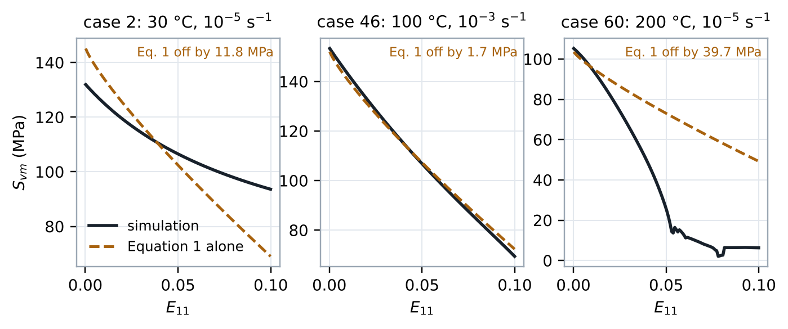

> **Remember (Part C).** Equation 1 = [A − Bεⁿ][1 + C ln ε̇*][1 − T*ᵐ][G/G₀]^q[1 − φ]^r. Minus sign (softening), plus G and porosity factors. ε = E11 (total). ε̇₀ = 10⁻⁵, T_r = 30 °C, T_M = 600 °C, G₀ = 25300 MPa, ρ₀ = 2700. B = Aβ/0.1ⁿ keeps it positive; C, q, r ≥ 0 (otherwise r = −0.027). Calibrated: A 148.77, B 526.23, n 0.828, C 0.0292, m 1.113, q 0.717, r 0. Separable → same shape (ratio 0.476) for all conditions → test error 7.37 MPa.

---

# Part D. The JC-PINN model

## 14. Background: what a physics-informed neural network is

A **physics-informed neural network (PINN)** (Raissi, Perdikaris and Karniadakis, 2019) is a neural network trained with a loss that has two parts:

$$
\mathcal L=\underbrace{\mathcal L_{\text{data}}}_{\text{fit the measurements}}+\lambda\,\underbrace{\mathcal L_{\text{physics}}}_{\text{residual of the governing equation}}
$$

The physics residual is evaluated at **collocation points**: input locations where no measurement is needed, only the requirement "obey the equation here". Derivatives in the residual are computed by **automatic differentiation**. Usually the governing equation is a partial differential equation (PDE) in space and time.

Physics can enter a network in two ways:

- **soft constraint:** a penalty term in the loss (weight λ);
- **hard constraint / architecture:** the physics is built into the model's form, so it holds by construction.

**How ours fits.** The JC-PINN is a **constitutive (material-point) PINN**: its governing equation is a constitutive law, Equation 1, not a PDE. Physics enters in both ways:

- **by architecture:** the model is Equation 1 times a correction, and it starts as exactly Equation 1;
- **by penalty:** the physics residuals (level and trend, Section 17) were tested at 4,096 collocation points with automatic-differentiation derivatives. The training-only selection, however, chose **λ = 0**.

The most precise description is therefore an **equation-backbone (grey-box) hybrid**, kept under the project name JC-PINN. It is not a 3D equilibrium PINN, because the data contain no spatial fields.

## 15. Architecture

$$
\boxed{\;\hat\sigma(\mathbf x)=\sigma_{JC}(\mathbf x;\theta)\cdot\exp\left(\delta(\mathbf z)\right)\;},\qquad
\mathbf x=(T,\ \log_{10}\dot\varepsilon,\ \rho,\ G,\ E_{11}),\qquad
\mathbf z=\frac{\mathbf x-\boldsymbol\mu}{\mathbf s}
$$

$$
\delta(\mathbf z)=\mathbf w_3^{\top}\tanh\left(W_2\tanh(W_1\mathbf z+\mathbf b_1)+\mathbf b_2\right)+b_3
$$

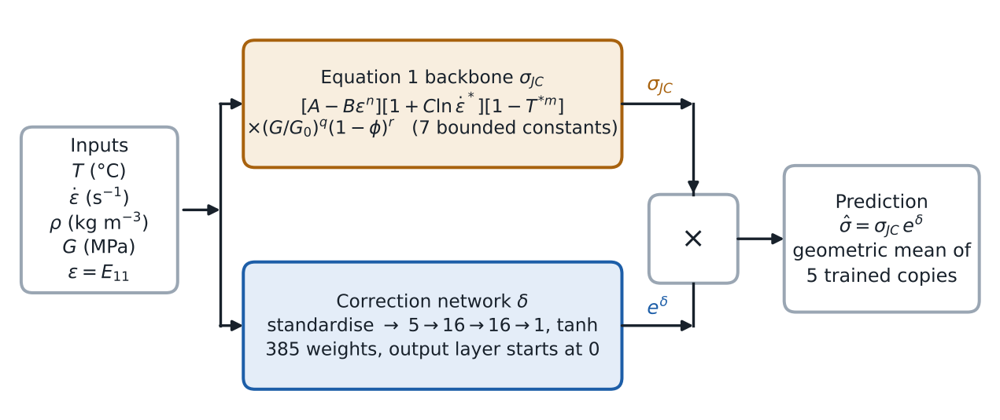

| Item | Value |
|---|---|
| Inputs | 5: T (°C), log₁₀ ε̇ (s⁻¹), ρ (kg/m³), G (MPa), E11, standardised with the training statistics |
| Layers | Linear 5→16, tanh, Linear 16→16, tanh, Linear 16→1 |
| Parameters per network | W₁ 16×5 + b₁ 16 + W₂ 16×16 + b₂ 16 + w₃ 16 + b₃ 1 = 80 + 16 + 256 + 16 + 16 + 1 = **385** |
| Initialisation | PyTorch default for the hidden layers (seeded); **output layer (w₃, b₃) set to zero** |
| Output | σ̂ = σ_JC · exp(δ) |

**Why each choice?**

- **Zero start.** With w₃ = 0 and b₃ = 0, δ ≡ 0 before training, so exp(δ) = 1 and **the untrained model is exactly Equation 1**. Training adds only what Equation 1 cannot explain, mainly the condition-dependent curve shape.
- **Multiplicative form, exp(δ).** exp(δ) is a correction *factor*: exp(δ) = 0.9 means 10 % below Equation 1. It always keeps the stress **positive** (if σ_JC > 0). It works in log space, $\ln\hat\sigma=\ln\sigma_{JC}+\delta$, where Equation 1's factors become sums. (Building it this way was the user's choice over residual or penalty-only forms, decision M3.)
- **tanh.** It is smooth, bounded and infinitely differentiable. Smoothness is needed for the trend residual (derivatives of δ) and later for the analytic slope in the USERMAT. Its derivative is $\tanh'(x)=1-\tanh^2(x)$.
- **Small network.** There are only 36 training curves; a 5–16–16–1 network with strong weight decay is enough to learn a smooth correction without memorising the data.
- **Input scaling.** Standardisation puts inputs of very different size (ρ ≈ 2600, E11 ≈ 0.05) on the same footing, so no input dominates the optimisation.

## 16. The ensemble

Five copies (members) are trained with seeds 0, 1, 2, 3 and 4. Each has its own network **and its own jointly trained constants θ_k**. Their stresses are combined by the **geometric mean**:

$$
\hat\sigma=\exp\left(\frac15\sum_{k=1}^{5}\ln\hat\sigma_k\right)=\exp\left(\frac15\sum_{k=1}^{5}\left[\ln\sigma_{JC}(\theta_k)+\delta_k\right]\right)
$$

- **Why geometric?** It is the natural average in log space, where the model works, and it keeps the stress positive. (Example: members at 100 and 121 MPa give a geometric mean of 110 MPa and an arithmetic mean of 110.5 MPa.)
- **Totals:** each member has 385 network parameters + 7 constants = 392 trainable values; five members have **1,960** (1,925 network + 35 constants). The saved model, `equation.json`, is 71 kB and can be evaluated with NumPy alone.
- **Agreement:** the five members agree to a mean spread of **0.104 MPa** (largest 0.338) on the test set. Individually they score 0.390 to 0.478 MPa; the ensemble (0.439) is better than four of the five and better than their average (0.453).

Member spread shows how much fitted copies agree. It is not a calibrated uncertainty and not a bound on the model's error.

## 17. Loss function and physics residuals

$$
\mathcal L=\underbrace{\frac1N\sum_{i=1}^{N}\left(\frac{\hat\sigma_i-\sigma_i}{s_y}\right)^{2}}_{\text{data}}
\;+\;\lambda\,\underbrace{\frac1M\sum_{j=1}^{M}R_j^{2}}_{\text{physics}}
\;+\;\underbrace{\frac{\alpha}{N}\sum W^{2}}_{\text{weight decay}}
$$

with N = 4,320 training points, s_y = 27.376 MPa, M = 4,096 collocation points and α = 1 (on the three weight matrices only, not the biases).

### 17.1 Collocation points

4,096 points from a **scrambled Sobol sequence** (seed 42) cover the whole planned design box:

| Input | Range |
|---|---|
| T | 30 – **300** °C |
| log₁₀ ε̇ | −5 to −3 |
| ρ | 2488.05 – 2700 kg/m³ |
| G | 23313.95 – 25300 MPa |
| E11 | 0.0002 – 0.0999 |

This box includes the 35 conditions that have no simulation (all of 300 °C, and 200 °C at 10⁻⁵ s⁻¹ except case 60). **No stress values are used at these points**; they only ask the model to obey Equation 1 there.

**Background: Sobol sequence.** A low-discrepancy (quasi-random) sequence that fills a box much more evenly than random sampling. Scrambling randomises it slightly while keeping it even.

### 17.2 The two residual forms that were tested

| Form | Residual R | Meaning |
|---|---|---|
| **level** | $R=\delta=\ln\hat\sigma-\ln\sigma_{JC}$ | The prediction should stay close to Equation 1 itself |
| **trend** | $R=\partial\delta/\partial z_c$ for c = T, log₁₀ ε̇, ρ, G (by automatic differentiation, in standardised units; the four squares are summed) | The model's *sensitivities* to the conditions should equal Equation 1's, while the strain-shape correction δ(E11) stays free |

The trend residual was added after a development check showed that the level penalty pulled predictions toward Equation 1, which is about 10 % off in level, and made fold errors worse.

**Background: automatic differentiation (autograd).** The computer applies the chain rule to every operation of the program, so derivatives are exact to rounding (not finite-difference approximations). Reverse mode (backpropagation) gives the gradient of one output with respect to all inputs or weights in one backward pass.

### 17.3 Weight decay α = 1

Weight decay is an L2 penalty on the weights. It keeps the network smooth and stops exp(δ) from growing very large away from the data. **α = 1 was fixed before the formal selection**, by a development check on the three training folds only (decision M8):

| α | 0.001 | 0.1 | **1** | 3 | 10 |
|---|---:|---:|---:|---:|---:|
| Fold mean RMSE (MPa), λ = 0 | 25.3 | 4.8 | **2.4** | 4.2 | 4.6 |

α = 0.001, inherited from the earlier scikit-learn MLP, let exp(δ) blow up when extrapolating. Because these development checks used the same three folds as the formal case CV, the selected model's CV estimate is mildly optimistic.

After training, the weight term dominates the loss (total 0.00278–0.00283; data 0.00039–0.00041; weight term 0.00238–0.00243 for members 0–4). The model is strongly regularised: it trades some interpolation precision for smoothness.

## 18. Frozen or joint constants

- **Frozen:** Equation 1's seven constants are calibrated first (Section 12) and then kept fixed; the network learns only δ.
- **Joint:** the constants (through their sigmoid variables) are trained together with the network, with the same Adam learning rate.

Both were candidates in the selection. **Joint won** (decision M9).

## 19. Training

| Item | Setting |
|---|---|
| Framework | PyTorch, float64, CPU, one thread per worker, fixed seeds (deterministic) |
| Batch | full batch: all 4,320 points at every step |
| Stage 1 | **Adam**, learning rate 0.005, **1,500 steps** |
| Stage 2 | **L-BFGS**, history 50, strong-Wolfe line search, at most **2,500 iterations**, gradient tolerance 10⁻¹⁰, change tolerance 10⁻¹⁴ |
| Result | every member used all 2,500 L-BFGS iterations; 12–17 s per member |

**Background: the two optimisers.**

- **Adam** (adaptive moment estimation) keeps running averages of each parameter's gradient (first moment) and squared gradient (second moment), and takes a per-parameter step scaled by them. It is robust far from the optimum, so it is a good start.
- **L-BFGS** (limited-memory Broyden–Fletcher–Goldfarb–Shanno) is a quasi-Newton method. It builds an approximation of the inverse Hessian from the last m = 50 gradient differences, so it converges much faster than first-order methods near the optimum of a smooth, full-batch, small problem. The **strong Wolfe** line search accepts a step only if it lowers the loss enough (sufficient decrease) and the slope has flattened enough (curvature condition).
- **Why both:** Adam brings the model robustly into a good region, and L-BFGS polishes it to high precision.

**What training looks like.** For member 0 (seed 0) the loss falls from 0.171 to 0.0028, about 60-fold. On a 200 °C training case the prediction starts as Equation 1 (step 0), is close by step 400, and matches the simulation at the end.

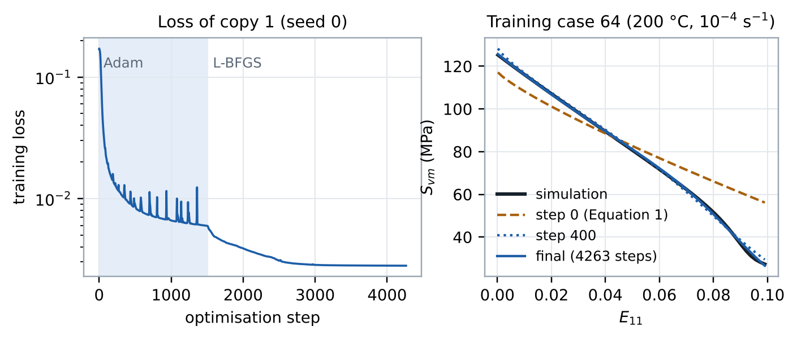

**Why build a new network instead of reusing the old MLP's weights?** scikit-learn's MLP cannot take a physics loss, and the network's job changed from "predict stress" to "predict the correction to Equation 1", so the old weights do not transfer. The 2 Nov plain MLP is kept as the baseline.

> **Remember (Part D).** σ̂ = σ_JC·exp(δ); δ = 5–16–16–1 tanh, 385 weights, output layer zero → starts as Equation 1. 5 members (seeds 0–4), geometric mean, 1,960 parameters. Loss = data + λ·physics + (α/N)ΣW², α = 1. Physics tested: level (δ) and trend (∂δ/∂conditions) at 4,096 Sobol points up to 300 °C. Adam 1,500 steps (lr 0.005) then L-BFGS ≤ 2,500. Joint constants won.

---

# Part E. Selection, lock and test

## 20. The protocol: choose without the test set

The rule was **lock first, score once, disclose** (decision M7). Every choice of setting was made with the 36 training cases only.

### 20.1 Two kinds of validation, both inside the training set

- **Case cross-validation (case CV):** the 36 training cases are split into **3 folds** of whole cases (scikit-learn `KFold`, shuffled, seed 42). Each fold is held out once and predicted by a model trained on the other two. The score is the mean per-curve RMSE over all 36 held-out predictions. This tests **interpolation** between known conditions.
- **Group holdouts:** each of the **9 temperature/rate groups** present in training is hidden in turn (every training case of, say, 100 °C and 10⁻⁵ s⁻¹), and a model trained on the rest predicts it. The score is the mean of the nine group-mean RMSEs. This tests prediction at **a condition the model has never seen**, which is closer to real use.

Inside every split, the scalers and Equation 1's constants are refitted on that split's fitting cases only, so no information leaks from the held-out cases.

### 20.2 The balanced score

$$
\text{score}=\tfrac12\left(\text{case-CV mean RMSE}+\text{mean of the nine group-holdout RMSEs}\right)
$$

The lowest score wins. Exact ties prefer the larger λ, then frozen constants (decision M6). A setting therefore had to interpolate **and** generalise.

### 20.3 The candidates

**14 settings** = 7 physics options × 2 constant modes (frozen, joint):

- no physics loss (λ = 0);
- level residual, λ ∈ {10⁻³, 10⁻², 10⁻¹};
- trend residual, λ ∈ {10⁻⁴, 10⁻³, 10⁻²}.

Each setting was a 3-seed ensemble (seeds 0, 1, 2) on each of the 12 splits: **504 fits** (14 × 12 × 3), which took **37.1 minutes** on 4 CPU workers.

**Why split by case and use group holdouts?** Neighbouring points of one curve come from the same simulation, so splitting by points would put near-duplicates on both sides and make the test look easier than it is. A random case split also usually leaves similar conditions in training, so it mostly tests interpolation. Hiding a whole temperature/rate group is harder and more honest about generalisation.

## 21. The selection result

| Candidate | Case CV | Groups | Score |
|---|---:|---:|---:|
| **none, λ = 0, joint (selected)** | **2.098** | **6.235** | **4.166** |
| none, λ = 0, frozen | 2.032 | 6.441 | 4.237 |
| trend, λ = 10⁻⁴, joint | 2.010 | 6.822 | 4.416 |
| trend, λ = 10⁻⁴, frozen | 2.505 | 7.101 | 4.803 |
| level, λ = 10⁻², joint | 3.332 | 7.997 | 5.664 |
| level, λ = 10⁻², frozen | 3.881 | 7.720 | 5.800 |
| level, λ = 10⁻³, joint | 4.160 | 8.310 | 6.235 |
| trend, λ = 10⁻², frozen | 2.925 | 9.587 | 6.256 |
| level, λ = 10⁻³, frozen | 4.219 | 8.383 | 6.301 |
| trend, λ = 10⁻³, frozen | 3.654 | 8.982 | 6.318 |
| trend, λ = 10⁻³, joint | 4.372 | 8.419 | 6.396 |
| trend, λ = 10⁻², joint | 4.071 | 8.951 | 6.511 |
| level, λ = 10⁻¹, frozen | 4.549 | 9.080 | 6.815 |
| level, λ = 10⁻¹, joint | 5.130 | 13.714 | 9.422 |
| *Equation 1 alone (reference)* | 10.238 | 13.947 | 12.092 |
| *Curve-copy lookup (reference)* | 3.603 | 13.961 | 8.782 |

(MPa, training cases only. The curve-copy lookup predicts the nearest training curve at the same temperature and rate.)

**The winner: no physics loss (λ = 0), constants trained jointly** (decision M9). Two settings came close (frozen 4.24; weakest trend residual 4.42). **Every stronger physics weight was worse** on both case CV and the hidden groups.

**Why did the physics penalty not help?** Equation 1 is about 10 % off in level, and its fixed curve shape is wrong for hot or slow conditions. Pulling the model toward Equation 1 (level), or toward its trends (trend), moves predictions away from the simulations. A physics penalty only helps when the governing equation is right where the data are missing.

**What still comes from Equation 1 at λ = 0?** The backbone and the zero start. No penalty is applied at the collocation points.

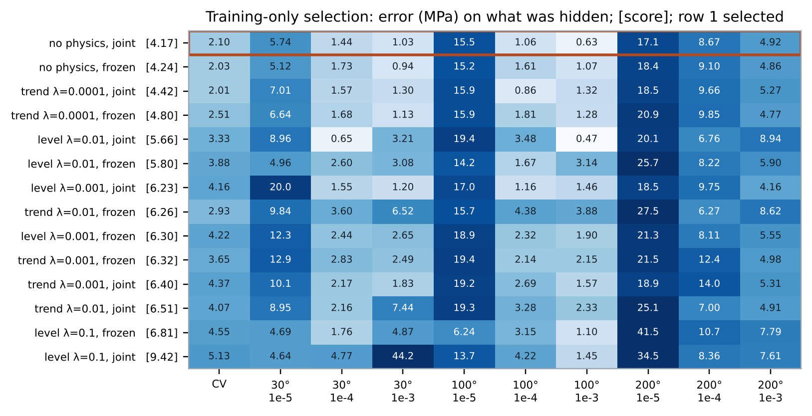

## 22. The lock

1. The selected setting was refitted on **all 36 training cases** as a **5-seed ensemble** (seeds 0–4).
2. The model (`equation.json`) and its **SHA-256 fingerprint** were written to `selection_lock.json` **before any test file was read**.
3. The 37 test cases were then read and scored **once**. No setting was changed afterwards.

**Background: SHA-256.** A cryptographic hash: a 256-bit fingerprint of a file. Changing a single byte changes the hash completely, so the lock proves that the scored model is the model chosen before the test. That is why `equation.json` must never be edited (corrections go in `ERRATA.md`).

The run was produced by `src/jc_pinn.py` at commit `c3ee1a6` (SHA-256 of the script begins `d3f66db6`), recorded in the lock.

## 23. The metrics

For case i with 120 points j:

$$
\text{RMSE}_i=\sqrt{\frac1{120}\sum_{j=1}^{120}\left(\hat\sigma_{ij}-\sigma_{ij}\right)^2},\qquad
\text{reported error}=\frac1{37}\sum_i\text{RMSE}_i\quad(\text{mean per-curve RMSE})
$$

- The headline metric is the **mean of the per-curve RMSEs**, not the RMSE of all points pooled together (the pooled point RMSE on test is 0.504 MPa).
- **MAE:** mean absolute error. **Bias (mean signed error):** positive means the model predicts too high on average; large positive and negative errors can cancel, so bias alone says little.
- **R²** = 1 − SSE/SST over all points. It is high when the target varies a lot, so a high R² alone does not prove good extrapolation.
- **Normalised RMSE:** RMSE_i divided by the root-mean-square stress of that curve.
- Always report the mean, the median, the worst case, and the error on hidden conditions together.

## 24. The test results

### 24.1 Headline (37 test cases, 4,440 points, scored once after the lock)

| Metric | Value | Metric | Value |
|---|---:|---|---:|
| **Mean curve RMSE** | **0.439 MPa** (0.4386) | Points within ±1 MPa | **94.9 %** |
| Median curve RMSE | 0.395 MPa | Points within ±0.5 MPa | 80.2 % |
| Worst curve RMSE | 0.841 MPa (case 10) | Points within ±2 MPa | 98.8 % |
| Best curve RMSE | 0.093 MPa (case 37) | **R²** (all points) | **0.99952** |
| Mean absolute error | 0.327 MPa (0.38 % of the stress) | Mean signed error (bias) | +0.009 MPa |
| Largest single point error | 2.90 MPa (9.2 %) | Cases above / below | 17 / 20 |
| Mean normalised RMSE | 0.42 % | Training-set fit | 0.356 MPa |

- **17 times better than Equation 1 alone** (7.37 → 0.439 MPa); better on **all 37** cases.
- **Not over-fitted:** the training fit (0.356) is close to the test error (0.439).
- **No systematic bias:** +0.009 MPa; 17 cases slightly high, 20 slightly low.
- **Errors grow only near the end of the curves**, where softening is steepest (mean absolute error 0.25, 0.23 and 0.51 MPa in the first, middle and last third of the strain range).
- **Size of the correction:** mean |δ| on the test set is 0.47 (largest 0.92). So exp(δ) is far from 1: the network does real work.

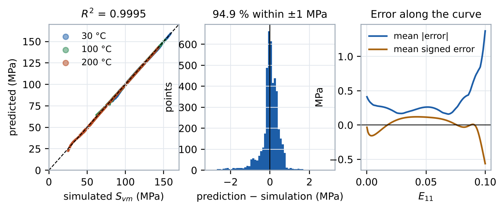

### 24.2 Error by condition

| T (°C) | Rate (s⁻¹) | Test cases | JC-PINN | Equation 1 alone | Plain MLP |
|---:|---:|---:|---:|---:|---:|
| 30 | 10⁻⁵ | 4 | 0.354 | 11.84 | 0.075 |
| 30 | 10⁻⁴ | 8 | **0.803** | 6.25 | 0.227 |
| 30 | 10⁻³ | 3 | 0.182 | 2.92 | 0.096 |
| 100 | 10⁻⁵ | 4 | 0.434 | 9.14 | 0.050 |
| 100 | 10⁻⁴ | 5 | 0.283 | 3.50 | 0.260 |
| 100 | 10⁻³ | 5 | 0.454 | 3.43 | 0.125 |
| 200 | 10⁻⁴ | 3 | 0.569 | 13.04 | 0.115 |
| 200 | 10⁻³ | 5 | **0.143** | 11.22 | 0.081 |

- **Every** condition is below 1 MPa and far better than Equation 1 alone.
- **Weakest: 30 °C, 10⁻⁴ s⁻¹ (0.80 MPa).** It has 8 test cases but only **1 training case**. **The eight worst test cases all sit at this condition.**
- Lowest: 200 °C, 10⁻³ (0.14) and 30 °C, 10⁻³ (0.18). Note 100 °C, 10⁻³ is 0.45, so "fast rate is easy" is not a rule.

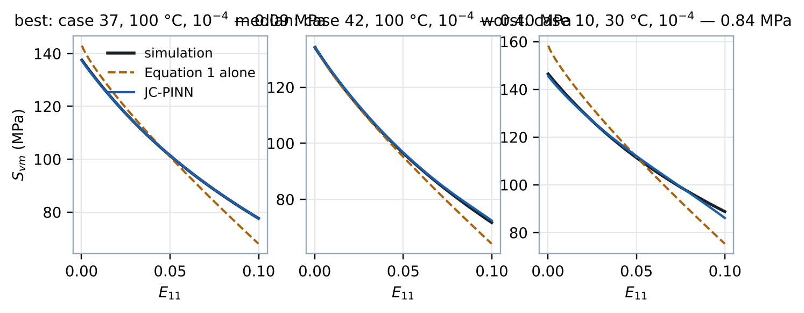

## 25. Comparisons and the control

### 25.1 All models on the same split

| Model | Case CV (train) | Unseen T/rate groups (train) | **Test, 37 cases** |
|---|---:|---:|---:|
| Equation 1 alone (7 constants) | 10.24 | 13.95 | 7.37 |
| Curve-copy lookup | 3.60 | 13.96 | 1.379 |
| **JC-PINN (this model)** | **2.098** | **6.235** | **0.439** |
| Same network, Equation 1 switched off (control) | 1.315 | 5.629 | 0.338 |
| Plain MLP of 2 Nov (5–16–16–1 tanh, scikit-learn, α = 0.001; the baseline) | 2.17 | 11.90 | 0.143 |

**How many test cases does the JC-PINN win?** All 37 against Equation 1 alone, 24 of 37 against the lookup, and **none** against the plain MLP.

### 25.2 The trade-off with the plain MLP

- **On the random test split, the plain MLP is more precise** (0.143 against 0.439). A random split rewards close interpolation between neighbouring curves, which a pure MLP does best.
- **At unseen conditions, the JC-PINN has about half the MLP's error** (6.23 against 11.90).
- The balanced score chose this trade-off on purpose: some interpolation precision for better behaviour on unseen temperature/rate combinations.
- **Caveat:** the group scores were part of the JC-PINN's selection (and the MLP's α was nested inside each group), so they are not an independent test of which model is better. Differences in architecture, output form and regularisation also stop us pinning the gap on one ingredient.

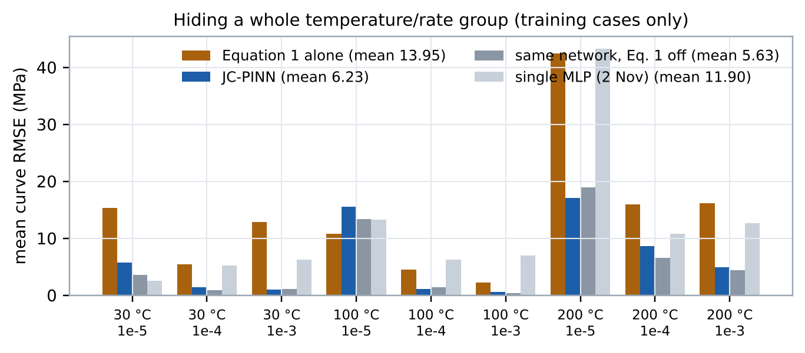

| Hidden group | Cases | Equation 1 alone | JC-PINN | Control | Plain MLP |
|---|---:|---:|---:|---:|---:|
| 30 °C, 10⁻⁵ | 5 | 15.275 | 5.740 | 3.524 | 2.488 |
| 30 °C, 10⁻⁴ | 1 | 5.449 | 1.443 | 0.894 | 5.261 |
| 30 °C, 10⁻³ | 6 | 12.796 | 1.031 | 1.139 | 6.267 |
| 100 °C, 10⁻⁵ | 5 | 10.814 | 15.524 | 13.397 | 13.236 |
| 100 °C, 10⁻⁴ | 4 | 4.484 | 1.063 | 1.359 | 6.228 |
| 100 °C, 10⁻³ | 4 | 2.214 | 0.627 | 0.405 | 6.925 |
| 200 °C, 10⁻⁵ (case 60) | 1 | 42.424 | **17.100** | 18.973 | 43.236 |
| 200 °C, 10⁻⁴ | 6 | 15.891 | 8.665 | 6.593 | 10.826 |
| 200 °C, 10⁻³ | 4 | 16.173 | 4.920 | 4.377 | 12.633 |
| **Mean of 9 groups** | 36 | 13.947 | **6.235** | 5.629 | 11.900 |

The hardest hidden group is case 60 (200 °C, 10⁻⁵ s⁻¹): 17.1 MPa for the JC-PINN, against 42.4 for Equation 1 alone. Hiding 100 °C or 200 °C at 10⁻⁵ s⁻¹ is hard for every model, because it removes most of the evidence for those shapes.

### 25.3 The control: does Equation 1 help?

After the lock we trained **the same network with the same recipe, splits and seeds, but with Equation 1 replaced by a constant** (every Equation 1 factor equal to 1 within 9 × 10⁻⁶). It was not used for selection (decision A1).

| | Case CV | Groups | Score | Test |
|---|---:|---:|---:|---:|
| JC-PINN (Equation 1 backbone, selected) | 2.098 | 6.235 | 4.166 | 0.439 |
| **Equation 1 switched off (control)** | **1.315** | **5.629** | **3.472** | **0.338** |

**The control is better on every measure**, even though the JC-PINN's numbers are already slightly optimistic (it was the best of 14 settings).

**The honest reading:**

- On these data, Equation 1's separable form **does not improve accuracy**. The network spends capacity undoing Equation 1's fixed curve shape.
- The gain over the earlier plain MLP on unseen conditions comes from the **training recipe** (strong weight decay α = 1 and the log-space output), not from Equation 1.
- What Equation 1 provides is **interpretability and structure**: seven named constants (strain, rate, temperature, modulus, porosity) with physical signs, a model that starts from a stated law, correct trends, and a 17-fold improvement over the law alone.
- We report the control rather than hide it. Testing the equation as a governing law and finding it too rigid is a result, not a failure of the method.

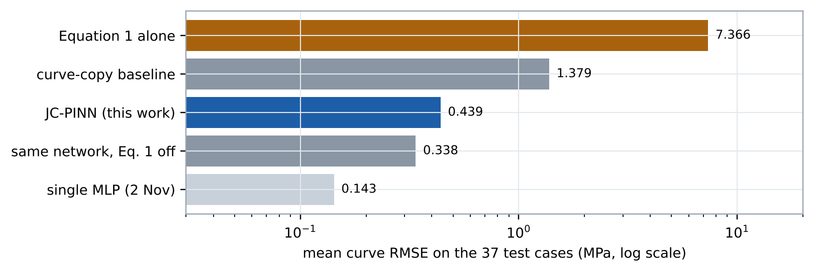

## 26. The constants inside the JC-PINN, and identifiability

| Constant | Equation 1 alone (calibrated) | Inside the JC-PINN (mean of 5 members) | Per-member range |
|---|---:|---:|---|
| A | 148.77 | 87.72 | 81.2 – 94.4 |
| B | 526.23 | 424.64 | 397.0 – 452.8 |
| n | 0.8276 | 0.9415 | 0.924 – 0.958 |
| C | 0.02925 | 0.05179 | 0.017 – 0.082 |
| m | 1.1132 | 2.742 | 1.02 – 5.38 |
| q | 0.7173 | 0.9112 | 0.752 – 1.064 |
| r | 0 (at bound) | 2 × 10⁻⁵ | 2 × 10⁻⁵ |

**Why are they so different?** With joint training and no physics penalty, the split of the stress between the backbone and the correction is **not identifiable**: a change in a constant can be offset by a change in δ, giving almost the same prediction. For example, at the study point the members' backbone alone gives only about 90 MPa at the start of the curve, and the correction multiplies it by exp(δ) ≈ 1.52 to reach 136 MPa; at large strain exp(δ) reaches about ×1.9 (×2.4 at 30 °C, 10⁻⁵ s⁻¹).

**So:** quote the "Equation 1 alone" constants as the calibrated law. The JC-PINN constants are meaningful only together with their networks, and averaging them into one set with one network would not reproduce the model.

## 27. Physical checks and extrapolation

### 27.1 Sign checks

The training pairs show four rules: stress falls with strain (except case 60) and with temperature, and rises with G and with density. We checked the signs of the model's derivatives (by autograd) at the 4,096 collocation points:

| Region | Points | ∂σ/∂E11 > 0 | ∂σ/∂T > 0 | ∂σ/∂G < 0 | ∂σ/∂ρ < 0 |
|---|---:|---:|---:|---:|---:|
| 30–200 °C (data) | 2,579 | 0 % | 0 % | 0 % | 0 % |
| 200–300 °C (no data) | 1,517 | 0 % | 0 % | 0 % | **2.5 %** |

**No wrong signs where there are data.** Between 200 and 300 °C, 2.5 % of points have stress falling with density. Strain rate is not checked, because the data themselves are mixed (at large strain, stress falls with rate at 30 °C). Sampled sign checks are empirical evidence, not an analytic guarantee.

### 27.2 Above 200 °C: unvalidated extrapolation

There are no data above 200 °C, and none will be added (decision D3). With λ = 0, **nothing constrains 200–300 °C except the Equation 1 backbone and the smooth network**. The model returns a curve at 300 °C, but it is unvalidated extrapolation. The USERMAT flags it (flag 4).

**Errata.** Two notes inside the locked files (`equation.json` validity note, `results.json` study-point note) say that 200–300 °C follows Equation 1 "through the physics term". They were written before the selection chose λ = 0, so they overstate the constraint. The corrections are recorded in `reports/jc_pinn_20261107/ERRATA.md`, and the locked files are left unchanged so the lock still verifies (decision A4). No prediction, metric or weight is affected.

### 27.3 Predicted curves at the study point

φ = 4 % (ρ = 2592 kg/m³), G = 24541 MPa (Svm in MPa):

| T (°C) | Rate (s⁻¹) | at E11 = 0.0002 | at 0.0999 | Correction exp(δ) at 0.0999 |
|---:|---:|---:|---:|---:|
| 30 | 10⁻⁵ | 131.39 | 92.97 | ×2.449 |
| 30 | 10⁻³ | 159.29 | 76.52 | ×1.635 |
| **100** | **10⁻⁴** | **136.06** | **75.41** | ×1.886 |
| 200 | 10⁻⁵ | 108.03 | 6.13 | ×0.193 |
| 200 | 10⁻³ | 142.27 | 46.03 | ×1.174 |
| 300 (extrapolation) | 10⁻⁴ | 67.60 | 4.28 | ×0.142 |

The study point (100 °C, 10⁻⁴ s⁻¹) starts at **136.06 MPa**; this is the USERMAT's initial yield stress in all the bracket runs.

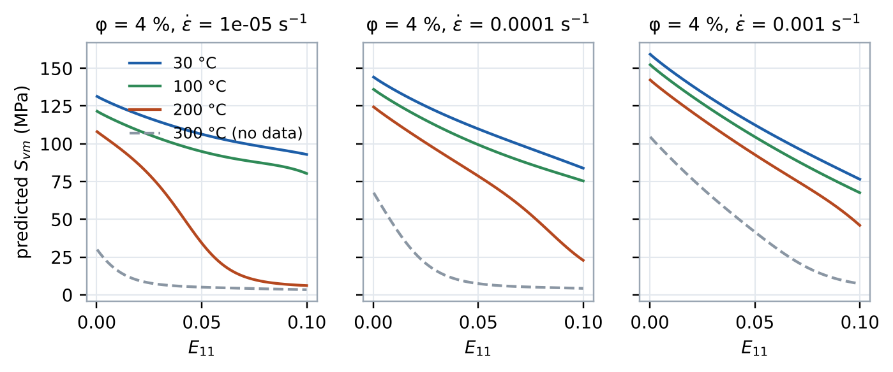

## 28. How porosity acts in the data

This analysis (9 Nov, `scripts/porosity_analysis.py`) is **post-hoc and descriptive**: it uses all 73 curves, fits nothing and changes nothing. It compares every pair of simulations that differ **in density alone** (same T, rate and G).

**Findings:**

1. **Real and consistent:** in **all 72 of 72 pairs**, lower density gives lower stress.
2. **Small:** φ 0 → 7.85 % lowers the stress by **0.34 %** on average (about **0.30 MPa**).
3. **Grows with temperature:** 0.25 % at 30 °C, 0.30 % at 100 °C and 0.53 % at 200 °C.
4. **Other inputs act far more strongly:** the full G range changes the stress by 5.45 %, about **16 times** more than porosity; going from 30 to 100 °C changes it by 10.0 %.

**Equation 1 missed it; the correction caught it.**

- The data imply a porosity exponent **r ≈ 0.041**, but both fits put r at its lower bound of zero. A 0.3 MPa effect is far smaller than Equation 1's roughly 10 MPa misfit, so least squares cannot resolve it.
- The JC-PINN carries the effect in its **correction network**, which sees density as an input: it predicts **0.31 %** over the full range (data 0.34 %), with the same sign in all 72 pairs, a pair-by-pair correlation of **0.97** over the 24 full-range pairs (0.95 over all 72), and the same growth with temperature (0.18 / 0.26 / 0.60 % at 30 / 100 / 200 °C).

**What this means for a real part.** The simulations vary density and G independently, but in a printed part both fall as porosity rises. Because G acts about 16 times more strongly, the porosity effect on a real bracket depends mainly on the relation G(φ), which these data do not define. That is why the bracket study needed decision D5 (Section 41).

**Careful wording:** r ≈ 0 does **not** mean real pores are harmless. It means that in these simulations density alone changes the stress very little, and that Equation 1's separable fit could not resolve that small effect.

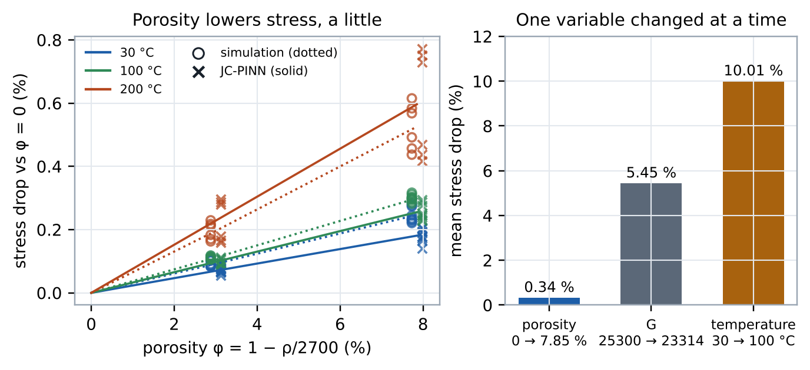

## 29. Could the model be improved? (the improvement screen)

After the lock, on training cases only (decision A2), we screened possible improvements:

| Idea | Result (training cases only) | Locked model |
|---|---|---|
| 8,000 L-BFGS iterations | case CV 2.150 | 2.098 |
| Weaker weight decay, α = 0.3 | case CV 4.072 | 2.098 |
| Wider 32–32 network | case CV 2.878 | 2.098 |
| Bounded correction (exp(δ) limited to ×⅓ … ×3), α = 0.1 | score 9.24 | 4.166 |
| Additive correction (α = 0.1 / 0.01) | score 4.94 / 5.26 | 4.166 |
| Extended backbone (B and n depend on T and rate) + exp correction | score 6.02 | 4.166 |
| Extended Equation 1 alone (13 constants, no network) | score 8.99 | 4.166 |

**None beat the locked model**, so the user decided to submit it unchanged (decision A3: "the model is fine to submit"). The strain-law floor (Section 13) explains why a correction is needed at all.

## 30. Verification and reproducibility

- **Independent re-implementation.** `scripts/verify_jc_pinn.py` rebuilds Equation 1 and the networks in plain NumPy, without importing the model code. It reproduces every JC-PINN prediction to about 3 × 10⁻¹³ MPa (Equation 1 alone exactly) and recomputes every metric.
- **Protocol checks** in the same script: the split matches `data/split.json`; training and test are disjoint; the lock hash matches the files; the lock was written before the test was read; the final fit used training cases only; each fold covers the training set once; each group holdout hides whole conditions; the selected setting is the best by the pre-registered rule; the constants are within bounds; the curves are identical to the 2 Nov hash-checked curves. **All checks pass.**
- **Deterministic rebuild.** The notebook's FAST mode retrained the final model and reproduced the locked weights exactly (test RMSE 0.43862877347121765).
- **Numbers come from files.** `scripts/write_latex_numbers.py` writes `report/numbers.tex` and `numbers.json`, which the report, paper and slides read. `scripts/make_figures.py` makes every figure.
- **Notebooks.** `notebooks/jc_pinn_colab.ipynb` runs on Colab, Kaggle or locally in three modes: `PREDICT` (no data needed), `FAST` (retrain the final model) and `FULL` (repeat the whole selection). `notebooks/jc_pinn_explained.ipynb` explains everything and computes every number live. Hosted Colab/Kaggle runs are still unverified (Q8).

> **Remember (Part E).** Selection on training only: 3 case folds + 9 group holdouts, score = ½(CV + groups), 14 settings, 504 fits. Winner: λ = 0, joint (CV 2.098, groups 6.235, score 4.166). Lock with SHA-256 before reading the test. Test: 0.439 mean curve RMSE, median 0.395, worst 0.841 (case 10), R² 0.99952, 94.9 % within ±1 MPa, bias +0.009. Weakest condition 30 °C/10⁻⁴ (1 training case). Control without Equation 1: 0.338 test, 5.629 groups → better. Plain MLP: 0.143 test, 11.90 groups. Porosity in data: −0.34 % over 0–7.85 %, 72/72 pairs; r implied 0.041 but fitted 0; G acts 16× more.

---

# Part F. From model to finite-element material (USERMAT)

Everything in Parts F, G and H was done **after the lock**, with the locked weights unchanged: nothing was refitted and no test case was touched.

## 31. Background: the continuum mechanics you need

### 31.1 Stress and the von Mises equivalent stress

- **Mean (hydrostatic) stress:** $p_h=\tfrac13\operatorname{tr}\boldsymbol\sigma$.
- **Deviatoric stress:** $\mathbf s=\boldsymbol\sigma-p_h\mathbf I$.
- **von Mises equivalent stress:**

$$
q=\sigma_{vm}=\sqrt{\tfrac32\,\mathbf s:\mathbf s}=\sqrt{3J_2}
=\sqrt{\tfrac12\left[(\sigma_1-\sigma_2)^2+(\sigma_2-\sigma_3)^2+(\sigma_3-\sigma_1)^2\right]}
$$

Under uniaxial stress q = |σ₁₁|; under pure shear τ, q = √3·|τ|; under pure hydrostatic stress q = 0. Von Mises yielding is **pressure-insensitive**, which suits an ideal isotropic ductile metal. It is **not** a crack-opening stress (that is the maximum principal stress S1 normal to the crack).

### 31.2 Small strain and isotropic elasticity

$$
\boldsymbol\varepsilon=\tfrac12\left(\nabla\mathbf u+\nabla\mathbf u^{\top}\right),\qquad
\boldsymbol\varepsilon=\boldsymbol\varepsilon^{e}+\boldsymbol\varepsilon^{p},\qquad
\boldsymbol\sigma=2G\,\boldsymbol\varepsilon^{e}+\lambda_L\operatorname{tr}(\boldsymbol\varepsilon^{e})\,\mathbf I
$$

$$
E=2G(1+\nu),\qquad K=\frac{E}{3(1-2\nu)},\qquad \lambda_L=\frac{2G\nu}{1-2\nu}
$$

At the study point (G = 24541 MPa, ν = 0.33, assumed): **E = 65,279 MPa**, K = 63,999 MPa, λ_L = 47,638 MPa. (λ_L is the Lamé constant, not the physics weight λ.)

### 31.3 J2 (von Mises) plasticity

- **Yield function:** $f=q-\sigma_y(\bar\varepsilon_p)\le0$. Elastic while f < 0; plastic flow when f = 0.
- **Associated (normal) flow rule:** $d\boldsymbol\varepsilon^{p}=d\bar\varepsilon_p\,\tfrac32\,\mathbf s/q$. Plastic flow is deviatoric, so $\operatorname{tr}(d\boldsymbol\varepsilon^p)=0$ (plastic incompressibility).
- **Equivalent (accumulated) plastic strain:** $d\bar\varepsilon_p=\sqrt{\tfrac23\,d\boldsymbol\varepsilon^p:d\boldsymbol\varepsilon^p}$. In a uniaxial test the plastic strain tensor is (p, −p/2, −p/2).
- **Hardening modulus:** $H=d\sigma_y/d\bar\varepsilon_p$. H > 0 hardening, H = 0 perfectly plastic, **H < 0 softening (our model)**.
- **Isotropic hardening** changes the size of the yield surface; **kinematic hardening** shifts it (Bauschinger effect). Our USERMAT is isotropic, which suits the monotonic data.
- **Uniaxial tangent:** with total strain dε = dσ/E + dε_p and dσ = H dε_p, the slope against total strain is $E_t=EH/(E+H)$. So a slope measured against total strain is not the plastic modulus H.

**Why the strain mapping is an assumption.** The data's strain E11 is total strain, but the USERMAT feeds the model the equivalent plastic strain (decision M4, "ε_p = E11"). At the study-point yield stress the elastic strain is about 136/65,279 ≈ 0.002. So the mapping shifts the curve by about 0.002 in strain: large compared with the first grid point (0.0002), small compared with the 0.1 range. It is a stated modelling approximation, not an identity shown by the data.

## 32. The USERMAT

### 32.1 What a USERMAT is

**Background.** ANSYS's *User Programmable Features* let you supply your own material routine, **USERMAT**, in Fortran. At every integration point, in every equilibrium iteration, ANSYS calls it with the stress and state variables at the start of the increment and the **strain increment**. The routine must return:

1. the **updated stress**;
2. the **material Jacobian** (tangent stiffness) $\partial\Delta\boldsymbol\sigma/\partial\Delta\boldsymbol\varepsilon$, which ANSYS needs for its global Newton–Raphson iterations;
3. the **updated state variables** (here plastic strain and flags).

### 32.2 Our routine

`umat/jc_pinn_usermat3d.F` is generated by `scripts/write_umat.py` **from the locked weights** in `equation.json`, not refitted (decision U1). It has a thin ANSYS wrapper (`usermat3d`) around a generated core:

| Routine | Job |
|---|---|
| `JCPRM` | the stress update: elastic trial and radial return, consistent tangent |
| `JCPFLW` | the flow stress and its slope, with the strain range handling and the range flags |
| `JCPSIG` | the five-member network and Equation 1, with the analytic slope dσ/dp |

- **Constitutive model:** small-strain J2 plasticity with isotropic hardening/softening, whose flow stress is the locked JC-PINN: $\sigma_y=\exp\left(\tfrac15\sum_k[\ln\sigma_{JC,k}+\delta_k]\right)$, evaluated exactly as in `src/jc_pinn.py`.
- **Elasticity:** from G (constant 4, or constant 7 if set) and an **assumed** Poisson's ratio ν = 0.33 (constant 5). ν is not in the data.
- **Elements:** `usermat3d` covers 3D solids (SOLID185/186/187), plane strain and axisymmetric elements (PLANE182/183), which all have three direct stress components. **Plane stress, beams and shells are not provided.** Components are in ANSYS order 11, 22, 33, 12, 23, 13.

### 32.3 Inputs (TB,USER constants) and outputs (TB,STATE variables)

| Constant | Meaning |
|---|---|
| 1 | T (°C), used when constant 6 = 0 |
| 2 | strain rate (s⁻¹): **a fixed condition**, not computed from the analysis |
| 3 | density (kg/m³); φ = 1 − ρ/2700; 2592 at the 4 % study point |
| 4 | G (MPa): the model input and, by default, the elastic shear modulus |
| 5 | ν (**assumed**, 0.33) |
| 6 | 0 = T from constant 1; 1 = T from the analysis temperature |
| 7 | optional elastic shear modulus (0 = use constant 4) |

| State variable | Meaning |
|---|---|
| SVAR1 | equivalent plastic strain (EQPS) |
| SVAR2 | current flow stress (MPa) |
| SVAR3 | range flag, kept for the whole history |
| SVAR4 | Newton iterations in the last increment |

**The range flag is a sum of bits:**

- **1** = EQPS above 0.0999 (flow stress held flat beyond the data);
- **2** = T outside 30–300 °C, or rate, density or G outside the data range;
- **4** = 200 < T ≤ 300 °C (no data, unvalidated).

So 250 °C alone, with everything else in range, gives flag **4**, not 6. A run at the study point that passes EQPS = 0.0999 shows flag 1. Conditions outside the data are **flagged, not clamped** (decision U3), so extrapolation is visible in the results.

**Strain handling** (decision U2):

- below EQPS = 0.0002 the flow stress is held at σ(0.0002), which is the **initial yield stress** (136.06 MPa at the study point);
- above 0.0999 it is held at σ(0.0999) (perfectly plastic) and flag 1 is set;
- the slope is zero strictly outside the interval.

**Example input (Mechanical APDL):**

```text
TB,USER,1,1,7              ! material 1, 1 temperature, 7 constants
TBTEMP,0
TBDATA,1,100,1.0E-4,2592,24541,0.33,0
TBDATA,7,0
TB,STATE,1,,4              ! 4 state variables
```

In Workbench the same lines go in a **Command Snippet** under the body. Engineering Data must still hold an isotropic elasticity entry consistent with E = 2G(1 + ν) ≈ 65,279 MPa, but the solver uses the stiffness the USERMAT returns. Add `OUTRES,SVAR,ALL` to save the state variables.

**Other limits of the routine:** the thermal tangent terms are zero (not for coupled thermal–structural steps); the strain rate is fixed; there is no regularisation of softening.

## 33. The return-mapping algorithm

### 33.1 Derivation

Within one increment, with the old state ($\boldsymbol\sigma_n$, $\bar\varepsilon_{p,n}$) fixed:

1. **Elastic predictor (trial state).** Assume the whole increment is elastic:
   $\boldsymbol\sigma^{tr}=\boldsymbol\sigma_n+\mathbf C^{e}:\Delta\boldsymbol\varepsilon$, with deviator $\mathbf s^{tr}$ and von Mises stress $q^{tr}$.
2. **Check yield.** If $q^{tr}\le\sigma_y(\bar\varepsilon_{p,n})$ the step is elastic: accept the trial stress and return the elastic stiffness.
3. **Plastic corrector.** Otherwise, by backward Euler with the associated flow rule, $\Delta\boldsymbol\varepsilon^p=\Delta p\,\tfrac32\,\mathbf s^{tr}/q^{tr}$ (the return is **radial**: the new deviator is parallel to the trial deviator). The elastic correction is $2G\,\Delta\boldsymbol\varepsilon^p=3G\,\Delta p\,\mathbf s^{tr}/q^{tr}$, so

$$
\mathbf s_{n+1}=\left(1-\frac{3G\,\Delta p}{q^{tr}}\right)\mathbf s^{tr},\qquad q_{n+1}=q^{tr}-3G\,\Delta p ,
$$

   and the hydrostatic stress is unchanged.
4. **Consistency:** the new state must lie on the yield surface, $q_{n+1}=\sigma_y(\bar\varepsilon_{p,n}+\Delta p)$. This gives **one scalar equation** for Δp:

$$
\boxed{\,g(\Delta p)=q^{tr}-3G\,\Delta p-\sigma_y\left(\bar\varepsilon_{p,n}+\Delta p\right)=0\,}
$$

5. **Newton's method:** $g'(\Delta p)=-3G-H$, so $\Delta p\leftarrow\Delta p+g/(3G+H)$. The denominator is **3G + H** (not 2G + H).
6. **Update:** $\mathbf s_{n+1}=(\sigma_y/q^{tr})\,\mathbf s^{tr}$, $\boldsymbol\sigma_{n+1}=\mathbf s_{n+1}+p_h\mathbf I$, $\bar\varepsilon_{p,n+1}=\bar\varepsilon_{p,n}+\Delta p$.

### 33.2 How `JCPRM` implements it (as in the code)

- Elastic if $q^{tr}\le(1+10^{-10})\,\sigma_{y0}$.
- The root is **bracketed** in $[0,\ q^{tr}/(3G)]$ (the upper end is where $q_{n+1}$ would reach zero).
- Each iteration takes the Newton step; if 3G + H ≤ 0, or the Newton step would leave the bracket, it takes the **bisection** (midpoint) step instead. This is a **safeguarded Newton** method.
- Converged when $|g|\le10^{-12}\,\sigma_y$; at most 50 iterations.
- If it does not converge, the wrapper sets **`keycut = 1`**, and ANSYS **bisects the substep** and tries again from the last converged state.
- Error codes: 2 = Equation 1 not positive (for example T ≥ T_M); 3 = 3G + H ≤ 0 at the solution (softening too steep); 4 = bad constants (rate ≤ 0, ν outside (−1, 0.5), or not three direct components). These are reported through ANSYS's error handler.

**Softening and the local solve.** Our H is negative, but 3G ≈ 73,600 MPa at the study point, far larger than |H|, so 3G + H > 0 and the *local* scalar equation is well posed. That does **not** make the *global* boundary-value problem well posed: softening still localises and makes the bracket mesh dependent (Section 43).

### 33.3 The analytic slope H = dσ_y/dp

The return map and the tangent need the slope of the flow stress. `JCPSIG` computes it **analytically** by the chain rule. For each member k,

$$
\frac{d\ln\sigma_k}{dp}=\underbrace{\frac{-nBp^{\,n-1}}{A-Bp^{\,n}}}_{\text{Equation 1 strain term}}+\underbrace{\frac{d\delta_k}{dp}}_{\text{through both tanh layers, with }1/s_{E11}}
$$

using $\tanh'(x)=1-\tanh^2(x)$ and the input scale $1/s_{E11}$ from the standardisation. For the geometric ensemble,

$$
H=\frac{d\hat\sigma}{dp}=\hat\sigma\cdot\frac15\sum_{k=1}^{5}\frac{d\ln\sigma_k}{dp}.
$$

## 34. The consistent (algorithmic) tangent

ANSYS solves global equilibrium by Newton–Raphson, which converges quadratically only if the tangent is the exact derivative of the *discrete* stress update: $\mathbf C^{alg}=\partial\boldsymbol\sigma_{n+1}/\partial\Delta\boldsymbol\varepsilon$ with the old state fixed. This **consistent (algorithmic) tangent** is not the elastic tensor, and not the continuum elastoplastic tangent. For J2 radial return it is

$$
\mathbf C^{alg}=K\,\mathbf I\otimes\mathbf I+2G\theta\,\mathbb I_{dev}+\left(\frac{3GH}{3G+H}-3G\theta\right)\mathbf f\otimes\mathbf f,
\qquad \theta=\frac{\sigma_y}{q^{tr}},\quad \mathbf f=\frac{\mathbf s^{tr}}{q^{tr}}
$$

This is exactly what `JCPRM` builds (`EFFG` = Gθ, `EFFLAM` = K − ⅔Gθ, `EFFHRD` = 3GH/(3G+H) − 3Gθ). It equals the standard textbook form $K\mathbf I\otimes\mathbf I+2G\theta\,\mathbb I_{dev}+6G^2\left(\Delta p/q^{tr}-1/(3G+H)\right)\bar{\mathbf n}\otimes\bar{\mathbf n}$ with the unit normal $\bar{\mathbf n}=\sqrt{3/2}\,\mathbf f$. When Δp → 0 (θ → 1) it reduces to the continuum elastoplastic tangent.

## 35. Verification of the USERMAT

**Verification vs validation.** *Verification* asks "does the code solve the model correctly?" *Validation* asks "is the model right about reality?" Everything below is **verification**. Nothing in the project is experimentally validated.

### 35.1 Offline, against the Python model

`scripts/verify_umat.py` compiles the routine with gfortran and an offline driver (`umat/test/umat_driver.F`) and writes `umat/verification.json`. **All checks pass.**

| Check | Result |
|---|---|
| Flow stress against `equation_predict` at 2,000 points | max relative difference **2 × 10⁻¹⁵** |
| Slope against finite differences | 3 × 10⁻⁹ |
| Single-element uniaxial stress (4 conditions, 3D and 4-component, 20 or 1,000 increments) | stays on the flow curve to 7 × 10⁻¹⁰; independent of increment size (spread 10⁻¹² MPa) |
| Consistent tangent against finite differences | 10⁻¹⁰ |
| Range flags | all 5 flag cases set correctly |
| Plastic strain tensor | matches the uniaxial (p, −p/2) to 10⁻¹⁷ |

### 35.2 In ANSYS: the single-element test (17 Nov 2026)

- **Build:** MAPDL 2024 R1 (v241). In v241 the stock `usermat3d` sits inside `usermat.F` (lines 535–934), so it was removed there and our file added as `usermat3d.F`. The library was built with **ifx 2026.2** and Visual Studio 2019 Build Tools, because the ifort 2023 that the v241 guide asks for can no longer be downloaded. The script `build_ifx.bat` repeats the steps of ANSYS's `ANSUSERSHARED.bat` with ifx. The result is `usermatLib.dll`, found through the environment variable **`ANS_USER_PATH`**.
- **Test:** `umat/ansys_test/single_element.mac` pulls one **SOLID185** cube to **ε₁₁ = 0.12** at the study point (100 °C, 10⁻⁴ s⁻¹, ρ 2592, G 24541) in 240 substeps.
- **Result: PASS.** At all **240 substeps**, MAPDL's σ₁₁ matches the offline result to **1.2 × 10⁻⁵ MPa** (tolerance 0.1 MPa; the difference is the rounding of the 8-digit CSV output). Final values: **σ₁₁ = 75.41 MPa, EQPS = 0.1188, flag 1** (strain beyond the data). The peak is 135.82 MPa at ε₁₁ = 0.0025.
- **Problems found and fixed:** `OUTRES,ALL` does not write state variables (fix: `OUTRES,SVAR,ALL`); the CSV had one row because `*GET ... NSETS` ran before POST26 stored data (fix: `STORE,MERGE`); the README's build steps did not match the v241 layout. The Fortran, the expected curve and the tolerance were not changed.

This test checks the routine and the build inside ANSYS. It does not validate the material.

> **Remember (Part F).** USERMAT = J2 radial return with the JC-PINN as flow stress σ_y(p), elasticity from G and assumed ν = 0.33 (E = 65,279 MPa). Local equation q_tr − 3GΔp − σ_y(p+Δp) = 0, safeguarded Newton with denominator 3G + H, keycut = 1 on failure. Analytic slope by the chain rule; consistent tangent for quadratic global convergence. Flags 1 / 2 / 4, flagged not clamped. Verified offline to 2e-15, in MAPDL to 1.2e-5 MPa (final σ 75.41 MPa at EQPS 0.1188, flag 1).

---

# Part G. The bracket

## 36. Background: the finite-element method you need

1. **Strong form.** Quasi-static equilibrium $\nabla\cdot\boldsymbol\sigma+\mathbf b=\mathbf 0$ in the body, with prescribed displacements $\mathbf u=\bar{\mathbf u}$ on part of the boundary and prescribed tractions $\boldsymbol\sigma\mathbf n=\bar{\mathbf t}$ on the rest.
2. **Weak form (virtual work).** Multiply by a virtual displacement **v** (zero where u is prescribed) and integrate by parts:
   $\int_V\boldsymbol\varepsilon(\mathbf v):\boldsymbol\sigma\,dV=\int_V\mathbf v\cdot\mathbf b\,dV+\int_{\Gamma_t}\mathbf v\cdot\bar{\mathbf t}\,dA$.
3. **Discretisation.** Inside each element, $\mathbf u=\mathbf N\mathbf d$ (shape functions N, nodal displacements d) and $\boldsymbol\varepsilon=\mathbf B\mathbf d$ (B holds the shape-function derivatives).
4. **Internal force and residual.** $\mathbf f_{int}=\sum_e\int_{V_e}\mathbf B^{\top}\boldsymbol\sigma\,dV$, evaluated by Gauss quadrature at **integration points**; residual $\mathbf R=\mathbf f_{ext}-\mathbf f_{int}(\mathbf d)$.
5. **Newton–Raphson.** Solve $\mathbf K_t\,\Delta\mathbf d=\mathbf R$ and repeat until R is small. $\mathbf K_t=\sum\int\mathbf B^{\top}\mathbf C^{alg}\mathbf B\,dV$ uses the material tangent from the USERMAT. The material law is evaluated **locally** at every integration point; equilibrium is solved **globally**.
6. **Load stepping.** The load is applied in substeps; ANSYS's automatic time stepping bisects a substep that fails to converge.
7. **Reactions** are recovered at the constrained degrees of freedom.

**Displacement control.** We impose a displacement and read the reaction force. A force-controlled analysis cannot pass a peak (limit point) of the load, but a displacement-controlled one can follow a **falling reaction after the peak**. That is how the bracket's softening branch is traced.

**Element types used in the project:**

| Element | Description | Used for |
|---|---|---|
| SOLID186 | 20-node quadratic 3D solid (with degenerate wedge forms) | the bracket (7,304 elements) |
| SOLID185 | 8-node linear 3D solid | the single-element USERMAT test |
| PLANE183 | 8-node quadratic 2D solid (plane strain here) | the 2D crack model |

Quadratic elements represent bending and curved boundaries better than linear ones of the same size.

**Plane strain vs plane stress.** Plane strain (ε_zz = 0) suits thick bodies where out-of-plane strain is restrained; plane stress (σ_zz = 0) suits thin plates.

**Stress singularities.** At sharp re-entrant corners and at the edge of a fully fixed face, the elastic stress is theoretically infinite, so the computed peak keeps rising as the mesh is refined. Such points (here, the corners of the mounting faces) must be excluded when reading stresses.

**Small strain.** All bracket runs are small-strain (NLGEOM off).

## 37. The bracket finite-element model

The team's ANSYS Workbench project (`bracket/ansys/Elastic.wbpj`, 2026 R1) was turned into MAPDL batch decks by `bracket/ansys_usermat/make_decks.py`, without changing its mesh or supports, and solved in **MAPDL 2024 R1**.

| Item | Setting |
|---|---|
| Geometry | `Rib Bracket.STEP` (Section 2.1) |
| Mesh | **7,304 quadratic SOLID186 elements**, about **5 mm** (34,763 nodes) |
| Supports | **both mounting faces at x = 210 mm fixed** |
| Load | **UY = +2 mm imposed on the upper half of the Ø10 mm bore** (nodes with y ≥ 0); UX and UZ free |
| Analysis | static, small strain, automatic substepping (20 initial, 10 minimum, 1,000 maximum substeps) |
| Output | reaction along y at the fixed support (−RFY) against the imposed UY; element stresses and plastic strain |

### 37.1 The load correction (18 Nov 2026)

- **Why only the upper half of the bore?** A pin can only *push*. It bears on the half of the bore that the load drives it into; on the other half a gap opens. Loading the whole bore would pull on the lower half and spread the force over twice the area.
- **The pin load is +P_y**, the wing-normal upload. The team's Workbench file had imposed UX = −2 mm on the whole bore. On 18 Nov the user corrected it, from the load figure, to UY = +2 mm on the upper half (`make_decks.py --load plus_y`), and **every bracket study was re-run** (14 MAPDL runs, 0 errors).
- The earlier −X runs (folders `*_2026-11-17` without `_uy`, for example a peak of 190.4 kN at −0.455 mm) are **superseded** and kept as evidence only. Under +P_y the bracket bends, so it is about 4.6 times more compliant than under the old load.
- The imposed displacement is a **way to load the model, not a service load**. No service load magnitude exists for this bracket.

## 38. The team's first ANSYS comparison (explicit dynamics)

Before the JC-PINN, the team ran three **Explicit Dynamics (AUTODYN)** systems in the Workbench project *Comparison Study – Final*, each importing the bracket STEP with a different material card:

| Run | Material | Peak von Mises at t = 0.06 s | Where |
|---|---|---:|---|
| A. Elastic | σ = Eε; never yields | 595.27 MPa | fixed corner of the upper mounting face (possible constraint singularity) |
| B. Built-in JC | ANSYS's Johnson–Cook strength (hardening, rate and temperature terms) | 320.79 MPa | around the bore |
| C. User-defined JC | multilinear (ε_p, σ_y) table entered by the team; source unconfirmed | 323.81 MPa | around the bore |

- The elastic peak is **1.86 times** the built-in JC peak: plasticity lowers the peak by about 46 %.
- C differs from B by **0.94 %**. That is one number at one instant; it does not validate the material law or any coupling of our model to ANSYS.
- The set-up (load history, mesh, energy balance) was not archived, and these are the team's screenshots, not re-run.
- An ANSYS plasticity table expects plastic strain, while our data use total strain E11, so converting them needs a confirmed Young's modulus.

Our model later entered ANSYS through its own USERMAT (the rest of Part G).

## 39. Three materials on the bracket (5 mm mesh, φ = 4 %)

| | Elastic | Elastic–plastic (EP, MISO) | **JC-PINN USERMAT** |
|---|---:|---:|---:|
| Material | Workbench "AlSi10Mg – E": EX 76,600 MPa (at 25 °C), ν 0.33 | Workbench "AlSi10Mg – EP": multilinear hardening, yield 251.45 MPa rising to 524.3 MPa at ε_p = 0.07 | study point: 100 °C, 10⁻⁴ s⁻¹, ρ 2592, G 24541, ν 0.33 (E = 65,279 MPa) |
| Initial stiffness (kN/mm) | 140.8 | 140.8 | **120.0** |
| Peak reaction (kN) | 281.5 (at 2 mm, linear) | 220.5 (at 2 mm, still hardening) | **100.5 at UY = 1.150 mm** |
| Reaction at 2 mm (kN) | 281.5 | 220.5 | **86.3** (softened) |
| Max element von Mises at 2 mm (MPa) | 690 | 321 | 136.0 |
| Max element plastic strain at 2 mm | 0 | 0.012 | 0.12 (SVAR1 0.119) |
| Elements flagged (EQPS > 0.0999) | – | – | 102 of 7,304 |
| Wall time | 13 s | 27 s | 46 s |

**Two checks tie the bracket run to the material:**

1. **Stiffness ratio:** 120.0 / 140.8 = **0.852** = 65,279 / 76,600, the USERMAT's E = 2G(1 + ν) over the Workbench modulus. So the stiffness difference has a simple elastic explanation; it is not a neural-network effect.
2. **Peak element stress:** 136.0 MPa, the peak of the model's flow curve at the study point (136.06 MPa).

**Where the plastic strain goes:** the JC-PINN's largest plastic strain is at the **loaded half of the bore**; the EP card's is at the **R10 crotch fillet**.

**What the comparison does and does not show.** The EP card is a **different material condition** (yield 251 MPa, hardening, no recorded source). The comparison only shows that the three decks behave alike apart from the material. It is **not a validation** of the JC-PINN. The 102 flagged elements are beyond the data's strain range, where the flow stress is held flat (extrapolation). The 100.5 kN peak is a displacement-controlled numerical peak: it is **not** a failure load, an ultimate load or a design allowable.


**Zone results (elastic run, per kN of pin load, `zones_uy_2026-11-18/`).** The R10 fillet is the highest real stress feature: maximum principal stress S1 = **4.14 MPa/kN** at (31.1, 14.3) mm, von Mises **3.788 MPa/kN**. Other zones: bore–fillet ligament 2.36, lower arm root 2.12, bore 1.78 MPa/kN (S1). The mounting-face corners are singular and excluded. These values set the limit load in Part H.

**The same model in Workbench 2024 R1** (`workbench_2024R1/`, a post-hoc re-run so the USERMAT model can be opened in Workbench): a swept 5 mm mesh of 6,696 SOLID186 elements gives the same stiffness (120.0 kN/mm) and a peak of 102.9 kN at 1.22 mm (2.3 % from the batch run). After the peak the two meshes differ (93.0 against 86.3 kN at 2 mm, 7.8 %), as expected for a softening material.

## 40. Porosity on the bracket: density only

Five USERMAT runs differ only in density and G (100 °C, 10⁻⁴ s⁻¹, 5 mm mesh):

| Case | ρ (kg/m³) | φ | G (MPa) | Peak (kN) | Change in peak | F at 2 mm (kN) | Change at 2 mm |
|---|---:|---:|---:|---:|---:|---:|---:|
| phi0 | 2700 | 0 % | 24541 | 100.6 | reference | 86.4 | reference |
| phi4 | 2592 | 4 % | 24541 | 100.5 | −0.08 % | 86.3 | −0.14 % |
| phi785 | 2488.05 | 7.85 % | 24541 | 100.4 | **−0.17 %** | 86.2 | −0.27 % |
| G_lo | 2592 | 4 % | 23313.95 | 98.5 | −1.97 % vs phi4 | 83.7 | |
| G_hi | 2592 | 4 % | 25300 | 101.8 | +1.29 % vs phi4 | 88.0 | |

- **Density alone** (G fixed), φ 0 → 7.85 %: the peak changes by **−0.17 %**. This matches the model's single-element change near first yield, **−0.15 %**. At 2 mm the change is −0.27 %, inside the single-element range at large strain (up to −0.37 %).
- **G matters more:** the data's G range at φ = 4 % (G −5.0 % and +3.1 %) moves the peak by −1.97 % and +1.29 %. Part of this comes from the elastic stiffness, which also scales with G. **Per percent change of the input, G acts about 19 times more strongly than density** on the bracket peak (16 times in the material data, Section 28).

These numbers are only the density part of the porosity effect. In a printed part, G also falls with porosity.

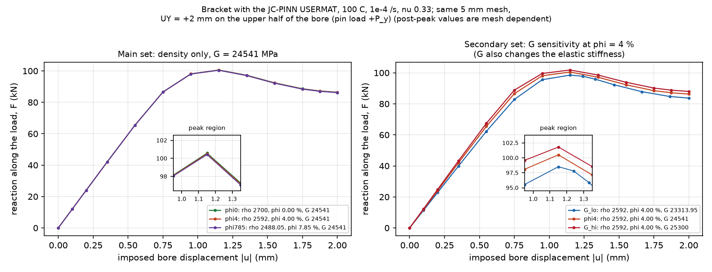

## 41. The shear modulus against porosity, G(φ)

### 41.1 Background: effective stiffness of a porous solid

Pores carry no load, so a porous solid is less stiff than the dense one. Simple relations (G₀ = dense shear modulus):

| Relation | Formula | Notes |
|---|---|---|
| **Linear (Voigt) rule** | $G=G_0(1-\phi)$ | Uniform-strain assumption; the **upper bound** for any pore shape |
| Reuss (uniform stress) | → 0 with voids | The lower bound becomes useless when one phase has zero stiffness |
| Dewey–Mackenzie (dilute spherical pores) | $G=G_0(1+[G]\phi)$, $[G]=-\dfrac{15(1-\nu_0)}{7-5\nu_0}$ | [G] = **−1.88** at ν₀ = 0.33; valid for small φ |
| Hashin–Shtrikman upper bound (spherical voids) | $G=G_0\dfrac{1-\phi}{1+\beta\phi}$ | Tighter upper bound for isotropic random materials (β = 0.879 here) |
| Coble–Kingery, Spriggs | quadratic / exponential extensions | Spriggs' constant is normally fitted to measurements |

Real LPBF pores, especially irregular lack-of-fusion voids, lower the stiffness faster than spherical-pore formulas predict.

### 41.2 Decision D5: G = 25300 (1 − φ)

No measured G(φ) exists for our material, and no LPBF AlSi10Mg relation with readable constants was found. On 17 Nov the user chose the **linear (Voigt) rule** (option 1 of the proposal):

$$
G(\phi)=25300\,(1-\phi)\ \text{MPa}\quad\Rightarrow\quad G=25300,\ 24288,\ 23313.95\ \text{MPa at}\ \phi=0,\ 4,\ 7.85\,\%
$$

**Why this choice:**

1. The data's three G levels follow it **exactly** (Section 6.3).
2. It keeps every input **inside the data's G range**, so the model does not extrapolate in G (no flag 2). The Mackenzie slope (−1.88) would give 21,569 MPa at 7.85 %, below the data's lowest G.

**What it means:** it is the **stiffest possible** G(φ), so porosity effects computed with it are a **lower estimate**. It is an explicit assumption, not a measurement (open question Q4). Careful: an upper bound on the elastic stiffness is not a rigorous bound on the nonlinear peak force, so call the result "a lower estimate under D5", not a proven bound.

## 42. Porosity with G coupled (decision D5)

Three USERMAT runs couple density and G (100 °C, 10⁻⁴ s⁻¹, 5 mm mesh):

| Case | φ | ρ (kg/m³) | G (MPa) | Initial stiffness (kN/mm) | Peak (kN), at UY | Change in peak | F at 2 mm (kN) | Change at 2 mm |
|---|---:|---:|---:|---:|---:|---:|---:|---:|
| gphi0 | 0 | 2700 | 25300 | 123.7 | 101.9 at 1.150 mm | reference | 88.1 | reference |
| gphi4 | 4 % | 2592 | 24288 | 118.7 | 100.1 at 1.150 mm | −1.79 % | 85.7 | −2.68 % |
| gphi785 | 7.85 % | 2488.05 | 23313.95 | 114.0 | 98.4 at 1.150 mm | **−3.38 %** | 83.6 | **−5.12 %** |

From φ = 0 to 7.85 %:

- the elastic stiffness changes by **−7.85 %**, exactly the G ratio;
- the peak reaction changes by **−3.38 %** (101.9 → 98.4 kN);
- the reaction at 2 mm changes by **−5.12 %**.

**Interpretation:**

- Density alone gave only −0.17 %, so **porosity acts on the bracket almost entirely through G**.
- The model's single-element change is −2.27 % near yield and −6.77 % at the end of the data. The bracket's change at 2 mm lies inside that range. The peak changes more than the near-yield value because the elastic stiffness falls too.
- Because D5 is the upper bound, **−3.38 % is a lower estimate** of the porosity effect.
- The force at 2 mm is after the peak, so like every post-yield value it depends on the mesh.

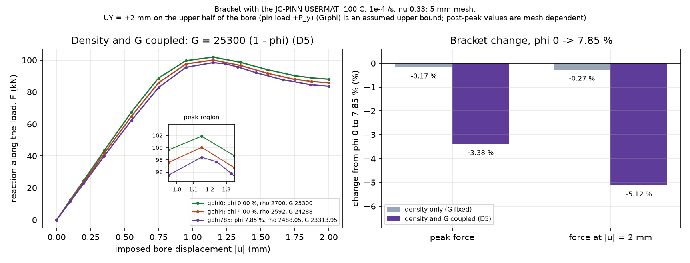

## 43. Mesh dependence

### 43.1 The study

Each element was split 2 × 2 × 2 in its own shape functions (`refine_mesh.py`): **58,432 elements of about 2.5 mm** (255,111 nodes), with the same geometry, supports and load. This is a **uniform refinement, not a Workbench remesh**.

| | 5 mm | 2.5 mm | Change |
|---|---:|---:|---:|
| Elements / nodes | 7,304 / 34,763 | 58,432 / 255,111 | |
| Initial stiffness (kN/mm) | 119.95 | 119.82 | **−0.11 %** |
| Peak (kN), at UY | 100.5 at 1.150 mm | 90.6 at 0.845 mm | **−9.8 %** |
| F at UY = 1.150 mm (kN) | 100.5 | 81.2 | −19.2 % |
| F at UY = 1 mm (kN) | 98.7 | 84.5 | −14.3 % |
| F at 2 mm (kN) | 86.3 | 77.4 | −10.3 % |
| Max element EQPS | 0.12 | 0.32 | ×2.66, still rising |
| Flagged elements (EQPS > 0.0999) | 102 | 648 | |
| Substeps, bisections, wall time | 12, 0, 46 s | 19, 3, 3,635 s | |

- **Elastic check:** the stiffness changes by only −0.11 %, so the supports and load carried over to the refined mesh correctly.
- **Not converged after yield:** the peak and the forces after it change by about 10 to 20 %, and at 2 mm the meshes still differ by −10.3 %. The plastic strain **localises at the loaded half of the bore** and keeps rising.

### 43.2 The same refinement with a hardening material

| | EP (hardening) change | USERMAT (softening) change |
|---|---:|---:|
| Peak force | −0.69 % | −9.8 % |
| F at 1.150 mm | −0.31 % | −19.2 % |
| F at 1 mm | −0.22 % | −14.3 % |
| F at 2 mm | −0.69 % | −10.3 % |
| Max local plastic strain | ×1.51 (at the R10 fillet) | ×2.66 (at the bore) |

With the hardening EP card the force changes by **at most 0.7 %**, so **93–98 % of the JC-PINN's change comes from its softening**. The local peak plastic strain is not converged for either material (it also grows ×1.51 for EP), because of the stress concentration at the load patch and fillet.

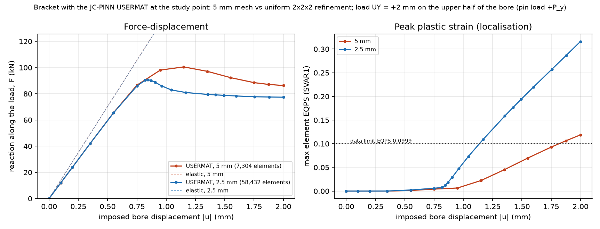

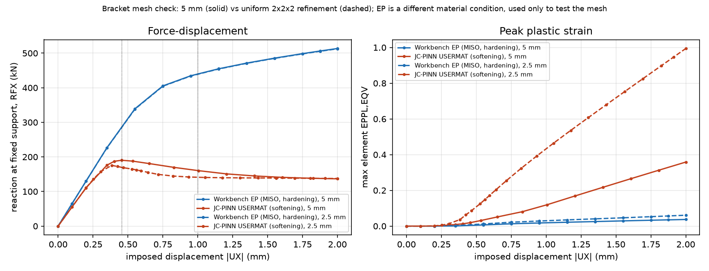

### 43.3 Why softening makes the result mesh dependent

**Background.** When H < 0, the stress falls as strain grows. Any element that yields slightly more than its neighbours becomes weaker and attracts even more strain, so deformation **localises** into a band. With a local (classic) continuum model, nothing sets the band's width, so it shrinks to **one element**. The governing equations lose ellipticity: the boundary-value problem becomes ill-posed.

Consequences:

- The energy dissipated in the band is roughly (band width h) × ∫σ dε_p, so it **falls with the element size**. Refining the mesh makes failure "cheaper", and the post-peak force drops.
- The peak force and the post-peak branch therefore depend on the element size, and the local plastic strain grows without limit under refinement.
- Smaller load increments can help the local solve converge, but cannot fix this: it is a property of the continuum model, not of the numerics.

**Regularisation (future work)** gives the model a **length scale**:

- crack-band / fracture-energy scaling of the softening with the element size;
- nonlocal or gradient-enhanced plasticity/damage;
- phase-field or cohesive-zone formulations;
- viscous (rate) regularisation, which must then be calibrated.

Each needs extra material parameters. None is in the submitted model.

**Conclusion (state it plainly):** the bracket forces after yield, **including the peak**, are specific to the mesh. They are not a converged strength.

> **Remember (Part G).** 7,304 SOLID186 (5 mm), fixed at x = 210 mm, UY = +2 mm on the upper half of the bore (corrected 18 Nov; a pin only pushes). Elastic 140.8 kN/mm; USERMAT 120.0 kN/mm (ratio 0.852 = 65,279/76,600). JC-PINN peak 100.5 kN at 1.150 mm → 86.3 kN at 2 mm. Density only −0.17 %; G acts 19× more per %. D5: G = 25300(1 − φ), the Voigt upper bound → lower estimate: stiffness −7.85 %, peak −3.38 %, 2 mm −5.12 %. Mesh 5 → 2.5 mm: stiffness −0.11 %, peak −9.8 % (90.6 kN), EP ≤ 0.7 % → softening localises; needs regularisation.

---

# Part H. Critical flaw length (CL)

This assessment was done on **20 November 2026**, after the lock, with the locked model unchanged (used as the USERMAT). The load and the toughness were chosen by the user (decisions F1 and F2). Evidence: `bracket/ansys_usermat/crack2d_2026-11-20/` and `docs/proposals/limit-load-check-2026-11-20.md`.

## 44. Background: fracture mechanics you need

### 44.1 Linear elastic fracture mechanics (LEFM)

- **Crack modes:** mode I (opening, tension normal to the crack), mode II (sliding), mode III (tearing). Our crack is loaded in **mode I**.
- **Stress intensity factor** for mode I: $K_I=Y\sigma\sqrt{\pi a}$, where σ is the remote stress that **opens** the crack (the maximum principal stress normal to it, not von Mises), a is the crack size and Y is a geometry factor (for example about 1.12 for a small edge crack). Units: MPa√m.
- Near the tip the stresses vary as $K_I/\sqrt{2\pi r}$: they are singular, and K_I sets their strength.
- **Fracture** occurs when $K_I$ reaches the material's **fracture toughness** $K_{IC}$ (plane-strain toughness).
- **Critical crack size** (if Y does not depend on a):

$$
a_c=\frac1\pi\left(\frac{K_{IC}}{Y\sigma}\right)^2
$$

  If Y depends on a, solve $Y(a_c)\,\sigma\sqrt{\pi a_c}=K_{IC}$ instead.
- **Energy view:** $J=G=K_I^2/E'$ for a linear elastic body, with E' = E (plane stress) or E/(1 − ν²) (plane strain).

### 44.2 When LEFM is valid: small-scale yielding

LEFM needs the plastic zone at the crack tip to be small compared with the crack and the remaining ligament. The **Irwin plastic-zone size** (plane stress) is

$$
r_p=\frac{1}{2\pi}\left(\frac{K_I}{\sigma_y}\right)^2
$$

(plane-strain zones are about a third of this). If the plastic zone is not small, use elastic–plastic fracture mechanics (J-integral, CTOD) or a **failure assessment diagram** (Section 50), which accounts for plastic collapse.

### 44.3 Computing K_I with finite elements

- **Quarter-point elements:** moving the mid-side nodes of quadratic elements at the crack tip to the quarter points reproduces the $1/\sqrt r$ singularity (ANSYS `KSCON`).
- **Interaction integral (ANSYS `CINT`):** a domain integral, related to the J-integral, that combines the actual field with a known auxiliary field to extract $K_I$ (separately from K_II). It is evaluated on several rings (contours) around the tip; in theory they are path-independent, so agreement between contours checks the result.

## 45. Background: damage tolerance in aircraft certification

The US airworthiness rules for transport aircraft (14 CFR Part 25) give the factors used in Part H:

- **§25.303:** a **factor of safety of 1.5**: ultimate load = 1.5 × limit load. (**Limit load** is the largest load expected in service.)
- **§25.625:** a **fitting factor of 1.15** for fittings such as brackets.
- **§25.571(b) damage tolerance:** a **cracked** structure must still carry **limit load**, considered as ultimate (static) load, **with no further 1.5 factor**. This is a **residual-strength** check.

So the right load for a critical-flaw-length check is the **limit load** itself, not 1.5 × limit.

## 46. Why simple LEFM at the bracket's peak was rejected (17 Nov)

The first proposal used $a_c=(1/\pi)(K_{IC}/Y\sigma)^2$ at the bracket's peak element stress, 136 MPa. That was rejected because:

- **No service load exists**, so there was no physical σ.
- At σ_y ≈ 136 MPa the Irwin plastic zone is **3–31 mm** for K = 20–60 MPa√m. That is as large as the critical crack sizes themselves and as the 40 mm plate, so **small-scale yielding does not hold**; LEFM is not valid at the yielding peak.
- The peak is where the bracket results become mesh dependent.
- Von Mises does not open a crack; the crack-opening (maximum principal) stress is needed.

The adopted method (20 Nov) therefore uses an **FE-computed K_I** (no handbook Y), a **collapse load from the USERMAT** and the **BS 7910 failure assessment diagram**, which allows for yielding.

## 47. The load: the capability-based limit pin load, 35.9 kN (decision F2)

No aircraft or wing-loads analysis exists, so no service load is known. The load is taken as **the largest limit load the bracket itself can carry**:

$$
P_{L}=\min\left(\frac{\sigma_y}{k_{vm}},\ \frac{P_{peak}}{1.5\times1.15}\right)=\min\left(\frac{136.06}{3.788},\ \frac{100.5}{1.725}\right)=\min(35.92,\ 58.3)=\mathbf{35.9\ kN}
$$

- σ_y = 136.06 MPa: the JC-PINN flow stress at first yield at the study point (100 °C, 10⁻⁴ s⁻¹, φ = 4 %).
- k_vm = 3.788 MPa/kN: the elastic von Mises stress per kN of pin load at the R10 fillet (5 mm mesh, zone results). The support corner (3.711 MPa/kN) is a singularity and is excluded.
- 1.5 = factor of safety (§25.303); 1.15 = fitting factor (§25.625).

So **35.9 kN means "the R10 fillet just reaches yield"**. First yield governs, because the other bound (58.3 kN) is much higher. It is a **capability bound, not a service load**.

**Loads used in the check:**

| Load | kN | Role |
|---|---:|---|
| Limit load (§25.571(b)) | **35.9** | the load for CL |
| Limit × 1.15 fitting factor | **41.3** | conservative sensitivity |
| Ultimate, 1.5 × limit | 53.9 | not the damage-tolerance load; sensitivity only |

**Checks of the limit load** (`scripts/check_limit_load.py`):

- **Not mesh converged.** On the 2.5 mm mesh the peak nodal stress per kN rises from 3.788 to 4.775 MPa/kN (+26 %), giving 136.06/4.775 = **28.5 kN**. A lower limit load only **lengthens** CL, so using 35.9 kN is conservative for CL.
- **Porosity** (G coupled by D5): the flow stress at first yield falls from 137.32 to 135.69 and 134.20 MPa, so **P_L = 36.25 / 35.82 / 35.43 kN at φ = 0 / 4 / 7.85 %, a −2.3 % drop**.
- **Do not change the load just to bring CL inside the modelled crack range.** That would choose the input from the answer.

## 48. The toughness: the literature band 36–50 MPa√m (decision F1)

| Source | Specimens / orientation | K_IC (MPa√m) |
|---|---|---|
| Hitzler et al. (2019) | ASTM E399, six build orientations | 40 – 60 |
| AlRedha et al. (2021) | C(T), T-S / S-T / T-L (not fatigue pre-cracked, so K_Q-type values) | 35.9 / 40.5 / 49.8 |
| Paul et al. (2021) | several scan strategies; strongly anisotropic | about 20 – 30 |

**K_mat = 36, 40 and 50 MPa√m, the same at every porosity.** No published K_IC(φ) relation for LPBF AlSi10Mg was found, so none is invented. Porosity therefore acts on CL **only through the stiffness and the collapse load**. The band is reported as a range. These are literature values, not results of this work.

## 49. The 2D cracked-section model

| Item | Setting |
|---|---|
| Why 2D | The bracket is a straight **40 mm extrusion**, so its x–y section is modelled in **2D plane strain** (PLANE183), with the profile from the CAD |
| Supports and load | as in 3D: the mounting faces fixed, UY imposed on the upper half of the bore; forces scaled by the 40 mm thickness |
| Crack | a **through-thickness edge crack** starting at the point of highest tension on the R10 fillet, **(31.15, 14.34) mm**, running radially at **−120°**, perpendicular to that tension, into the boss |
| Crack lengths | **a = 1, 2, 4, 6, 8, 12, 16, 20, 25, 30 mm** (10 lengths); the crack line leaves the section at about **39 mm** |
| Mesh | singular **quarter-point elements** at the tip (KSCON); 2 mm elsewhere |

### 49.1 Crack driving force K_I(a)

- **Linear elastic** runs at UY = 0.1 mm give K_I by the **interaction integral** (CINT, 6 contours).
- **k(a) = K_I / P** is the median of contours 2–6. The contours agree within 0.3 %, except at a = 1 mm, where contour 6 reaches the fillet.
- k(a) **does not depend on E**, and so not on porosity: in a linear elastic body with a given load, K_I does not depend on the modulus.

| a (mm) | 1 | 2 | 4 | 8 | 16 | 25 | 30 |
|---|---:|---:|---:|---:|---:|---:|---:|
| k (MPa√m per kN) | 0.199 | 0.245 | 0.289 | 0.341 | 0.439 | 0.543 | 0.577 |

### 49.2 Collapse load P_C(a, φ)

- **JC-PINN USERMAT** runs at 100 °C and 10⁻⁴ s⁻¹, with ρ and G at **φ = 0, 4 and 7.85 % (coupled by D5)**, with UY ramped to 2 mm.
- **P_C = the peak reaction** (× 40 mm thickness). Where the reaction rises again after a first fall, the later peak is also assessed (the "second peak").
- Because the material softens, P_C scatters by about ±3 % (for example, at a = 1–2 mm it is slightly above the uncracked value).

## 50. The BS 7910 Option 1 failure assessment diagram (FAD)

**Background.** A FAD checks two failure modes at once:

- **fracture**, through the **toughness ratio** $K_r=K_I/K_{mat}$;
- **plastic collapse**, through the **load ratio** $L_r=P/P_C$.

A point (L_r, K_r) **inside** the curve K_r = f(L_r) is acceptable; reaching the curve means failure. Pure LEFM is the special case of the top-left corner (K_r = 1 at small L_r); the curve bends down as yielding grows. That is why the FAD stays valid when the ligament yields, unlike plain LEFM.

**The equations used:**

$$
K_r=\frac{k(a)\,P}{K_{mat}},\qquad L_r=\frac{P}{P_C(a,\phi)}
$$

$$
f(L_r)=\left(1+\tfrac12L_r^2\right)^{-1/2}\left[0.3+0.7\,e^{-\mu L_r^6}\right],\qquad \mu=\min\left(0.001\,\frac{E}{\sigma_y},\ 0.6\right)
$$

- The curve is **cut off at L_r = 1**, because a softening material carries no load above its peak.
- σ_y in μ is the first-yield flow stress at each φ: 137.32 / 135.69 / 134.20 MPa.
- **Residual strength P_f(a, φ):** the load at which the point (L_r, K_r) reaches the curve, found by increasing P.
- **CL at a load P:** the crack length at which P_f falls to P.

## 51. Worked example: the weakest case

**a = 30 mm, φ = 7.85 %, K_mat = 36 MPa√m** (from `fad_cl.json`, recomputed for this guide):

1. **Inputs:** k = 0.5774 MPa√m/kN; P_C = 49.96 kN; G = 23313.95 MPa, so E = 2G(1.33) = 62,015 MPa; σ_y = 134.20 MPa; μ = min(0.001 × 62,015/134.20, 0.6) = **0.462**.
2. **At the limit load, P = 35.9 kN:**
   - K_I = 0.5774 × 35.9 = **20.73 MPa√m**;
   - K_r = 20.73/36 = **0.576**;
   - L_r = 35.9/49.96 = **0.719**;
   - f(0.719) = (1 + 0.5 × 0.719²)^(−1/2) × [0.3 + 0.7 e^(−0.462 × 0.719⁶)] = **0.853**.
   - K_r = 0.576 < 0.853: the point is **inside the FAD**, so the crack does not fail.
3. **At 41.3 kN** (limit × 1.15): K_r = 0.662, L_r = 0.827, f = 0.781: still inside.
4. **Failure:** increasing P, the point reaches the curve at **P_f = 44.80 kN**, where K_r = f(L_r) = 0.718 and L_r = 0.897 (44.36 kN with the second peak).
5. **Reserve factor:** P_f / P_L = 44.80/35.9 = **1.248** (1.236 with the second peak). This is the **lowest** of all cases.

## 52. Results

### 52.1 The answer

**At the capability-based limit pin load of 35.9 kN, no modelled crack fails, at any porosity, for any K_mat in the band (36–50 MPa√m), and for either peak definition. The same holds at 41.3 kN. So the critical flaw length is greater than 30 mm, the longest crack modelled.** The bracket is **limited by yield, not by fracture**.

> **CL > 30 mm is a bound, not a value.** The model shows that every crack up to 30 mm survives; it does not give the length at which a crack would fail at 35.9 kN.

### 52.2 Residual strength against crack length (K_mat = 40, first peak, kN)

| a (mm) | 0 | 8 | 16 | 25 | 30 |
|---|---:|---:|---:|---:|---:|
| φ = 0 % | 89.26 | 83.48 | 72.98 | 57.96 | **47.79** |
| φ = 4 % | 88.01 | 82.64 | 72.49 | 57.44 | 47.29 |
| φ = 7.85 % | 87.27 | 81.86 | 72.02 | 56.94 | **46.85** |


### 52.3 How porosity acts on CL (three small ways)

1. **Limit load:** −2.3 % from φ = 0 to 7.85 % (36.25 → 35.43 kN).
2. **Residual strength** at a = 30 mm (K_mat 40): 47.79 → 46.85 kN, **−2.0 %**.
3. **CL above the limit load** (a sensitivity study, not design loads), where cracks inside the modelled range do fail (K_mat 40, first peak, mm):

| Load (kN) | 50 | 60 | 70 | 80 |
|---|---:|---:|---:|---:|
| φ = 0 % | 28.91 | 23.93 | 18.17 | 10.66 |
| φ = 4 % | 28.66 | 23.68 | 17.86 | 10.08 |
| φ = 7.85 % | 28.44 | 23.45 | 17.55 | 9.52 |

At 60 kN, porosity shortens CL from 23.93 to 23.45 mm; at 80 kN, from 10.66 to 9.52 mm. At 45 kN only the lowest toughness brings CL just inside the modelled range.

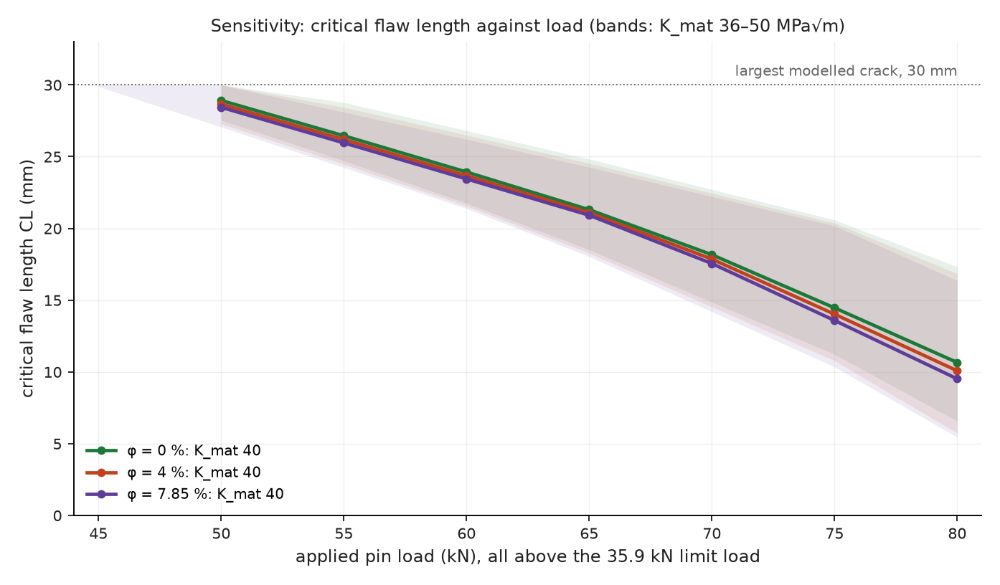

## 53. Checks and caveats

### 53.1 The 2D section against the 3D model

| Quantity | 2D | 3D | Difference | Effect on CL |
|---|---:|---:|---:|---|
| Elastic stiffness (kN/mm) | 154.3 | 140.8 | +9.6 % | |
| USERMAT stiffness, φ 4 % (kN/mm) | 130.1 | 120.0 | +8.4 % | |
| USERMAT peak, φ 4 % (kN) | 88.0 | 100.5 | **−12.4 %** | lower collapse load → **conservative** |
| Fillet S1 per kN (MPa/kN) | 3.93 | 4.137 | **−5.0 %** | lower tension → K_I too low → **not conservative** |

**Sensitivity:** scaling every K_I up by **5.2 %** (the 3D/2D ratio) still leaves the weakest case at **43.3 kN**, above 41.3 kN. The conclusion holds.

### 53.2 Other caveats

- **The load** is a capability bound at the study point, not a service load.
- **First yield is not mesh converged** (28.5 kN on the 2.5 mm mesh); a lower limit load only lengthens CL.
- **Softening scatter:** collapse loads scatter by about ±3 %. Five runs stopped converging after their peak (a = 30 mm at every φ; a = 25 mm at φ = 4 and 7.85 %); their histories were read up to the last converged step, by which point the reaction had already fallen by more than 1 %. Runs that diverged before their peak were rerun with line search and converged.
- **Toughness:** if K_IC were as low as **20 MPa√m** (reported by Paul et al., but outside the chosen band), CL at 35.9 kN would be **23.4–23.5 mm** at every porosity. At 25 MPa√m and above, CL is still beyond 30 mm.
- **Scope:** a static check on simulated material data, not a fatigue or crack-growth assessment. Nothing is experimentally validated.

**What would turn the bound into a value:** a service load from a wing-loads analysis, a measured K_IC(φ) for the printed material, and a 3D crack model with a mesh-converged limit load.

> **Remember (Part H).** CL = critical flaw length, a static residual-strength check (§25.571(b): cracked part carries limit load, no 1.5). P_L = min(136.06/3.788, 100.5/1.725) = 35.9 kN (first yield at the R10 fillet); 41.3 kN = ×1.15. K_mat 36/40/50 MPa√m, no K_IC(φ). 2D plane-strain PLANE183, edge crack at the R10 fillet, a = 1–30 mm, K_I by interaction integral (k(30) = 0.577), P_C from USERMAT at φ 0/4/7.85 %. FAD: K_r = kP/K_mat, L_r = P/P_C, f(L_r) = (1 + L_r²/2)^(−½)[0.3 + 0.7e^(−μL_r⁶)], cut off at L_r = 1. Weakest case 44.80 kN (RF 1.248) → CL > 30 mm at every φ; yield-limited. Porosity: P_L −2.3 %, P_f(30 mm) −2.0 %. K = 20 would give 23.4–23.5 mm.

---

# Part I. Limits, decisions and open questions

## 54. The limits: state them every time

| Limit | What it means |
|---|---|
| **Not a blind test** | The 37 test cases were explored in earlier project stages, although nothing in the JC-PINN's fitting or selection used them. The group-holdout errors were part of the selection score, so they are slightly optimistic. |
| **Simulations, not experiments** | Agreement is with the supplied simulations. Nothing (model or bracket) is experimentally validated. |
| **Units confirmed by the user, generator undocumented** | °C, s⁻¹, MPa, kg/m³ (D1). Which solver and constitutive model produced the histories, and why every one softens, is still unknown (Q2). |
| **Nothing validated above 200 °C** | No data there, and none will be added (D3). With λ = 0 no physics penalty acts there either. 200–300 °C is unvalidated extrapolation, flagged by the USERMAT (flag 4). |
| **Total strain** | E11 is total axial strain, read as plastic strain (M4). The FE material adds elasticity from G and an assumed ν = 0.33. |
| **Porosity mapping** | Density stands for porosity (D2). The data vary density and G independently and do not define G(φ). The coupled results use an assumed upper bound (D5), so they are a lower estimate. |
| **Mesh dependence** | The model softens, so bracket results after yield, including the peak, depend on the mesh. They are not a converged strength. |
| **FE scope** | One temperature and rate (100 °C, 10⁻⁴ s⁻¹), an imposed displacement (not a service load), small strain. |
| **CL is a bounded check** | 2D, static, at a capability-based load, with literature toughness and no K_IC(φ). It shows CL > 30 mm; it gives no CL value at that load. |
| **Weak spot** | The model is weakest where training cases are scarce: 30 °C, 10⁻⁴ s⁻¹ (one training case); case 60 is a single irregular case. |

## 55. Decision log (who decided what)

| ID | Decision | By |
|---|---|---|
| S1 | Use the 73 supplied simulations as complete | User |
| S2 | Random 50/50 split by simulation, 36/37, seed 42 | Instructor, via user |
| S3 | CL = critical flaw length, not coefficient of lift (27 Oct) | User |
| S4 | Target Svm along E11, resampled to 120 strains 0.0002–0.0999 | Agreed |
| M1 | Equation 1 is the governing equation | User |
| M2 | Constants ε̇₀ = 10⁻⁵ s⁻¹, T_r = 30 °C, T_M = 600 °C, G₀ = 25300 MPa, ρ₀ = 2700 kg/m³ | User (notes) |
| M3 | Equation 1 backbone × learned correction exp(δ) | User (chosen over residual or penalty-only forms) |
| M4 | ε_p = E11; ε̇* = ε̇/ε̇₀ | User |
| M5 | φ = 1 − ρ/2700; study point φ = 4 % | User |
| M6 | Balanced score ½(case CV + mean of 9 group holdouts), training cases only | User |
| M7 | Lock first, score once, disclose that earlier stages explored the test set | User |
| M8 | α = 1 and the trend residual fixed from training-fold development checks | Claude, recorded in config |
| M9 | Selected by the score: no physics loss (λ = 0), joint constants | Protocol |
| A1 | Run and report the post-hoc control (Equation 1 off) although it scored better | Claude, accepted |
| A2 | Screen improvements on training cases only | Claude |
| A3 | **Submit the locked model unchanged** | User |
| A4 | Correct the λ = 0 extrapolation note in ERRATA.md, not in locked files | Claude |
| U1–U3 | USERMAT generated from the locked weights; strain mapping per M4 with holds and flags; out-of-range conditions flagged, not clamped | User request; Claude |
| D1 | Units are °C, s⁻¹, MPa, kg/m³ | User (17 Nov) |
| D2 | Density stands for porosity | User |
| D3 | No simulations above 200 °C will be requested | User |
| D4 / C1 | ANSYS is the only FE solver; no Abaqus | User |
| D5 | G(φ) = 25300 (1 − φ), the linear (Voigt) upper bound | User |
| C2 | The only earlier model quoted is the 2 Nov plain MLP | User |
| C3 | One slide deck (the corrected deck) | User |
| F1 | K_mat = 36, 40, 50 MPa√m at every porosity; no K_IC(φ) invented | User (20 Nov) |
| F2 | CL assessed at the 35.9 kN capability-based limit load (41.3 kN sensitivity); load not changed to bring CL into range | User |

## 56. Open questions and next steps

| ID | Open question | What would close it |
|---|---|---|
| Q2 | Which solver and constitutive model generated the histories, and why does every one soften? | The generator's description |
| Q4 | Is the assumed G(φ) close to the real printed bracket? | A measured or LPBF-specific relation (for example an ultrasonic fit for LPBF AlSi10Mg) |
| Q5 | Is CL assessed at the right load and toughness? | A wing-loads analysis (service and limit load), a measured K_IC(φ), a 3D crack model with a mesh-converged limit load |
| Q7 | Should Equation 1 depend on temperature and rate (B and n)? | A user decision; a screen showed no gain from the forms tried |
| Q8 | Do the notebooks run end to end on hosted Colab and Kaggle? | One run of each on the user's account |
| Q9 | How can the post-yield bracket response be made mesh independent? | A regularised softening law (a length scale, or a nonlocal/gradient formulation) |

**Resolved, not to be reopened:** CL = critical flaw length; the data folder is complete; the split is 36/37 by case; the study point is φ = 4 %; Equation 1 and its constants are as in the user's notes; the model is submitted as locked; units are confirmed; density is porosity; the USERMAT builds and runs in MAPDL 2024 R1; no data above 200 °C will be added.

**The next steps** that would make the model useful for a real bracket:

1. a measured G(φ), to replace the assumed upper bound;
2. a regularised softening law, for mesh-independent results;
3. a service load, a measured K_IC(φ) and a 3D crack model, to turn the CL bound into a value;
4. a fatigue / crack-growth assessment, because flight loads are cyclic;
5. an experimental check of the material and the bracket;
6. the planned decision tool (CT-scan porosity and largest pore → JC-PINN → bracket analysis → fracture check → accept / inspect / reject). That is a concept only: a static critical crack size is not a fatigue-life or airworthiness criterion.

---

# Part J. Revision tools

## 57. Formula sheet

**Data and porosity**

$$
\phi=1-\frac{\rho}{2700},\qquad G_{D5}(\phi)=25300(1-\phi)\ \text{MPa},\qquad E=2G(1+\nu),\ \nu=0.33
$$

**Equation 1**

$$
\sigma_{JC}=[A-B\varepsilon^n][1+C\ln(\dot\varepsilon/10^{-5})][1-T^{*m}][G/25300]^q[1-\phi]^r,\qquad T^*=\max\left(\frac{T-30}{570},0\right)
$$

$$
B=\frac{A\beta}{0.1^n},\ 0\le\beta\le0.99\ \Rightarrow\ A-B\varepsilon^n\ge0.01A\ \text{for}\ \varepsilon\le0.1
$$

**JC-PINN**

$$
\hat\sigma_k=\sigma_{JC}(\theta_k)\,e^{\delta_k},\quad
\delta=\mathbf w_3^{\top}\tanh(W_2\tanh(W_1\mathbf z+\mathbf b_1)+\mathbf b_2)+b_3,\quad
\hat\sigma=\exp\left(\tfrac15\sum_k\ln\hat\sigma_k\right)
$$

$$
\#\text{params}=(5\cdot16+16)+(16\cdot16+16)+(16+1)=385;\quad 5\times(385+7)=1960
$$

**Loss**

$$
\mathcal L=\frac1N\sum\left(\frac{\hat\sigma-\sigma}{s_y}\right)^2+\lambda\frac1M\sum R^2+\frac{\alpha}{N}\sum W^2;\quad R_{level}=\delta,\ R_{trend}=\frac{\partial\delta}{\partial z_{T,\dot\varepsilon,\rho,G}}
$$

**Selection and metrics**

$$
\text{score}=\tfrac12(\text{CV}+\overline{\text{groups}}),\qquad \text{RMSE}_i=\sqrt{\tfrac1{120}\textstyle\sum_j e_{ij}^2},\qquad R^2=1-\frac{SSE}{SST}
$$

**J2 plasticity and the USERMAT**

$$
q=\sqrt{\tfrac32\mathbf s:\mathbf s},\qquad g(\Delta p)=q^{tr}-3G\Delta p-\sigma_y(p_n+\Delta p)=0,\qquad \Delta p\leftarrow\Delta p+\frac{g}{3G+H}
$$

$$
\mathbf s_{n+1}=\frac{\sigma_y}{q^{tr}}\mathbf s^{tr},\qquad
\mathbf C^{alg}=K\mathbf I\otimes\mathbf I+2G\theta\,\mathbb I_{dev}+\left(\frac{3GH}{3G+H}-3G\theta\right)\mathbf f\otimes\mathbf f,\ \ \theta=\frac{\sigma_y}{q^{tr}},\ \mathbf f=\frac{\mathbf s^{tr}}{q^{tr}}
$$

$$
H=\hat\sigma\cdot\frac15\sum_k\frac{d\ln\sigma_k}{dp},\qquad E_t=\frac{EH}{E+H}
$$

**Fracture**

$$
K_I=Y\sigma\sqrt{\pi a},\qquad a_c=\frac1\pi\left(\frac{K_{IC}}{Y\sigma}\right)^2,\qquad r_p=\frac1{2\pi}\left(\frac{K_I}{\sigma_y}\right)^2,\qquad J=\frac{K_I^2}{E'}
$$

$$
P_L=\min\left(\frac{\sigma_y}{k_{vm}},\frac{P_{peak}}{1.5\times1.15}\right),\qquad K_r=\frac{kP}{K_{mat}},\quad L_r=\frac{P}{P_C},\quad f(L_r)=\left(1+\tfrac12L_r^2\right)^{-\frac12}\left[0.3+0.7e^{-\mu L_r^6}\right],\ \mu=\min\left(\frac{0.001E}{\sigma_y},0.6\right)
$$

**Porous stiffness**

$$
\text{Voigt: }G=G_0(1-\phi);\qquad \text{Mackenzie: }G=G_0\left(1-\frac{15(1-\nu_0)}{7-5\nu_0}\phi\right)\ (=1-1.88\phi\ \text{at}\ \nu_0=0.33)
$$

## 58. Key numbers

### Data and model

| Quantity | Value |
|---|---|
| Planned / supplied simulations | 108 / 73 (none at 300 °C; one at 200 °C, 10⁻⁵ s⁻¹: case 60) |
| Split | 36 train / 37 test, by case, seed 42 |
| Grid | 120 strains, E11 = 0.0002–0.0999 |
| Training / test points | 4,320 / 4,440 |
| Densities → porosity | 2700 / 2619 / 2488.05 kg/m³ → 0 / 3 / 7.85 % |
| G levels | 25300 / 24541 / 23313.95 MPa |
| Study point | φ = 4 %, ρ = 2592, G = 24541 (coupled study: G = 24288); 100 °C, 10⁻⁴ s⁻¹ in ANSYS |
| Equation 1 constants (alone) | A 148.77, B 526.23, n 0.828, C 0.0292, m 1.113, q 0.717, r 0 |
| Network | 5–16–16–1 tanh, 385 weights; 5 members; 1,960 parameters |
| Collocation points | 4,096 (Sobol, up to 300 °C) |
| Training | Adam 1,500 steps (lr 0.005) + L-BFGS ≤ 2,500; α = 1 |
| Selection | 14 settings, 3 folds + 9 groups, 504 fits, 37.1 min |
| Selected | none, λ = 0, joint: CV 2.098, groups 6.235, score 4.166 |

### Test

| Quantity | Value |
|---|---|
| Mean / median / worst curve RMSE | **0.439** / 0.395 / 0.841 MPa (case 10) |
| R²; within ±1 MPa | 0.99952; 94.9 % |
| Bias; cases high/low | +0.009 MPa; 17 / 20 |
| Training fit | 0.356 MPa |
| Equation 1 alone (test) | 7.37 MPa (17× worse) |
| Control (Equation 1 off) | test 0.338; groups 5.629; score 3.472 |
| Plain MLP (2 Nov) | test 0.143; groups 11.90; CV 2.17 |
| Weakest condition | 30 °C, 10⁻⁴ s⁻¹: 0.803 MPa (1 training case) |
| Hardest hidden group | case 60: 17.1 MPa (Equation 1 alone 42.4) |
| Ensemble spread | mean 0.104, max 0.338 MPa |
| Porosity in data (φ 0 → 7.85 %) | −0.34 % (model −0.31 %), 72/72 pairs, implied r ≈ 0.041, G 16× stronger |

### USERMAT and bracket

| Quantity | Value |
|---|---|
| Offline agreement (flow stress / tangent) | 2 × 10⁻¹⁵ / 10⁻¹⁰ |
| MAPDL single element | 1.2 × 10⁻⁵ MPa over 240 substeps; final σ₁₁ 75.41 MPa, EQPS 0.1188, flag 1 |
| Initial yield at the study point | 136.06 MPa |
| Bracket mesh | 7,304 SOLID186 (5 mm); refined 58,432 (2.5 mm) |
| Stiffness elastic / USERMAT | 140.8 / 120.0 kN/mm (ratio 0.852) |
| USERMAT peak / at 2 mm | 100.5 kN at 1.150 mm / 86.3 kN |
| Elastic / EP at 2 mm | 281.5 / 220.5 kN |
| Density only, peak | −0.17 % (G 19× stronger per %) |
| G coupled (D5): stiffness / peak / 2 mm | −7.85 % / **−3.38 %** / −5.12 % |
| Mesh 5 → 2.5 mm: stiffness / peak / EP max | −0.11 % / **−9.8 %** (90.6 kN) / ≤ 0.7 % |

### Critical flaw length

| Quantity | Value |
|---|---|
| Limit load | **35.9 kN** = 136.06/3.788 (other bound 58.3 kN) |
| Sensitivity loads | 41.3 kN (×1.15); 53.9 kN (×1.5) |
| Limit load, 2.5 mm mesh | 28.5 kN |
| P_L(φ) | 36.25 / 35.82 / 35.43 kN (−2.3 %) |
| K_mat band | 36 / 40 / 50 MPa√m |
| Crack lengths | 1–30 mm (10); section exit about 39 mm |
| Weakest case (30 mm, 7.85 %, K 36) | P_f = 44.80 kN; RF 1.248 (second peak 44.36 kN, 1.236) |
| Result | **CL > 30 mm** at every φ and K_mat |
| K = 20 sensitivity | CL ≈ 23.4–23.5 mm |
| 2D vs 3D | stiffness +9.6 %, collapse −12.4 %, fillet S1 −5.0 % (K scaled +5.2 % → 43.3 kN) |

## 59. Glossary

| Term | Meaning |
|---|---|
| **AlSi10Mg** | Aluminium casting alloy (about 10 % Si, a little Mg), widely used in LPBF |
| **LPBF** | Laser powder-bed fusion: metal 3D printing by laser-melting powder layers |
| **Porosity φ** | Pore volume fraction; here φ = 1 − ρ/2700 |
| **Svm, E11** | The data's von Mises stress and axial (total) strain |
| **Johnson–Cook (JC)** | Separable flow-stress law: strain × rate × temperature factors |
| **Equation 1** | Our customised JC law with a minus sign, a G factor and a porosity factor |
| **Homologous temperature T*** | (T − T_r)/(T_M − T_r) |
| **JC-PINN** | Equation 1 × exp(δ), δ from a small neural network; 5-member ensemble |
| **PINN** | Physics-informed neural network: loss = data + λ × residual of a governing equation at collocation points |
| **Collocation points** | Input locations without data where the physics residual is evaluated |
| **Level / trend residual** | δ itself / derivatives of δ with respect to the conditions |
| **λ (lambda)** | Physics-loss weight; selected value 0 |
| **α (alpha)** | Weight-decay (L2) strength; fixed at 1 |
| **Frozen / joint** | Equation 1 constants fixed after calibration / trained with the network |
| **Ensemble, geometric mean** | Average of 5 trained copies in log space |
| **Case CV** | Cross-validation that holds out whole simulations (3 folds) |
| **Group holdout** | Hiding every case of one temperature/rate combination |
| **Balanced score** | ½ (case CV + mean group-holdout error) |
| **Lock** | SHA-256 fingerprint of the model written before the test set is read |
| **Control** | Same network and recipe with Equation 1 switched off |
| **Identifiability** | Whether parameters can be determined uniquely; backbone vs correction is not identifiable here |
| **Curve-copy lookup** | Baseline that predicts the nearest training curve at the same T and rate |
| **USERMAT** | ANSYS user material subroutine (User Programmable Features) |
| **J2 plasticity** | Von Mises yield with associated flow |
| **Radial return** | Return-mapping algorithm for J2: scale the trial deviator back to the yield surface |
| **Consistent tangent** | Exact derivative of the discrete stress update; gives quadratic Newton convergence |
| **EQPS** | Equivalent plastic strain (SVAR1) |
| **keycut** | USERMAT flag asking ANSYS to cut back (bisect) the substep |
| **SOLID186 / SOLID185 / PLANE183** | Quadratic 3D / linear 3D / quadratic 2D elements |
| **Plane strain** | ε_zz = 0; for thick sections |
| **Localisation** | Concentration of strain into a narrow band in a softening material |
| **Regularisation** | Adding a length scale so softening results converge with mesh refinement |
| **Voigt bound** | Uniform-strain estimate, the upper bound on effective stiffness |
| **Critical flaw length (CL)** | Longest crack of a given type that does not fracture under a given load |
| **K_I, K_IC, K_mat** | Mode-I stress intensity factor; plane-strain fracture toughness; toughness used in the assessment |
| **Interaction integral** | Domain integral that extracts K from an FE solution |
| **FAD** | Failure assessment diagram (BS 7910): K_r against L_r |
| **Limit load / ultimate load** | Largest load expected in service / 1.5 × limit |
| **Fitting factor** | Extra 1.15 factor for fittings (§25.625) |
| **Damage tolerance** | The cracked structure must still carry limit load (§25.571(b)) |
| **Reserve factor** | P_f / P_L |
| **Verification / validation** | Solving the model right / solving the right model (agreement with reality) |

## 60. Practice questions with model answers

Cover each answer and say yours out loud first.

### 60.1 The one-minute answer

**Q. Explain your project in one minute.**
We studied how porosity affects a 3D-printed AlSi10Mg aircraft wing-rib bracket. From 73 simulated stress–strain histories we built a JC-PINN: our customised Johnson–Cook equation multiplied by a small neural correction that starts at zero. We selected it on the 36 training cases only, locked it, and scored it once on 37 test cases: 0.439 MPa mean curve error, 17 times better than the equation alone. A control without the equation was slightly better, so the equation gives interpretability, not accuracy. We turned the locked model into an ANSYS USERMAT, verified it to 1.2 × 10⁻⁵ MPa, and solved the bracket: the reaction peaks at 100.5 kN and softens, and porosity from 0 to 7.85 % lowers the peak by 3.38 % when the shear modulus falls with porosity. The softening makes post-yield results mesh dependent. Finally, a 2D crack model with the BS 7910 failure assessment shows that the critical flaw length exceeds 30 mm at the bracket's 35.9 kN limit load, at every porosity.

### 60.2 Problem and data

**Q1. What does CL mean in this project, and what kind of quantity is it?**
Critical flaw length: the longest crack of a given type that the bracket can carry under a given load without fracturing. Ours is a static critical crack size from a residual-strength check, not a fatigue life or an airworthiness criterion.

**Q2. Why is porosity a concern in LPBF parts?**
LPBF leaves gas pores, lack-of-fusion voids and keyhole pores. They lower density and stiffness, and each pore is a ready-made flaw from which a crack can grow under cyclic flight loads.

**Q3. How many simulations were planned and supplied, and what is missing?**
108 planned (4 T × 3 rates × 9 ρ/G pairs), 73 supplied. Nothing at 300 °C, and only one case (case 60) at 200 °C, 10⁻⁵ s⁻¹.

**Q4. How is porosity represented in the data?**
Only through density, φ = 1 − ρ/2700, confirmed by the user: 0, 3 and 7.85 % for 2700, 2619 and 2488.05 kg/m³. The study point φ = 4 % is ρ = 2592 kg/m³.

**Q5. Why resample every curve to 120 points?**
Slow runs have up to 100,000 rows and fast runs 1,000; without resampling the slow runs would dominate the loss. With 120 points from E11 = 0.0002 to 0.0999 each curve counts equally.

**Q6. Why split by case rather than by point?**
All points of one curve come from one simulation. A point split would put near-duplicate neighbours in both sets and make the test look easier than it is (data leakage).

**Q7. Why is the test set "not blind"?**
Earlier project stages (before 7 Nov) explored the same 37 cases. They were excluded from all JC-PINN fitting and selection, but the team had seen them.

**Q8. Name two features of the data that shaped the whole model.**
Every curve softens (stress falls with strain; no elastic segment), and the curve shape changes with condition (end/start stress from 0.71 to 0.06).

### 60.3 The governing equation

**Q9. Write Equation 1 and explain each factor.**
σ_JC = [A − Bεⁿ][1 + C ln ε̇*][1 − T*ᵐ][G/G₀]^q[1 − φ]^r: a softening strain term, a logarithmic rate term, a thermal-softening term, a shear-modulus term and a porosity term. ε = E11, ε̇* = ε̇/10⁻⁵, T* = (T − 30)/570, G₀ = 25300 MPa, φ = 1 − ρ/2700.

**Q10. How does it differ from the classic Johnson–Cook model?**
A minus sign in the strain term (softening, not hardening), plus a G factor and a porosity factor. Also, ε is total axial strain, not equivalent plastic strain.

**Q11. Why write B = Aβ/0.1ⁿ with β ≤ 0.99?**
Then A − Bεⁿ = A[1 − β(ε/0.1)ⁿ] ≥ 0.01A > 0 for all ε ≤ 0.1, so the stress can never become zero or negative in the data range.

**Q12. Why bound C, q and r to be non-negative?**
So no trend can have the wrong sign. Without the bound the fit gave r = −0.027: porosity would raise the stress.

**Q13. Prove that Equation 1 cannot change the curve shape.**
σ_JC(ε₂)/σ_JC(ε₁) = (A − Bε₂ⁿ)/(A − Bε₁ⁿ): the rate, temperature, G and porosity factors cancel. With the calibrated constants, σ(0.0999)/σ(0.0002) = 0.476 for every condition, while the data range from 0.71 to 0.06.

**Q14. What are the calibrated Equation 1 constants, and how were they found?**
A 148.77, B 526.23, n 0.828, C 0.0292, m 1.113, q 0.717, r 0 (at its bound). Bounded nonlinear least squares (SciPy, trust-region reflective), 8 starts, on the 36 training cases.

**Q15. How good is Equation 1 alone?**
Test 7.37 MPa, case CV 10.24, unseen groups 13.95 (about 10 % of the stress). Even fitting A − Bεⁿ to each curve separately leaves 0.84 MPa, so the strain law itself is a floor.

### 60.4 The JC-PINN

**Q16. Write the JC-PINN and explain why it is multiplicative.**
σ̂ = σ_JC(θ)·exp(δ), δ from a 5–16–16–1 tanh network. exp(δ) is a correction factor (0.9 = 10 % below Equation 1); it keeps the stress positive and works in log space, where Equation 1's factors add.

**Q17. What does "starts as Equation 1" mean, and why do it?**
The output layer's weights and bias are zero, so δ = 0 and exp(δ) = 1 before training: the untrained model is exactly Equation 1. Training then adds only what Equation 1 cannot explain.

**Q18. Count the parameters.**
(5·16 + 16) + (16·16 + 16) + (16 + 1) = 96 + 272 + 17 = 385 per network; plus 7 constants = 392 per member; × 5 = 1,960.

**Q19. What are the network's inputs, and how are they scaled?**
T, log₁₀ ε̇, ρ, G and E11, standardised with the training means and standard deviations: z = (x − μ)/s.

**Q20. How are the five members combined, and why that way?**
Geometric mean: σ̂ = exp(mean of ln σ̂_k). It matches the log-space form and keeps the stress positive. Each member has its own constants.

**Q21. Is the JC-PINN really a PINN?**
It is a constitutive (material-point) PINN: the governing law is a constitutive equation, physics residuals were tested at 4,096 collocation points with autograd derivatives, and the architecture builds Equation 1 in. But the selected λ = 0, so no penalty is active; the most precise description is an equation-backbone hybrid. It is not a PDE/equilibrium PINN.

**Q22. What were the two physics residuals?**
Level: R = δ (stay close to Equation 1). Trend: R = ∂δ/∂(T, log ε̇, ρ, G) by autograd (match Equation 1's sensitivities, leave the strain shape free).

**Q23. What are collocation points, and where were ours?**
Input points without data where the residual is evaluated: 4,096 scrambled-Sobol points over T 30–300 °C, all rates, densities, G and strains, including the 35 missing conditions.

**Q24. Why α = 1?**
A training-fold development check: α = 0.001 let exp(δ) blow up away from the data (fold error 25.3 MPa); α = 1 gave the lowest fold error (2.4 MPa). It was fixed before the formal selection.

**Q25. Why Adam followed by L-BFGS?**
Adam is robust far from the optimum; L-BFGS, a quasi-Newton method with a strong-Wolfe line search, converges fast and precisely on a small, smooth, full-batch problem. 1,500 Adam steps (lr 0.005), then up to 2,500 L-BFGS iterations.

**Q26. Frozen vs joint constants: which won?**
Joint (constants trained with the network), with λ = 0.

### 60.5 Selection, testing and results

**Q27. Describe the selection protocol.**
14 settings (7 physics options × frozen/joint), each a 3-seed ensemble, scored on the 36 training cases with 3 case folds and 9 temperature/rate group holdouts; score = ½(CV + mean group error); 504 fits. The best was refitted as a 5-seed ensemble and locked with a SHA-256 hash before the test was read.

**Q28. Why include group holdouts?**
A random case split mostly tests interpolation. Hiding a whole temperature/rate group tests prediction at an unseen condition, which is closer to real use.

**Q29. Which setting won, with what numbers?**
No physics loss (λ = 0), joint constants: CV 2.098, groups 6.235, score 4.166 MPa. Every stronger physics weight was worse.

**Q30. Why did the physics penalty not help?**
Equation 1 is about 10 % off and has the wrong shape at hot/slow conditions; pulling the model toward it moves predictions away from the data. A physics penalty helps only if the equation is right where data are missing.

**Q31. What does the lock prove?**
That the scored model is the one chosen before the test set was read: the SHA-256 fingerprint of `equation.json` was written first, and any change to the file would change the hash.

**Q32. Give the headline test results.**
Mean curve RMSE 0.439 MPa (median 0.395, worst 0.841 for case 10), R² 0.99952, 94.9 % of points within ±1 MPa, bias +0.009 MPa (17 high, 20 low), training fit 0.356.

**Q33. Where is the model weakest, and why?**
30 °C, 10⁻⁴ s⁻¹ (0.80 MPa): 8 test cases but only one training case. The eight worst test cases are all there.

**Q34. What is the "control", and what did it show?**
The same network and recipe with Equation 1 replaced by a constant. It scored better everywhere (test 0.338, groups 5.629). So Equation 1 does not add accuracy on these data; it adds interpretability and structure.

**Q35. Is the JC-PINN better than the plain MLP?**
On the random test split, no (0.439 vs 0.143). On unseen temperature/rate groups, yes, about half the error (6.23 vs 11.90). But the group scores were used in selection, so this is not an independent proof of superiority.

**Q36. Why are the JC-PINN's constants different from the calibrated ones (A 88 vs 149)?**
With joint training and λ = 0, the split between backbone and correction is not identifiable: δ compensates for changes in the constants. Quote the "Equation 1 alone" constants as the calibrated law.

**Q37. Can the model predict at 300 °C?**
It returns a curve, but there are no data above 200 °C and no physics penalty acts there (λ = 0). It is unvalidated extrapolation, flagged by the USERMAT (flag 4).

**Q38. What do the sign checks show?**
At 2,579 points in 30–200 °C: 0 % wrong signs for ∂σ/∂ε ≤ 0, ∂σ/∂T ≤ 0, ∂σ/∂G ≥ 0, ∂σ/∂ρ ≥ 0. At 1,517 points in 200–300 °C, 2.5 % have the wrong density sign. Rate is not checked because the data are mixed.

### 60.6 Porosity

**Q39. How large is the porosity effect in the data?**
Over φ 0 → 7.85 % (density only), stress falls by 0.34 % (about 0.3 MPa), in all 72 of 72 pairs; 0.25 / 0.30 / 0.53 % at 30 / 100 / 200 °C.

**Q40. Why is r = 0 if the data show a porosity effect?**
The implied r is about 0.041, but a 0.3 MPa effect is buried under Equation 1's roughly 10 MPa misfit, so least squares sets r to its bound. The correction network, which sees density, carries the effect (0.31 %, correlation 0.97).

**Q41. Does r = 0 mean pores are harmless?**
No. It means density alone changes these simulated stresses very little and the separable fit could not resolve it. Real pores also reduce stiffness (G) and act as flaws.

**Q42. Why did the bracket study need an assumed G(φ)?**
The data vary G and density independently, but in a real part G falls with porosity, and G acts about 16 times (bracket: 19 times) more strongly than density. The relation decides the result, and the data do not define it.

**Q43. Why is −3.38 % called a lower estimate?**
D5, G = 25300(1 − φ), is the Voigt upper bound on stiffness for any pore shape. Real pores lower G faster (dilute spherical pores: slope −1.88), so the true porosity effect is likely larger.

### 60.7 USERMAT and finite elements

**Q44. What must a USERMAT return?**
The updated stress, the consistent tangent (material Jacobian) and the updated state variables, at every integration point and iteration.

**Q45. Derive the scalar return-mapping equation.**
Trial: σ_tr = σ_n + C_e Δε. Radial return with associated flow: s_new = (1 − 3GΔp/q_tr)s_tr, so q_new = q_tr − 3GΔp. Consistency q_new = σ_y(p_n + Δp) gives g(Δp) = q_tr − 3GΔp − σ_y(p_n + Δp) = 0, solved by Newton with Δp ← Δp + g/(3G + H).

**Q46. Why "safeguarded" Newton?**
With softening (H < 0) a plain Newton step can overshoot. The root is bracketed in [0, q_tr/3G]; if 3G + H ≤ 0 or the step leaves the bracket, bisection is used. If it still fails, keycut = 1 makes ANSYS bisect the substep.

**Q47. Why is a consistent tangent needed?**
ANSYS's global Newton–Raphson converges quadratically only with the exact derivative of the discrete stress update. The elastic or continuum tangent would slow or break convergence.

**Q48. How is the slope H obtained?**
Analytically, by the chain rule through Equation 1's strain term and both tanh layers (tanh' = 1 − tanh²), then H = σ̂ · mean_k(d ln σ_k/dp). It agrees with finite differences to 3 × 10⁻⁹.

**Q49. What do the three range flags mean?**
1: EQPS above 0.0999 (flow stress held flat). 2: T outside 30–300 °C, or rate, density or G outside the data. 4: 200 < T ≤ 300 °C. They add up and persist; they flag, they do not clamp.

**Q50. Where does the USERMAT's elastic stiffness come from?**
From G (the model input, or constant 7) and an assumed ν = 0.33: E = 2G(1 + ν) = 65,279 MPa at the study point.

**Q51. Describe the single-element test and its result.**
One SOLID185 cube pulled to ε₁₁ = 0.12 at the study point in MAPDL 2024 R1: σ₁₁ matches the offline result to 1.2 × 10⁻⁵ MPa at all 240 substeps; final 75.41 MPa, EQPS 0.1188, flag 1.

**Q52. Why is the bracket loaded on the upper half of the bore only?**
A pin can only push: it bears on the half of the bore facing the load, and a gap opens on the other half. The load is +P_y (wing-normal upload), imposed as UY = +2 mm.

**Q53. Why is the USERMAT bracket softer than the elastic one (120.0 vs 140.8 kN/mm)?**
Pure elasticity: the USERMAT's E (65,279 MPa) is lower than the Workbench EX (76,600 MPa); the ratio 0.852 is exactly the stiffness ratio. It is not a network effect.

### 60.8 Mesh dependence

**Q54. What did the mesh study show?**
Halving the element size (5 → 2.5 mm) changed the stiffness by −0.11 % but the peak by −9.8 % (100.5 → 90.6 kN) and post-peak forces by up to −19.2 %, and the peak plastic strain rose from 0.12 to 0.32. The hardening EP card changed by at most 0.7 %.

**Q55. Why does softening cause mesh dependence?**
With H < 0, strain localises into a band whose width is set only by the element size. The dissipated energy scales with the band width, so it falls on refinement; the problem loses ellipticity and has no mesh-independent post-peak solution.

**Q56. How would you fix it?**
Regularise: give the model a length scale (crack-band/fracture-energy scaling, nonlocal or gradient plasticity/damage, phase-field), or a calibrated viscous regularisation. None is in the submitted model.

### 60.9 Critical flaw length

**Q57. Why was simple LEFM at the peak rejected?**
There was no service load, and at σ_y ≈ 136 MPa the Irwin plastic zone (3–31 mm for K = 20–60 MPa√m) is as large as the cracks and the 40 mm plate, so small-scale yielding fails. Also, von Mises is not the crack-opening stress.

**Q58. How was the 35.9 kN load obtained?**
P_L = min(σ_y/k_vm, P_peak/(1.5 × 1.15)) = min(136.06/3.788, 100.5/1.725) = min(35.9, 58.3) = 35.9 kN: the pin load at which the R10 fillet first yields.

**Q59. Why assess at limit load and not 1.5 × limit?**
Damage tolerance (14 CFR 25.571(b)) requires the cracked structure to carry limit load, treated as ultimate, with no further 1.5 factor. 41.3 kN (× 1.15 fitting factor) is a sensitivity.

**Q60. Why a 2D plane-strain model?**
The bracket is a straight 40 mm extrusion, so its section represents it; plane strain suits a thick section. A through-thickness edge crack at the R10 fillet is then a 2D problem.

**Q61. How was K_I computed?**
Linear elastic FE runs with quarter-point elements at the tip and the interaction integral (CINT, 6 contours); k(a) = K_I/P is the median of contours 2–6 (they agree within 0.3 %). It does not depend on E or porosity.

**Q62. Write the BS 7910 Option 1 FAD and explain L_r and K_r.**
K_r = K_I/K_mat (fracture), L_r = P/P_C (plastic collapse); failure when K_r = f(L_r) = (1 + L_r²/2)^(−1/2)[0.3 + 0.7 exp(−μL_r⁶)], μ = min(0.001E/σ_y, 0.6), cut off at L_r = 1 for a softening material.

**Q63. Why cut the FAD off at L_r = 1?**
L_r = 1 is the collapse (peak) load. A softening material carries no load above its peak, so no point beyond it is acceptable.

**Q64. What is the result, and what does "CL > 30 mm" mean?**
At 35.9 kN no crack up to 30 mm fails at any porosity or K_mat in 36–50 MPa√m; the weakest case (30 mm, φ 7.85 %, K 36) carries 44.80 kN (reserve factor 1.248). CL > 30 mm is a bound: all modelled cracks survive; no CL value is found at that load.

**Q65. How does porosity act on CL?**
Only through stiffness and the collapse load (no K_IC(φ) is known): the limit load falls 2.3 %, the residual strength at 30 mm about 2.0 %, and above the limit load CL shortens slightly (60 kN: 23.93 → 23.45 mm).

**Q66. Is the 2D model conservative?**
Partly. It collapses 12.4 % below 3D (conservative), but its fillet tension per kN is 5.0 % lower (not conservative). Scaling every K_I up by 5.2 % still leaves the weakest case at 43.3 kN, above 41.3 kN.

### 60.10 Limits and traps

**Q67. What has been validated experimentally?**
Nothing. The model reproduces simulations; the USERMAT is verified against the model; the bracket and CL results are computations.

**Q68. Verification vs validation?**
Verification: the code solves the model correctly (NumPy verifier, offline USERMAT tests, single-element MAPDL test). Validation: the model agrees with reality (experiments), which we do not have.

**Q69. Is 100.5 kN the bracket's strength?**
No. It is a displacement-controlled numerical peak at one material condition, it is mesh dependent (90.6 kN on the finer mesh), and there is no fracture criterion or experiment behind it.

**Q70. Are the units inferred?**
No longer: the user confirmed °C, s⁻¹, MPa and kg/m³ (17 Nov). But no documentation of the generator was seen.

**Q71. Did you use Abaqus?**
No. ANSYS is the only finite-element solver in the project (D4, C1).

**Q72. Why not just submit the more accurate control?**
The project's aim was to test Equation 1 as the governing law; the user decided to submit the locked model unchanged (A3). The control was a post-hoc check, not part of the selection, and choosing it after seeing test results would break the protocol. We report it honestly instead.

**Q73. What is the study point, exactly?**
φ = 4 % (ρ = 2592 kg/m³), G = 24541 MPa, 100 °C, 10⁻⁴ s⁻¹, ν = 0.33. In the coupled porosity study, 4 % uses G = 24288 MPa instead.

**Q74. Why is strain rate a fixed constant in the USERMAT?**
In the data each case has one prescribed rate, so the model treats rate as a condition. The routine does not compute it from the analysis.

**Q75. What would you do next?**
A measured G(φ); a regularised softening law; a service load, a measured K_IC(φ) and a 3D crack model; a fatigue assessment; experiments.

## 61. Numerical problems with worked solutions

**P1. Input terms.** For T = 200 °C, ε̇ = 10⁻³ s⁻¹, ρ = 2619 kg/m³, G = 24541 MPa, find T*, ln ε̇*, G/G₀ and φ.

> T* = (200 − 30)/570 = **0.2982**; ln ε̇* = ln(10⁻³/10⁻⁵) = ln 100 = **4.605**; G/G₀ = 24541/25300 = **0.97**; φ = 1 − 2619/2700 = **0.03**.

**P2. Equation 1 at the first grid point.** Using the calibrated constants, find σ_JC at 30 °C, 10⁻⁵ s⁻¹, ρ = 2700, G = 25300, ε = 0.0002.

> At this condition T* = 0, ln ε̇* = 0, G/G₀ = 1 and φ = 0, so every factor except the strain term equals 1.
> σ_JC = 148.769 − 526.229 × 0.0002^0.82756 = 148.769 − 0.457 = **148.31 MPa**.

**P3. The shape ratio.** Using the calibrated constants, show that σ_JC(0.0999)/σ_JC(0.0002) is the same for every condition, and compute it.

> The non-strain factors cancel. Strain factor: 148.769 − 526.229 × 0.0999^0.82756 = 70.56 MPa at ε = 0.0999, and 148.31 MPa at ε = 0.0002. Ratio = 70.56/148.31 = **0.476**, at every condition. The data range from 0.06 to 0.71.

**P4. Recover B from β.** A = 148.769, β = 0.5261, n = 0.82756. Find B.

> B = Aβ/0.1ⁿ = 148.769 × 0.5261/0.1^0.82756 = 78.27/0.14874 = **526.2 MPa**.

**P5. Parameter count.** How many parameters does the 32–32 network of the improvement screen have (5 inputs, 1 output)?

> (5·32 + 32) + (32·32 + 32) + (32 + 1) = 192 + 1056 + 33 = **1,281** (against 385 for 16–16).

**P6. Geometric mean.** Five members predict 134.0, 136.5, 135.2, 137.1 and 136.0 MPa. What does the ensemble predict?

> exp(mean of ln σ_k) = **135.756 MPa**. (The arithmetic mean is 135.760 MPa; the two differ slightly, and the geometric mean is never larger.)

**P7. Mean curve RMSE vs pooled RMSE.** Curve 1 has errors (0.3, −0.4, 0.5, −0.2) MPa and curve 2 (1.0, −1.2, 0.8, −1.0) MPa. Find each curve's RMSE, the mean curve RMSE and the pooled RMSE.

> RMSE₁ = √((0.09 + 0.16 + 0.25 + 0.04)/4) = **0.367**; RMSE₂ = √((1.00 + 1.44 + 0.64 + 1.00)/4) = **1.010**.
> Mean curve RMSE = (0.367 + 1.010)/2 = **0.689**; pooled = √((0.54 + 4.08)/8) = **0.760**. The project reports the mean curve RMSE (test: 0.439; pooled 0.504).

**P8. Elastic constants.** For the coupled 4 % case, G = 24288 MPa and ν = 0.33. Find E and K.

> E = 2 × 24288 × 1.33 = **64,606 MPa**; K = E/(3(1 − 2 × 0.33)) = 64,606/1.02 = **63,339 MPa**.

**P9. Stiffness check.** The elastic bracket (EX = 76,600 MPa) has a stiffness of 140.8 kN/mm. Predict the USERMAT bracket's initial stiffness at the study point.

> Stiffness scales with E for the same geometry and ν: 140.8 × 65,279/76,600 = 140.8 × 0.852 = **120.0 kN/mm**, as computed by ANSYS.

**P10. One return-mapping step (illustrative numbers).** G = 24541 MPa, a linear softening slope H = −600 MPa, σ_y(p_n) = 120 MPa, and the trial von Mises stress q_tr = 150 MPa. Find Δp and the new stress.

> With linear H, g(Δp) = 0 has the closed form Δp = (q_tr − σ_y(p_n))/(3G + H) = 30/(73,623 − 600) = **4.108 × 10⁻⁴**.
> q_new = 150 − 73,623 × 4.108 × 10⁻⁴ = **119.75 MPa** = σ_y(p_n + Δp) = 120 − 600 × 4.108 × 10⁻⁴. ✓ The deviator is scaled by 119.75/150 = 0.798; the hydrostatic stress is unchanged.

**P11. Limit load.** k_vm = 3.788 MPa/kN (5 mm mesh), σ_y = 136.06 MPa, peak reaction 100.5 kN. Find P_L. Repeat with the 2.5 mm mesh value k_vm = 4.775 MPa/kN.

> P_L = min(136.06/3.788, 100.5/(1.5 × 1.15)) = min(**35.92**, 58.26) = **35.9 kN**. On the 2.5 mm mesh, 136.06/4.775 = **28.5 kN**, a lower limit load, which would only lengthen CL.

**P12. FAD check at 41.3 kN.** For the weakest case (k = 0.5774 MPa√m/kN, P_C = 49.96 kN, K_mat = 36 MPa√m, μ = 0.462), check P = 41.3 kN.

> K_r = 0.5774 × 41.3/36 = **0.662**; L_r = 41.3/49.96 = **0.827**;
> f(0.827) = (1 + 0.5 × 0.827²)^(−½) × [0.3 + 0.7 e^(−0.462 × 0.827⁶)] ≈ **0.78**.
> 0.662 < 0.78: **inside the FAD**, so the 30 mm crack survives 41.3 kN.

**P13. Computing μ.** For φ = 7.85 %, G = 23313.95 MPa, ν = 0.33, σ_y = 134.20 MPa, find μ.

> E = 2 × 23313.95 × 1.33 = 62,015 MPa; 0.001 E/σ_y = 62.015/134.20 = **0.462** < 0.6, so μ = 0.462.

**P14. Why LEFM fails at yield.** With K_IC = 40 MPa√m, Y = 1.12 and σ = 136 MPa, find a_c and the Irwin plastic zone r_p (σ_y = 136 MPa). Comment.

> a_c = (1/π)(40/(1.12 × 136))² = (1/π)(0.2626)² m = **22.0 mm**.
> r_p = (1/2π)(40/136)² m = **13.8 mm**.
> The plastic zone is more than half the crack size and a third of the 40 mm plate: small-scale yielding fails, so LEFM is not valid here. Hence the FAD.

**P15. Porous shear modulus.** Find G at φ = 4 % by the Voigt rule and by the dilute Mackenzie relation (ν₀ = 0.33). Which stays inside the data's G range (23,314–25,300 MPa) at φ = 7.85 %?

> Voigt: 25300 × 0.96 = **24,288 MPa**. Mackenzie: [G] = −15(0.67)/(7 − 1.65) = −1.879, so G = 25300 × (1 − 1.879 × 0.04) = **23,399 MPa**.
> At 7.85 %: Voigt gives 23,314 MPa (inside, the data's lowest level); Mackenzie gives 21,569 MPa (outside, extrapolation).

**P16. Percentage changes.** The coupled-porosity peaks are 101,887.6 N at φ = 0 and 98,439.2 N at φ = 7.85 %. Find the change.

> 98,439.2/101,887.6 − 1 = **−3.38 %**. (Use unrounded forces: the rounded 101.9 and 98.4 kN would give −3.43 %.)

**P17. Data volume.** How many raw history rows are there?

> 19 cases at 10⁻⁵ s⁻¹ × 100,000 + 27 at 10⁻⁴ × 10,000 + 27 at 10⁻³ × 1,000 = 1,900,000 + 270,000 + 27,000 = **2,197,000 rows** (about 2.2 million).

## 62. Common mistakes: say this, not that

| Don't say | Say instead |
|---|---|
| "The physics loss improved accuracy." | The selected λ is 0; the physics residuals were tested and did not help. The control without Equation 1 was more accurate. |
| "The JC-PINN beats the MLP." | It has about half the MLP's error on unseen conditions (6.23 vs 11.90), but the MLP is more precise on the random test split (0.143 vs 0.439). |
| "The model is validated." | It is verified (NumPy verifier, USERMAT tests) and tested on simulations; nothing is experimentally validated. |
| "We tested on a blind set." | The test set was locked out of fitting and selection, but it was explored earlier, so it is not blind. |
| "The units are inferred." | The units were confirmed by the user (17 Nov); no generator documentation was seen. |
| "r = 0 shows porosity has no effect." | Equation 1's separable fit could not resolve a 0.3 MPa effect; the network carries it (0.31 %). |
| "Porosity reduces the bracket peak by 3.38 %." | With the assumed upper-bound G(φ), the peak changes by −3.38 %, a lower estimate; density alone gives −0.17 %. |
| "The bracket's strength is 100.5 kN." | The 5 mm mesh gives a displacement-controlled peak of 100.5 kN; it is mesh dependent (90.6 kN at 2.5 mm), not a converged strength. |
| "CL = 30 mm." | CL > 30 mm: every modelled crack up to 30 mm survives the 35.9 kN limit load. It is a bound. |
| "35.9 kN is the service load." | 35.9 kN is a capability-based limit load (first yield at the R10 fillet); no service load exists. |
| "CL is coefficient of lift." | CL is critical flaw length. |
| "The constants of the JC-PINN are A = 87.7, m = 2.7 …" | Quote the calibrated Equation 1 constants (A 148.77 …); the JC-PINN constants are not identifiable on their own. |
| "The model predicts 300 °C." | It returns a curve there, but it is unvalidated extrapolation (no data, no penalty). |
| "ε in Equation 1 is plastic strain." | It is total axial strain E11, read as plastic strain in the USERMAT (an assumption). |
| "The ensemble averages stresses." | It averages log-stresses (geometric mean). |
| "The 4 % study point has G = 24288." | The original study point has G = 24541; 24288 is the coupled D5 study. |
| "Δp ← Δp + g/(2G + H)." | The local Newton denominator is 3G + H. |
| "Flag 6 at 250 °C." | 250 °C alone gives flag 4 (bit 2 is only for T outside 30–300 °C). |

## 63. Where to find things in the repository

| What | Where |
|---|---|
| The model code | `src/jc_pinn.py` |
| All settings | `configs/jc_pinn.json` |
| Data manifest and split | `data/manifest.json`, `data/split.json` (raw data are not in Git) |
| The locked run | `reports/jc_pinn_20261107/` (`equation.json`, `selection_lock.json`, `results.json`, `ERRATA.md`, `README.md`) |
| Test report, all 37 cases | `reports/jc_pinn_20261107/test_report/` |
| Control, screen, porosity analysis | `control_no_equation.json`, `improvement_screen.json`, `porosity_analysis.json` in the run folder |
| Every quoted number | `report/numbers.json` / `numbers.tex` (from `scripts/write_latex_numbers.py`) |
| USERMAT | `umat/jc_pinn_usermat3d.F`, `umat/templates/jc_pinn_core.f.in`, `umat/README.md`, `umat/verification.json`, `umat/ansys_test/` |
| Bracket runs | `bracket/ansys_usermat/` (`results_uy_`, `porosity_uy_`, `porosity_gphi_uy_`, `mesh_uy_`, `mesh_ep_uy_`, `zones_uy_` … `2026-11-18`) |
| Critical flaw length | `bracket/ansys_usermat/crack2d_2026-11-20/`, `docs/proposals/limit-load-check-2026-11-20.md` |
| Decisions and open questions | `docs/decisions.md`, `docs/open-questions.md` |
| Report, paper, slides | `report/report.pdf` (24 pages), `paper/paper.pdf` (5 pages), `presentation/Final Presentation - Porosity in an AM Wing Bracket (corrected).pdf` (24 slides) |
| Notebooks and videos | `notebooks/jc_pinn_explained.ipynb`, `notebooks/jc_pinn_colab.ipynb`; `reports/jc_pinn_20261107/video/` |
| Flowcharts | `docs/ansys-flowchart/` (ANSYS, USERMAT, JC-PINN, return mapping) |

---

*Every project number in this guide was read from the saved files listed above; the worked examples were recomputed from the locked model (`equation.json`, `equation_only.json`) and the saved assessment (`fad_cl.json`). If a number here ever disagrees with `report/numbers.json`, the file wins.*
