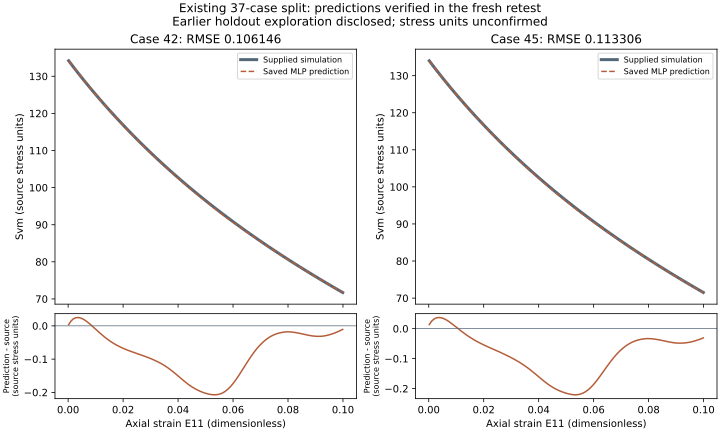

# Model test results — 25 October 2026

The delivered AlSi10Mg Svm model passed the fresh source, prediction and refit checks. **13 unit tests and 3 live Model Studio tests passed.** The delivered model, NumPy weights, archived predictions and metrics were unchanged, confirmed by SHA-256 hashes.

## Results on the existing test split

The same 37 test cases were used, with 120 strain queries per curve. These cases were excluded from final weight fitting, but earlier full-data exploration means this is not a new blind test.

| Measure | Fresh value |
|---|---:|
| Mean of 37 curve RMSEs | **0.0590851517** |
| Median curve RMSE | 0.0505666552 |
| Worst curve RMSE | 0.1133061791 — case 45 |
| Mean curve MAE | 0.0489985921 |
| RMSE pooled over 4,440 test points | 0.0648628073 |
| Largest absolute point error | 0.2883202786 |

All errors are in **source stress units**. The likely MPa interpretation remains unconfirmed. RMSE is an error magnitude, not an accuracy percentage. Mean curve RMSE averages an RMSE calculated separately for each curve; pooled RMSE takes the square root after pooling squared errors, so the two values differ.

The left panel shows case 42; the right shows the worst test case, 45. The lower panels show residuals, defined as prediction minus supplied simulation. The small residuals show close numerical agreement on these two cases, not experimental validation.

## What was checked

| Check | Outcome |
|---|---|
| All 73 source histories, 2,197,000 rows | Checksums, matrix inputs, finite values, increasing E11 and grid support passed. |
| Raw-to-cache interpolation | Maximum absolute difference 0.0. |
| Fixed split | Seed 42 reproduces 36 training / 37 test cases, with no overlap. |
| Preprocessing | Saved means, variances and stress scaling match training-only calculations; 4,320 fitted queries. |
| Architecture | Five 5–16–16–1 tanh networks, 385 parameters each, alpha 0.001. |
| Saved model reload | Maximum prediction difference from archived test predictions 0.0. |
| NumPy inference | Maximum difference from the saved model across all 73 cases 0.0. |
| Fresh frozen-settings fit | Seeds 0–4, 17.26 seconds, no warnings; maximum weight and prediction difference 0.0. |
| Unit suite | 13 passed: parser, split, warnings, PCA-MLP isolation/reload and NumPy runtime behaviour. |
| Live Studio suite | 3 passed: final model identity, saved test curve, invalid rates, lift requests and range warnings. |
| Delivered artifacts | All four protected files retained identical hashes. |

The first live attempt was blocked by sandbox networking. A subsequent attempt found Studio stopped. After starting the local service on port 8766, all three checks passed. The initial failure log and successful retry log are both retained.

## Limits that still matter

The saved training-side case-CV mean curve RMSE is **1.15826321**. The mean over nine temperature/rate condition holdouts is **6.79360255**, with **23.52512868** for 200 / 1e-5. These are existing diagnostic results whose aggregation was checked; the condition models were not retrained in this retest.

The fresh run repeats the existing data and frozen configuration in the same environment (NumPy 2.2.6, scikit-learn 1.7.2). It demonstrates local reproducibility. It does not establish cross-platform reproducibility, an independent holdout score, experimental agreement, ANSYS coupling, a verified porosity mapping or coefficient-of-lift prediction. There are no available histories at temperature 300.

## Evidence and repeat command

- [Machine-readable results](../reports/retests/20261025T172218Z/results.json)
- [All 37 per-case errors](../reports/retests/20261025T172218Z/per_case.csv)
- [Unit-test log](../reports/retests/20261025T172218Z/unit.txt)
- [Successful live Studio log](../reports/retests/20261025T172218Z/live_studio_retry.txt)
- Script: `reports/retest_model.py`

Start Model Studio with `.venv/bin/python app/server.py`, then run `.venv/bin/python reports/retest_model.py` from the project root. Raw files and prepared caches must be present. Each run writes a new evidence directory without replacing the fitted deliverables.
