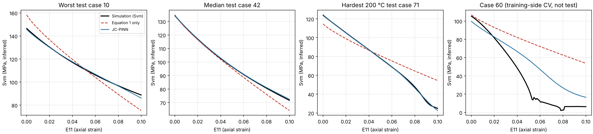
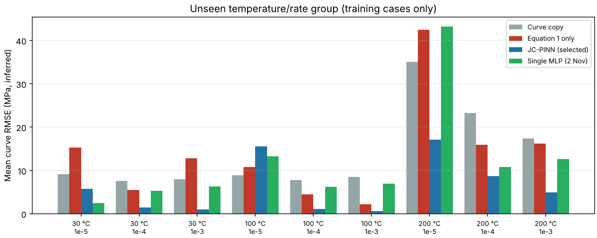
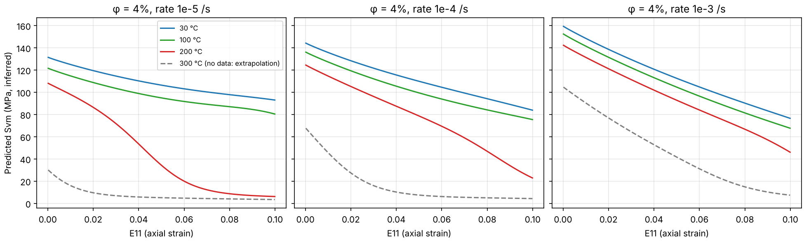

# JC-PINN: user Equation 1 as the governing law - 20261107

A physics-informed model of the supplied AlSi10Mg Svm(E11) simulations whose backbone is the user's
customised Johnson-Cook equation (Equation 1, 7 November 2026). Same 36/37 case split as every earlier model.

## Model

```text
sigma_JC = [A - B*E11^n] * [1 + C*ln(rate/1e-5)] * [1 - T*^m] * [G/25300]^q * [1 - phi]^r
T* = (T - 30)/(600 - 30)  (T in C),   phi = 1 - density/2700
sigma   = sigma_JC(A,B,n,C,m,q,r) * exp(delta(T, log10 rate, density, G, E11))
```

delta is a 5-16-16-1 tanh network (385 parameters) that starts at zero, so the untrained model is exactly
Equation 1. Training loss = normalised data MSE (120 equal-weight points per case) + lambda x physics residual
at 4096 Sobol collocation points (T 30-300 C) + weight decay (alpha = 1). Physics residual forms:
**level** = delta (stay near Equation 1) and **trend** = d delta / d(T, log10 rate, density, G) via autograd,
i.e. the model's condition sensitivities equal Equation 1's while the strain-shape correction stays free.

**Selected on training cases only: none, λ=0, joint.** Final model: 5-seed ensemble, geometric mean of members.

## Equation 1 constants

| Constant | Equation 1 alone (calibrated on 36 training cases) | Inside the JC-PINN (member mean) |
|---|---:|---:|
| A | 148.769 | 87.7181 |
| B | 526.229 | 424.645 |
| n | 0.827558 | 0.941546 |
| C | 0.0292469 | 0.0517904 |
| m | 1.11323 | 2.74211 |
| q | 0.717322 | 0.911192 |
| r | 6.50974e-21 | 2.10825e-05 |

Equation 1 alone sits at a bound for: r. r = 0 means the separable fit finds no porosity effect it can use; density changes stress by only about 0.2 %
in the data, and the shape mismatch dominates the fit.

## Test results (37 held-out cases, scored once after the lock)

Errors are per-curve RMSE in source stress units (MPa inferred).

| Model | Mean | Median | Worst | Mean MAE | Mean normalised |
|---|---:|---:|---:|---:|---:|
| **JC-PINN (this run)** | 0.4386 | 0.3952 | 0.8406 | 0.3269 | 0.42 % |
| Equation 1 alone | 7.3656 | 6.8852 | 13.4724 | 6.0574 | 7.32 % |
| Curve-copy baseline | 1.3790 | 0.2893 | 4.9788 | 1.3632 | 1.27 % |
| Single MLP, 2 Nov (no physics) | 0.1427 | 0.1020 | 0.4191 | 0.1201 | 0.14 % |
| Same network, Equation 1 switched off (post-hoc control) | 0.3375 | 0.3627 | 0.6120 | 0.2533 | 0.33 % |
| 5-net MLP ensemble, 24 Oct (no physics) | 0.0591 | 0.0506 | 0.1133 | - | - |

| Test condition | Cases | JC-PINN mean RMSE | Equation 1 alone |
|---|---:|---:|---:|
| 30 C, 1e-5 /s | 4 | 0.3543 | 11.842 |
| 30 C, 1e-4 /s | 8 | 0.8031 | 6.245 |
| 30 C, 1e-3 /s | 3 | 0.1816 | 2.922 |
| 100 C, 1e-5 /s | 4 | 0.4339 | 9.142 |
| 100 C, 1e-4 /s | 5 | 0.2832 | 3.501 |
| 100 C, 1e-3 /s | 5 | 0.4537 | 3.425 |
| 200 C, 1e-4 /s | 3 | 0.5689 | 13.037 |
| 200 C, 1e-3 /s | 5 | 0.1431 | 11.224 |



## Training-side selection (no test data)

Score = 0.5 x (three-fold case-CV mean RMSE + mean over nine temperature/rate group holdouts). Every scaler
and the Equation 1 constants are refitted inside each split; each candidate is a 3-seed ensemble.

| Candidate | Case-CV mean | Group-holdout mean | Score |
|---|---:|---:|---:|
| none, λ=0, joint **(selected)** | 2.098 | 6.235 | 4.166 |
| none, λ=0, frozen | 2.032 | 6.441 | 4.237 |
| trend, λ=0.0001, joint | 2.010 | 6.822 | 4.416 |
| trend, λ=0.0001, frozen | 2.505 | 7.101 | 4.803 |
| level, λ=0.01, joint | 3.332 | 7.997 | 5.664 |
| level, λ=0.01, frozen | 3.881 | 7.720 | 5.800 |
| level, λ=0.001, joint | 4.160 | 8.310 | 6.235 |
| trend, λ=0.01, frozen | 2.925 | 9.587 | 6.256 |
| level, λ=0.001, frozen | 4.219 | 8.383 | 6.301 |
| trend, λ=0.001, frozen | 3.654 | 8.982 | 6.318 |
| trend, λ=0.001, joint | 4.372 | 8.419 | 6.396 |
| trend, λ=0.01, joint | 4.071 | 8.951 | 6.511 |
| level, λ=0.1, frozen | 4.549 | 9.080 | 6.815 |
| level, λ=0.1, joint | 5.130 | 13.714 | 9.422 |
| Equation 1 alone | 10.238 | 13.947 | 12.092 |
| Curve-copy baseline | 3.603 | 13.961 | 8.782 |

### Unseen temperature/rate groups

Each group is withheld from fitting; mean curve RMSE on its cases. The selected JC-PINN's numbers were part of
its selection score, so they are mildly optimistic. The single MLP re-selected alpha inside each group (nested);
the 24 Oct ensemble used fixed settings chosen after earlier all-data exploration.

| Group | Cases | Curve copy | Equation 1 alone | JC-PINN (selected) | Eq. 1 off (control) | Single MLP | MLP ensemble |
|---|---:|---:|---:|---:|---:|---:|---:|
| 30 C, 1e-5 /s | 5 | 9.156 | 15.275 | 5.740 | 3.524 | 2.488 | 1.945 |
| 30 C, 1e-4 /s | 1 | 7.604 | 5.449 | 1.443 | 0.894 | 5.261 | 0.805 |
| 30 C, 1e-3 /s | 6 | 7.978 | 12.796 | 1.031 | 1.139 | 6.267 | 4.932 |
| 100 C, 1e-5 /s | 5 | 8.859 | 10.814 | 15.524 | 13.397 | 13.236 | 6.121 |
| 100 C, 1e-4 /s | 4 | 7.744 | 4.484 | 1.063 | 1.359 | 6.228 | 5.208 |
| 100 C, 1e-3 /s | 4 | 8.543 | 2.214 | 0.627 | 0.405 | 6.925 | 1.261 |
| 200 C, 1e-5 /s | 1 | 35.091 | 42.424 | 17.100 | 18.973 | 43.236 | 23.525 |
| 200 C, 1e-4 /s | 6 | 23.267 | 15.891 | 8.665 | 6.593 | 10.826 | 9.084 |
| 200 C, 1e-3 /s | 4 | 17.405 | 16.173 | 4.920 | 4.377 | 12.633 | 8.261 |
| **Mean of 9 groups** | 36 | 13.961 | 13.947 | 6.235 | 5.629 | 11.900 | 6.794 |

## Does Equation 1 help? Post-hoc control

Same network, weight decay, optimiser, splits and seeds, with Equation 1 switched off (constant backbone,
every Equation 1 term equal to 1 within 9e-06). Not used for selection.

| | Case-CV mean | Group-holdout mean | Score | Test mean RMSE |
|---|---:|---:|---:|---:|
| JC-PINN (Equation 1 backbone, selected) | 2.098 | 6.235 | 4.166 | 0.4386 |
| Equation 1 switched off | 1.315 | 5.629 | 3.472 | 0.3375 |

**Finding:** the control is better on every measure, although the JC-PINN figures are already optimistic (best of 14
settings). The improvement over the earlier MLPs comes from the training recipe (weight decay alpha = 1, log-space
output), not from Equation 1. Equation 1 is a product of separate terms, so it gives every condition the same curve
shape, and the correction network spends capacity undoing that shape. None of the 13 physics-penalty settings
improved the training-side score either. Equation 1 in this separable form is therefore not supported as the governing
law of these simulations. Its value here is interpretability: seven constants and a 17x error reduction over
Equation 1 alone. It does not add accuracy.

**Trade-off against earlier models.** On the random 50/50 test the earlier MLPs remain more precise (single MLP
0.143, 5-net ensemble 0.059 versus 0.439).
On unseen temperature/rate groups the new recipe is better than the single MLP (6.23 with Equation 1,
5.63 without, versus 11.90) and close to the 24 Oct ensemble (6.79).
The strong weight decay buys generalisation at the cost of interpolation precision; the balanced score chose that trade-off.

**Constants inside the JC-PINN.** With joint training and no physics penalty, the split between backbone and correction
is not identifiable. A falls from 149 to 88, m ranges from 1.0 to 5.4 across seeds, and at large strain exp(delta)
reaches x2.4. Quote the "Equation 1 alone" constants as the calibrated law; the JC-PINN constants are only meaningful
together with its network.



## Physical consistency

* Correction size on the test queries: mean |delta| = 0.4663, max |delta| = 0.9166 (exp(delta) is the factor applied to Equation 1).
* Share of collocation points that break the sign rules found in every training-data pair
  (stress falls with E11 and T, rises with G and with density):

| Region | Points | dS/dE11 > 0 | dS/dT > 0 | dS/dG < 0 | dS/d(density) < 0 |
|---|---:|---:|---:|---:|---:|
| 30-200 C (data) | 2579 | 0.0 % | 0.0 % | 0.0 % | 0.0 % |
| 200-300 C (no data) | 1517 | 0.0 % | 0.0 % | 0.0 % | 2.5 % |

Strain rate is not checked: at large strain the data itself shows stress falling with rate at 30 C.

## Study condition: phi = 4% (density 2592 kg/m3), G = 24541 MPa

| T | Rate (1/s) | Svm at E11=0.0002 | at 0.05 | at 0.0999 | Correction at 0.0999 |
|---|---:|---:|---:|---:|---:|
| 30 C | 1e-5 | 131.39 | 106.51 | 92.97 | x2.449 |
| 30 C | 1e-4 | 144.19 | 110.05 | 83.87 | x1.977 |
| 30 C | 1e-3 | 159.29 | 112.83 | 76.52 | x1.635 |
| 100 C | 1e-5 | 121.55 | 95.04 | 80.37 | x2.246 |
| 100 C | 1e-4 | 136.06 | 99.61 | 75.41 | x1.886 |
| 100 C | 1e-3 | 152.37 | 104.91 | 67.63 | x1.533 |
| 200 C | 1e-5 | 108.03 | 34.94 | 6.13 | x0.193 |
| 200 C | 1e-4 | 124.43 | 78.95 | 22.84 | x0.643 |
| 200 C | 1e-3 | 142.27 | 93.13 | 46.03 | x1.174 |
| 300 C (extrapolation) | 1e-5 | 30.03 | 5.10 | 3.39 | x0.126 |
| 300 C (extrapolation) | 1e-4 | 67.60 | 7.50 | 4.28 | x0.142 |
| 300 C (extrapolation) | 1e-3 | 104.59 | 42.05 | 7.36 | x0.222 |

300 C has no data. With lambda_phys = 0 nothing constrains 200-300 C except the Equation 1 backbone and the smooth network, so those curves are unvalidated extrapolation (equation.json's validity note, written for lambda > 0, overstates this).



## Verification

`scripts/verify_jc_pinn.py` (independent NumPy re-implementation, no import of the model code): **all checks passed**. JC-PINN predictions reproduced to 2.6e-13, Equation 1 alone to 0.0e+00. It also checks the split, lock order and hashes, the pre-registered selection rule, the CV and test metrics, that the curves are identical to the 2 Nov curves, the constant bounds and that earlier delivered artifacts are unchanged.
NumPy equation versus torch: 3.4e-13. Unit tests: `tests/test_jc_pinn.py`.

## Limits

* The 37 test cases were explored in earlier project stages, so this is not a blind test. Group-holdout errors were part of the selection score, so the selected model's group errors are optimistic. Stress units are inferred as MPa. No experimental validation; 300 C predictions are unvalidated.
* Development checks on the three training folds fixed alpha = 1 and added the trend residual before this run
  (configs/jc_pinn.json `development_notes`), so the selected case-CV estimate is mildly optimistic.
* The raw histories are not in Git. This run read a stand-in folder rebuilt from the committed 120-point curves
  (`scripts/build_raw_from_committed_curves.py`); np.interp at identical grid points returns those values exactly,
  and the verifier confirms the curves equal the 2 Nov curves that were hash-checked against the raw files.
* Equation 1 constants are effective fitting constants for these simulations, not measured material properties.

## Reproduce

```bash
python scripts/build_raw_from_committed_curves.py            # only if the real raw folder is absent
python src/jc_pinn.py --raw TEAM_8_extracted_results_set_1 --output reports/NEW --mode full --workers 4
python src/jc_pinn.py --raw TEAM_8_extracted_results_set_1 --output reports/NEW --mode fast --selected-from reports/jc_pinn_20261107/results.json
python scripts/verify_jc_pinn.py reports/jc_pinn_20261107
```

Colab/Kaggle: `notebooks/jc_pinn_colab.ipynb` (PREDICT needs no data; FAST and FULL read the professor folder).
Run time 37.1 min on 4 CPU workers; python 3.13.18, numpy 2.5.4, torch 2.15.0+cu132, scipy 1.18.1, sklearn 1.7.2, matplotlib 3.11.2.
