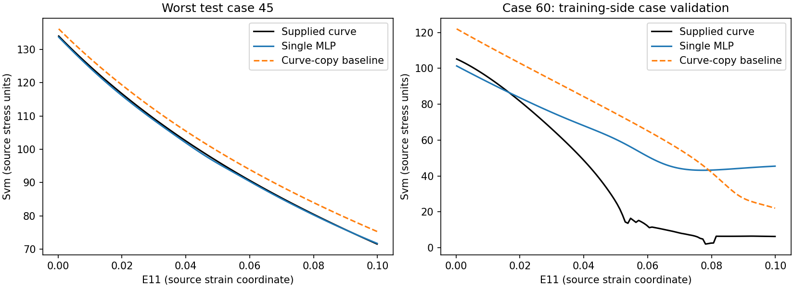

# Single MLP test - 2 November 2026

Fresh single 5-16-16-1 tanh network, seed 42, **385 learned parameters**.
Alpha selected on the 36 training cases: **0.001**.
This is a new fit, distinct from the earlier delivered five-network ensemble.

- Three-fold training-case validation mean curve RMSE: **2.174491**.
- Same-fold curve-copy baseline mean RMSE: **3.602695**.
- Final 37-case test mean/median/worst RMSE: **0.142667 / 0.102016 / 0.419130**.
- Test mean MAE: **0.120072**. Worst test case: **45**.
- Curve-copy baseline test mean RMSE: **1.378978**.

All errors above are in source stress units, whose physical units remain unconfirmed.
The split stays 36/37 simulation cases, never rows. Each curve contributes 120
E11 queries from 0.0002 to 0.0999. All scalers are fitted on fitting cases only.
The architecture and seed are fixed before test scoring. Alpha candidates are
0.0001, 0.001 and 0.01; three case folds use seed 42. The objective is standard
scikit-learn MLP regression with L2 regularization. Optimizer: L-BFGS, max_iter=5000,
max_fun=50000, tol=1e-9. Training-side selection warnings: 0;
final fit warnings: [].

## Generalization checks

These group holdouts use only the 36 training cases. Alpha is reselected inside
the remaining cases for each holdout; no omitted-condition targets enter fitting
or selection. Each group reports mean curve RMSE, followed by the lookup baseline:

- T=30, log10(rate)=-5: **2.487967**, baseline 9.155728; 5 omitted cases.
- T=30, log10(rate)=-4: **5.260719**, baseline 7.603719; 1 omitted cases.
- T=30, log10(rate)=-3: **6.267105**, baseline 7.977806; 6 omitted cases.
- T=100, log10(rate)=-5: **13.235630**, baseline 8.859467; 5 omitted cases.
- T=100, log10(rate)=-4: **6.228451**, baseline 7.744432; 4 omitted cases.
- T=100, log10(rate)=-3: **6.924733**, baseline 8.542928; 4 omitted cases.
- T=200, log10(rate)=-5: **43.236012**, baseline 35.090891; 1 omitted cases.
- T=200, log10(rate)=-4: **10.826335**, baseline 23.267477; 6 omitted cases.
- T=200, log10(rate)=-3: **12.633144**, baseline 17.404611; 4 omitted cases.

Case 60 stays included; it is the sole training example in its temperature/rate
group. Random-case interpolation scores and new-condition scores answer different
questions. The final test set has historical exposure, so it is not a new blind
test. Neither the scores nor the equation establish experimental or physical
validation, universal model superiority, or a porosity response.

## Exact prediction equation

For x=[T,log10(rate),density,G,E11], let z=(x-mean)/scale.

`Svm = target_mean + target_scale * (w3.T tanh(W2 tanh(W1 z+b1)+b2)+b3)`

Every numerical coefficient is in [equation.json](equation.json). W1 is 16x5,
W2 is 16x16 and w3 has 16 entries. This empirical equation exactly represents the
trained MLP; it is not a constitutive law derived from physics. Fixed porosity
0.04 is assumed metadata, not a learned input. No missing physical constants are
invented. Use the source stress/strain conventions and observed loading family.

Equation reload maximum difference from sklearn: 0.
Joblib reload maximum difference: 0.
Existing delivered artifact hashes are unchanged. All source hashes, saved metrics,
fold scaler statistics, nested holdout isolation and numerical equation predictions
were independently verified by scripts/verify_single_mlp.py.

## Reproduce

Run `python src/single_mlp.py --output reports/NEW_DIRECTORY` from the repository.
Run `python scripts/verify_single_mlp.py` to check this saved run.
The new notebook is `notebooks/single_mlp_equation.ipynb`; set its Drive ZIP path
and run in order. Its embedded computation is the tested local module. Hosted
Colab execution and Drive access were not verified here.

Versions: {'python': '3.13.15', 'numpy': '2.2.6', 'scipy': '1.15.3', 'sklearn': '1.7.2'}. Fit/selection/diagnostic runtime: 1070.6 seconds.
